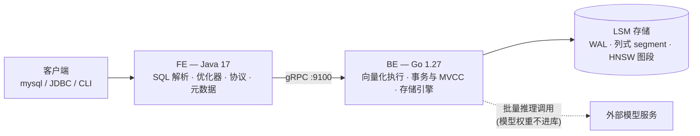

# tang_db

> 自研 **HTAP + AI 原生**数据库 —— 以 OLAP 分析为主干,原生支持 OLTP 事务,并把向量检索与模型推理做成一等公民。

---

## 这是什么

一个从零实现的数据库。存储引擎、事务、查询执行、优化器、SQL 协议层、向量索引,**全部自己写**,不引入任何现成的存储引擎或执行引擎。

目标不是玩具:它要能建表、能跑事务、能跑分析查询、能存向量做语义检索、能让现成的 MySQL 客户端直接连上来。

## 核心设计

- **单引擎统一双负载** —— 一套 LSM 基座同时支撑 OLTP 与 OLAP:写入时走行式内存(memtable),落盘时转列式 segment。写要快、读要少,两者的诉求在不同时刻分别满足。
- **FE / BE 分层** —— FE(Java)负责 SQL 解析、优化、协议;BE(Go)负责执行与存储。两者是两个独立进程,只通过 gRPC 通信,边界不可穿透。
- **MVCC + 快照隔离** —— 读写互不阻塞;LSM 天然多版本,事务与存储共用一套版本体系。
- **向量与普通列同权** —— 向量列一样享受原子写入、MVCC 可见性、崩溃恢复与后台合并。

## 创新点

1. **HTAP + 向量 + 推理三合一,共用同一套引擎**
   事务写入、分析聚合、语义检索、模型推理,同一个库、同一份数据、同一个事务体系 —— 而不是拼四套系统加三条同步链路。

2. **HNSW 图索引做进 LSM**
   不搞常驻内存的全局大图,而是让每个 segment 自带一段图,随 compaction 增量重建。于是向量索引**天生可持久化、天然崩溃安全**,重启不需要重建。

3. **混合查询在优化器里做代价决策**
   "结构化条件 + 向量相似度"的查询,在 `先过滤后检索` 与 `先检索后过滤` 之间按选择率自动选择 —— 现成向量库普遍只能走一条路径,选错就差几十倍。

4. **模型推理下推,与向量化执行共用 batch 语义**
   `ai_embed(text)` 这样的函数下推到 BE 按批执行,一次 1024 行;模型权重不进库,库只认一个推理端点配置。

## 架构



## 路线图

| 期 | 主题 | 目标 |
|---|---|---|
| **P1** | 基座 | FE → BE 跨语言链路打通;最小可用 LSM;崩溃后数据不丢 |
| **P2** | 表与 SQL | DDL / DML / 条件查询,SQL 解析与元数据 |
| **P3** | 事务与 MVCC | 并发写、快照隔离、原子批写、崩溃一致性 |
| **P4** | 索引 | 主键、二级索引、唯一索引、索引选择 |
| **P5** | 分析引擎 | 列式 segment、向量化执行、聚合、JOIN、子查询 |
| **P6** | 优化器 | 统计信息、CBO、谓词下推、连接顺序 |
| **P7** | AI 能力 | `VECTOR` 类型、HNSW 分段图、混合查询、推理下推 |
| **P8** | 生产化 | MySQL 协议兼容、监控、慢查询、备份恢复 |

每期都能独立跑起来、独立演示;上一期没跑通,下一期不开工。

## 技术栈

| 层 | 技术 |
|---|---|
| FE(客户端层) | Java 17 + Maven |
| BE(数据层) | Go 1.27 |
| 服务间通信 | gRPC + Protocol Buffers 3 |
| 存储结构 | LSM-Tree(写时行式、存时列式) |
| 事务 | MVCC + 快照隔离 |
| 向量索引 | HNSW(分段式) |
| 客户端接入 | 自实现 MySQL 协议 |

## 项目结构

```
tang_db/
├── config/                     两个进程的配置(一行一项 key = value)
│   ├── be.conf                 数据层:data_dir / port / memtable_size / fe_host / fe_port /
│   │                                  heartbeat_interval_seconds / max_txn_write_bytes / test_crash_point
│   └── fe.conf                 客户端层:be_host / be_port / mode(fed|cli)/ mysql_port / user / password /
│                                  session_max / session_idle_timeout / shutdown_grace_seconds /
│                                  heartbeat_listen_port / be_offline_cycles / heartbeat_enabled
├── proto/tangdb.proto          FE 与 BE 之间唯一的接口契约
├── be/                         Go —— 数据层
│   ├── go.mod
│   ├── cmd/be/                 服务入口
│   └── internal/
│       ├── config/             配置文件解析(标准库手写,零第三方依赖)
│       ├── wal/                预写日志、批写、校验
│       ├── memtable/           跳表、版本链
│       ├── segment/            列式文件读写、编码压缩、zone map
│       ├── compaction/         分层合并、GC 水位
│       ├── manifest/           版本管理、原子切换
│       ├── store/              引擎主干:Put/Get/Scan、刷盘调度、WAL 回收
│       ├── txn/                事务、MVCC、冲突检测
│       ├── index/              主键 / 二级 / 唯一 / 分段 HNSW
│       ├── exec/               向量化算子、范围扫描迭代器
│       ├── ai/                 推理客户端、批量调度、缓存
│       └── server/             gRPC 服务实现、心跳上报
├── fe/                         Java —— 客户端层
│   ├── pom.xml
│   └── src/main/java/com/wangyu/tangdb/
│       ├── fed/                常驻 FE 进程:启动顺序、心跳归属、协议监听、优雅退出
│       ├── session/            会话层:每连接一个会话(当前库 / 事务 / 写集 / 空闲回收)
│       ├── protocol/           MySQL 协议(自研分帧 / 握手 / 认证 / 结果集;含 CLI 用的客户端侧)
│       ├── parser/             词法、语法、AST
│       ├── catalog/            元数据(存进 BE 的系统表;库命名空间在这里)
│       ├── planner/            逻辑计划、优化器
│       ├── execute/            唯一 SQL 执行入口(SqlEngine)、计划切分与调度
│       ├── storage/            key 保序编码、行值/墓碑编码
│       ├── server/             FE 侧服务:BE 注册与心跳接收
│       ├── txn/                事务协调、快照
│       └── client/             gRPC 客户端封装、瘦客户端 CLI、配置文件加载
├── tools/                      导入与基准工具
│   ├── jdbc-smoke/             JDBC 连通用例(官方 mysql-connector-j,独立模块,不进 FE 依赖)
│   ├── importer/               CSV 批量导入
│   ├── bench-tpcc/             OLTP 基准
│   ├── bench-tph/              OLAP 基准
│   └── recall-check/           向量召回率校验
└── scripts/                    启动/停止(start-be.sh、start-fe.sh)与 gen-proto.sh、演示 SQL
    ├── tests/                  一键验收与回归(p35 / p3 / p2 / crash-test.sh)
    └── sql/                    按场景编号的可复现脚本(01~35)
```

## 设计原则

**不借外力。** 存储引擎、执行引擎、优化器、向量索引、协议层,全部自己实现。以下这些以及它们的任何绑定,一律不引入:

> RocksDB · LevelDB · Badger · Pebble · SQLite · bbolt · DuckDB · Velox · hnswlib · faiss

借了外力,这个项目就没有存在意义了。

## 快速开始

### 环境要求

- Go 1.27+(Windows: 装在 `C:\Program Files\Go`)
- Java 17 + Maven 3.9+
- Windows 上执行构建命令请在 git-bash 中;**Maven 必须用 `mvn.cmd`**(POSIX 版 `mvn` 在本机不可用)

### 配置文件

两个进程的配置都在 `config/` 下,与 `fe/`、`be/` 同级,各自一份:

```
config/
├── be.conf     数据层:data_dir / port / memtable_size
└── fe.conf     客户端层:be_host / be_port / mode / mysql_port / user / password /
                session_max / session_idle_timeout / shutdown_grace_seconds /
                heartbeat_listen_port / heartbeat_enabled
```

格式是一行一项 `key = value`,`#` 开头为注释。取值优先级:**命令行参数 > 配置文件 > 内置默认值**。

```bash
./scripts/start-be.sh                      # 读 config/be.conf
./scripts/start-be.sh --port=9200          # 临时换端口,不改文件
./scripts/start-be.sh --config=其他/be.conf # 换一份配置(也可设 TANGDB_BE_CONFIG)
```

配置写错(未知项、格式错、取值非法)会**直接启动失败并指出第几行**,不会静默用默认值跑起来。

### 启动(开三个终端)

> **P3.5 起 FE 变成常驻服务 `fed`,CLI 退化为瘦客户端。**启动顺序固定为 **BE → `fed` → 客户端**;
> `fed` 持有唯一的 catalog 权威缓存与会话层,所有客户端(CLI / mysql / JDBC / DataGrip)连同一个 `fed`。

终端 A —— 起数据层:

```bash
./scripts/start-be.sh
# === Building BE ===
# === Starting BE (config: ...\config\be.conf) ===
# ... INFO BE 已就绪 listen=127.0.0.1:9100
```

终端 B —— 起常驻 FE(`fed`,监听 MySQL 协议端口 `3406`、心跳端口 `9091`):

```bash
./scripts/start-fe.sh
# === Building FE ===
# === Starting fed (config: ...\config\fe.conf) ===
# fed 已就绪:mysql_port=3406,be=127.0.0.1:9100,heartbeat=9091
# 信息: fed 已就绪 mysql_port=3406 session_max=64 idle_timeout=0s
```

终端 C —— 起命令行客户端(瘦客户端,通过 MySQL 协议连 `fed`;不自带 FE、不直连 BE)。
**同一个脚本的 `cli` 子命令**:

```bash
./scripts/start-fe.sh cli
# tang_db 命令行客户端（fed 127.0.0.1:3406）
# tangdb> CREATE TABLE t (id INT PRIMARY KEY, name VARCHAR(32));
# OK, 表 t 已创建(表 ID 64)
```

CLI 也支持显式参数:`--host / --port / --user / --password / --database`(或从 `config/fe.conf` 取)。
`fed` 没起时,CLI 会明确报 **“连不上 fed 127.0.0.1:3406”** 而不是崩栈。

> 启动脚本只有两个:`scripts/start-be.sh`(起 BE)与 `scripts/start-fe.sh`(起常驻 FE;`cli` 子命令起客户端)。测试脚本在 `scripts/tests/`。
>
> 两者都支持后台与停止:
>
> ```bash
> ./scripts/start-be.sh --daemon     # 后台起 BE,日志 tmp/be.log,PID tmp/be.pid
> ./scripts/start-be.sh stop         # 停 BE(温和 → 5 秒后强制)
> ./scripts/start-fe.sh --daemon     # 后台起常驻 FE,日志 tmp/fed.log,PID tmp/fed.pid
> ./scripts/start-fe.sh stop         # 停常驻 FE(优雅退出,上限 5 秒)
> ```
>
> 不带 `--daemon` 就是前台启动,日志打屏、Ctrl+C 退出。
>
> **停止的实情**:Windows 上 `taskkill` 不带 `/F` 送不到 SIGTERM,所以 `stop` 会等约 5~6 秒后**强制结束**;想走优雅退出路径就用前台 + `Ctrl+C`(JVM shutdown hook 会按 FR-413 收尾)。强杀不丢已提交数据(WAL 已 fsync),只丢未提交事务 —— 与 `crash-test.sh` 的口径一致。

### 用 SQL:建表、写入、查询、改、删(P2)

同一个 CLI,输入 SQL 以 `;` 结束(可跨多行)。下面这段取自实际运行的输出(为便于阅读,合并了几次会话):

```sql
tangdb> CREATE TABLE users (id BIGINT PRIMARY KEY, name VARCHAR(32), city VARCHAR(32), age INT);
OK, 表 users 已创建(表 ID 16)

tangdb> INSERT INTO users (id, name, city, age) VALUES (1, 'wangyu', '北京', 26);
OK, 1 row affected

tangdb> INSERT INTO users (id, name, city, age) VALUES (2, 'lisi', '北京', 20), (3, 'zhangsan', '上海', 30);
OK, 2 rows affected

tangdb> SELECT name, city FROM users WHERE city = '北京' AND age > 25;
+--------+------+
| name   | city |
+--------+------+
| wangyu | 北京 |
+--------+------+
(1 row)

tangdb> UPDATE users SET city = '上海' WHERE id = 1;
OK, 1 row affected

tangdb> DELETE FROM users WHERE id = 2;
OK, 1 row affected

tangdb> SELECT * FROM users WHERE id = 2;
+----+------+------+-----+
| id | name | city | age |
+----+------+------+-----+
+----+------+------+-----+
(0 rows)

tangdb> SHOW TABLES;
+------------+----------+---------------------+
| table_name | table_id | created_at          |
+------------+----------+---------------------+
| users      | 16       | 2026-10-22T15:44:39 |
+------------+----------+---------------------+
(1 row)

tangdb> DESC users;
+--------+-------------+-------------+----------+
| column | type        | primary_key | nullable |
+--------+-------------+-------------+----------+
| id     | BIGINT      | YES         | NO       |
| name   | VARCHAR(32) | NO          | YES      |
| city   | VARCHAR(32) | NO          | YES      |
| age    | INT         | NO          | YES      |
+--------+-------------+-------------+----------+
(4 rows)

tangdb> SHOW BACKENDS;
+--------------------------------------+----------------+----------+--------+---------------------+----------------+---------------+-----------+-----------+
| be_id                                | endpoint       | version  | status | last_heartbeat      | memtable_bytes | segment_count | put_count | get_count |
+--------------------------------------+----------------+----------+--------+---------------------+----------------+---------------+-----------+-----------+
| 46ea4a79-5017-446b-9baf-daeb7bd9b93c | 127.0.0.1:9200 | P2-0.1.0 | 可用   | 2026-10-22 15:52:45 | 0              | 1             | 17        | 17        |
+--------------------------------------+----------------+----------+--------+---------------------+----------------+---------------+-----------+-----------+
(1 row)
```

元数据(表、列)存在**库里自己的系统表**里,不依赖任何外部数据库;重启 BE 与 FE 之后 `SHOW TABLES` / `DESC` 与数据都还在。

### P2.1 补充的三类写法(反引号列名 / 省略列名 / SHOW DATABASES)

下面三段都是**实际运行**的输入与输出(合并自同一次会话)。

**① 反引号标识符** —— `select`、`from` 这类关键字可以当列名;反引号内除反引号外任意字符都合法(空格、中划线、中文、数字开头),双写反引号表示一个反引号。反引号**不改变大小写语义**,也不能用来包裹语句关键字或列类型。

```sql
tangdb> CREATE TABLE `order` (`id` INT PRIMARY KEY, `select` VARCHAR(16), `from` INT);
OK, 表 order 已创建(表 ID 16)

tangdb> INSERT INTO `order` (`id`, `select`, `from`) VALUES (1, 'first', 10);
OK, 1 row affected

tangdb> SELECT `id`, `select`, `from` FROM `order` WHERE `id` = 1;
+----+--------+------+
| id | select | from |
+----+--------+------+
| 1  | first  | 10   |
+----+--------+------+
(1 row)
```

**② INSERT 省略列名列表** —— 值按**表定义顺序**给全所有列;少给/多给会指出第几组。

```sql
tangdb> CREATE TABLE users (id BIGINT PRIMARY KEY, name VARCHAR(32), city VARCHAR(32), age INT);
OK, 表 users 已创建(表 ID 17)

tangdb> INSERT INTO users VALUES (1, 'wangyu', '北京', 26);
OK, 1 row affected

tangdb> INSERT INTO users VALUES (2, 'lisi', '上海', 20), (3, 'zhangsan', '北京', 30);
OK, 2 rows affected

tangdb> SELECT * FROM users;
+----+----------+------+-----+
| id | name     | city | age |
+----+----------+------+-----+
| 1  | wangyu   | 北京 | 26  |
| 2  | lisi     | 上海 | 20  |
| 3  | zhangsan | 北京 | 30  |
+----+----------+------+-----+
(3 rows)

tangdb> INSERT INTO users VALUES (5, 'sunqi');
错误：第 1 组取值个数(2)与列数(4)不一致
```

显式列名(`INSERT INTO users (id, name) VALUES (...)`)行为不变,两种写法可以混用;`INSERT INTO users () VALUES (...)` 报 `列名列表不能为空`。

**③ SHOW DATABASES** —— 只有默认库 `default`;由 FE 直接回答,**不访问 BE**,BE 停着也照常输出。

```sql
tangdb> SHOW DATABASES;
+----------+
| Database |
+----------+
| default  |
+----------+
(1 row)
```

P2 的 SQL 边界(一期一期加,别当成完整 SQL):

- 支持:`CREATE / DROP / TRUNCATE TABLE`、`SHOW TABLES` / `SHOW DATABASES`、`DESC`、`INSERT`(多行,可省略列名列表)、`UPDATE`、`DELETE`、`SELECT 列/*/AS` + `WHERE`(`=` `<>` `<` `<=` `>` `>=`、`AND`/`OR`、`IN`)+ `LIMIT`;标识符可用反引号包裹
- **P3 新增**:`BEGIN` / `COMMIT` / `ROLLBACK`(`BEGIN TRANSACTION` / `COMMIT WORK` 也可);事务提示符为 `tangdb(txn)>`
- 不做(留给后面几期):JOIN、聚合、GROUP BY、子查询、ORDER BY、表达式与函数、二级索引;`NOT` / `IS [NOT] NULL` / `LIKE` / `BETWEEN` 归 P5
- 主键:单列,类型限 `INT` / `BIGINT` / `VARCHAR` / `DATE`
- 一条端到端功能测试:`bash scripts/tests/p2-test.sh`(11 个场景 + P2.1 兼容性断言,52 条断言,含强杀重启、心跳判死、跨内存/磁盘)

### P3 事务与 MVCC:并发写不再静默覆盖(P3)

下面两段都是**实际运行**的输出。

**① 提交 / 回滚 / 读己之写**

```sql
tangdb> CREATE TABLE t (id INT PRIMARY KEY, name VARCHAR(32));
OK, 表 t 已创建(表 ID 16)

tangdb> BEGIN;
OK, 事务已开始(snapshot = 18)

tangdb(txn)> INSERT INTO t VALUES (1, 'a');
OK, 1 row affected
tangdb(txn)> INSERT INTO t VALUES (2, 'b');
OK, 1 row affected
tangdb(txn)> SELECT * FROM t;
+----+------+
| id | name |
+----+------+
| 1  | a    |
| 2  | b    |
+----+------+
(2 rows)                      -- 读己之写:本事务刚插入的行自己可见

tangdb(txn)> COMMIT;
OK, 事务已提交(commit_ts = 19)

tangdb> BEGIN;
OK, 事务已开始(snapshot = 19)

tangdb(txn)> UPDATE t SET name = 'x' WHERE id = 1;
OK, 1 row affected
tangdb(txn)> ROLLBACK;
OK, 已回滚

tangdb> SELECT * FROM t WHERE id = 1;
+----+------+
| id | name |
+----+------+
| 1  | a    |                -- 回滚后与事务前完全一致(未提交数据从未落盘)
+----+------+
(1 row)
```

**② 两个会话抢同一行:后到的被明确拒绝,绝不静默覆盖**

两个终端都连同一个 BE;第二个及以后的会话用 `heartbeat_enabled = false` 启动(否则心跳端口会冲突)。
按时间顺序:A 先 `BEGIN; UPDATE ...;`(未提交),B 再 `BEGIN; UPDATE ...;`(未提交),A 先 `COMMIT`,B 后 `COMMIT`。

```
# 会话 A(默认 config/fe.conf,持有心跳端口 9091)
tangdb> BEGIN;
OK, 事务已开始(snapshot = 21)
tangdb(txn)> UPDATE t SET name = 'A' WHERE id = 1;
OK, 1 row affected
tangdb(txn)> COMMIT;
OK, 事务已提交(commit_ts = 22)

# 会话 B(另一份 fe.conf:heartbeat_enabled = false)
tangdb> BEGIN;
OK, 事务已开始(snapshot = 21)          -- 与 A 相同的快照
tangdb(txn)> UPDATE t SET name = 'B' WHERE id = 1;
OK, 1 row affected                      -- 写集只在 B 的内存里
tangdb(txn)> COMMIT;
错误：表 t 主键 1 写写冲突(该行在本事务开始后被其它事务修改,请重试)
提示：事务仍在进行中，可继续执行或 ROLLBACK
tangdb(txn)> exit
已丢弃未提交事务(CLI 退出)

# 再查:数据库里是 A 的值,B 没有覆盖 A
tangdb> SELECT * FROM t WHERE id = 1;
| 1  | A |
```

P3 的语义边界(详见 `specs/P3-transactions-mvcc.md` §2.3):

- 一个事务要么全生效、要么全不发生;`COMMIT` 返回 OK ⇔ 批记录已 fsync
- 快照隔离(SI):事务内反复读同一行结果稳定;读不到未来数据;不做 SSI(理论上仍有写偏斜)
- 写写冲突:**报错、整批不写、不自动重试、不排队、不静默覆盖**
- `commit_ts` 单调不回退、可跳号;未提交写集只活在 FE 内存,`ROLLBACK` 是零成本
- 不支持:`READ UNCOMMITTED` / savepoint / 嵌套事务 / 分布式事务 / 死锁检测 / 事务超时

**升级到 P3 必须清空数据目录。** P3 起数据目录格式版本 = 2(版本段语义从 P2 的固定 0 改成 `^commit_ts`);
老目录(无 `format_version` 或 = 1)会**明确拒绝启动**:

```
错误：打开存储引擎失败: 数据目录格式版本 1 与本期(2)不兼容:请清空数据目录后重启
```

```bash
taskkill /F /IM be.exe
rm -rf data/BE          # 日常开发目录;测试脚本各自用独立目录,不受影响
./scripts/start-be.sh
```

**验收开关(默认关闭,仅验收使用)**

- `config/be.conf` 的 `test_crash_point`:取值 `before_wal` / `after_fsync` / `after_memtable` / `before_ok`,
  命中一次即让 BE 进程立即退出(模拟强杀)。启动日志会打印 `WARN 崩溃注入已启用:...`。
  **风险**:打开后任何一次提交都会杀掉进程,绝不能用于日常运行。
- `config/fe.conf` 的 `heartbeat_enabled`:默认 `true`(P2 行为不变:心跳端口被占用即启动失败);
  设为 `false` 时不绑心跳端口、不启动 FE 侧 gRPC 服务,SQL 照常 —— 这是同机开多个 CLI 会话做并发验收的前提。
- `config/be.conf` 的 `max_txn_write_bytes`:单事务写入量上限(默认 `64MB`),超限报
  `事务写入量超过上限(64MB)` 且不写任何数据。
- 一键验收:`bash scripts/tests/p3-test.sh`(SC-201 ~ SC-211,报告在 `tmp/p3-test/report.txt`),
  其中会顺带跑 `p2-test.sh` 与 `crash-test.sh` 做回归。

### 最强的那个动作:强杀后重启,数据还在

```bash
taskkill /F /IM be.exe      # 强杀,不给它正常退出的机会
./scripts/start-be.sh
# 恢复完成 segments_loaded=2 wal_replayed=37
# 再查,数据一条没少
```

### 崩溃测试(一键)

```bash
bash scripts/tests/crash-test.sh                # 默认写入 1000 条随机 KV
COUNT=5000 bash scripts/tests/crash-test.sh     # 自定义条数
```

流程:写入 N 条 → 打印数据目录状态 → 强杀 BE → 重启 → 逐条校验 → 输出报告到 `tmp/crash-test/report.txt`。

### 重新生成接口桩代码

```bash
bash scripts/gen-proto.sh
```

### P3.5 常驻 FE + 多库命名空间 + MySQL 协议

**一个 `fed` 服务所有客户端。** 起 BE → 起 `fed` → 任意客户端连接。下面两段都是**实际运行**的输出。

**① 多库:CREATE DATABASE / USE / 限定名**

```sql
tangdb> CREATE DATABASE shop;
OK, 库 shop 已创建

tangdb> USE shop;
OK, 已切换库 shop

tangdb> CREATE TABLE orders (id INT PRIMARY KEY, amount INT);
OK, 表 orders 已创建(表 ID 65)

tangdb> INSERT INTO orders VALUES (10, 99);
OK, 1 row affected

tangdb> USE default;
OK, 已切换库 default

tangdb> SHOW TABLES;
+------------+----------+---------------------+
| table_name | table_id | created_at          |
+------------+----------+---------------------+
| users      | 64       | 2026-10-26T10:40:47 |
+------------+----------+---------------------+
(1 row)

tangdb> SELECT * FROM shop.orders;     -- 限定名跨库访问
+----+--------+
| id | amount |
+----+--------+
| 10 | 99     |
+----+--------+
(1 row)
```

- 表名唯一性 = **库内唯一**;表 ID 仍**全局唯一**(新库从 64 起,不按库分段 → BE 与 key 布局零改动)
- 库名**大小写不敏感**(统一按小写存储);`default` 始终存在、不可删;非空库拒删(`1451`)
- 库名规则与表名一致(含反引号);重名库 `1007`、未知库 `1049`

**② 用官方 MySQL 客户端 / JDBC 直连**

`fed` 监听 MySQL 协议端口(`mysql_port`,默认 `3406`),明文口径(`useSSL=false`),认证为
`mysql_native_password`。连接串样例(K66):

```
jdbc:mysql://127.0.0.1:3406/<db>?useSSL=false&allowPublicKeyRetrieval=true&useServerPrepStmts=false&characterEncoding=utf8&serverTimezone=Asia/Shanghai
```

```bash
# 官方 mysql 客户端(本机需 Docker 或已安装 mysql)
mysql -h 127.0.0.1 -P 3406 -u root -ptangdb -D default
```

JDBC 冒烟测试在 `tools/jdbc-smoke/`(独立 Maven 工程,**不进 `fe/pom.xml`**):

```bash
cd tools/jdbc-smoke && mvn.cmd compile
# 然后按 JdbcSmoke 的用法连到 fed 的 mysql_port,覆盖建表/插入/事务/切库/错误码(1146)
```

支持的可测子集(不是完整 MySQL):握手 v10 + `mysql_native_password` + `COM_QUERY` / `COM_INIT_DB` /
`COM_PING` / `COM_QUIT`、文本结果集、`SET` / `SELECT @@xxx` 等连接期白名单、`information_schema`
的 `SCHEMATA` / `TABLES` / `COLUMNS` 三张最小只读视图。
**不做**:TLS、`caching_sha2_password`、服务端预编译(`COM_STMT_*` → `1295`,连接串请用
`useServerPrepStmts=false`)、权限、跨库单条 SQL、查询超时 / 慢查询。

**③ 新增配置(`config/fe.conf`)**

| 项 | 默认 | 说明 |
|---|---|---|
| `mode` | `fed` | `fed`(常驻服务)/ `cli`(瘦客户端) |
| `mysql_port` | `3406` | MySQL 协议监听端口(3306 留给真 MySQL) |
| `session_max` | `64` | 会话上限,超限拒绝连接 |
| `session_idle_timeout` | `0` | 空闲超时(秒),0 = 不超时 |
| `shutdown_grace_seconds` | `5` | 优雅退出等在途语句的上限 |
| `user` / `password` | `root` / `tangdb` | 认证凭据;口令只在配置文件,启动时派生哈希存内存 |
| `heartbeat_listen_port` / `heartbeat_enabled` | `9091` / `true` | 沿袭 P3(心跳端口由 `fed` 独占) |

**升级说明:P3.5 不需要清空数据目录。** P3 期间产生的老目录会被**宽容读**:老表一律归 `default`、
数据一条不丢、key 布局与 `MANIFEST.format_version` 都不变;`sys_tables` 缺的 “所属库” 列在启动时幂等补齐。
(这与 P3 必须清库的情况不同 —— P3 改了版本段语义,所以格式版本从 1 升到 2。)

一键验收:`bash scripts/tests/p35-test.sh`(SC-301 ~ SC-318,报告在 `tmp/p35-test/report.txt`),
它会顺带跑 `p2-test.sh` 与 `p3-test.sh` 做回归。

### P4 索引:二级索引 / 唯一索引 / 索引选择 / EXPLAIN + 图形客户端自省(P4)

P4 把“索引”做成**同一套有序 key 空间里的另一段前缀**,BE 一行代码没改(`proto/` 与 `be/` 零改动)。

**① 建索引与查询(实际运行输出节选)**

```sql
tangdb> CREATE TABLE orders (id INT PRIMARY KEY, category VARCHAR(32), amount INT);
OK, 表 orders 已创建(表 ID 64)
tangdb> INSERT INTO orders VALUES (1,'数码',100),(2,'数码',200),(3,'图书',300),(4,'图书',400);
OK, 4 rows affected
tangdb> CREATE INDEX idx_category ON orders (category);
OK, 索引 idx_category 已创建(索引 ID 1,状态 ACTIVE)

tangdb> EXPLAIN SELECT * FROM orders WHERE category = '数码';
+----------------------------------------------------------------------------+
| plan                                                                       |
+----------------------------------------------------------------------------+
| 访问路径: INDEX POINT                                                      |
| 表: orders                                                                 |
| 索引: idx_category(列 category,索引 ID 1)                                  |
| key 范围: [0000004000000001E695B0E7A0810000, …(25B))                       |
| 残余过滤: category = '数码'(由 FE 按谓词执行)                              |
| 扫描方式: 索引区间扫描 + 逐行回表(二次校验)                               |
+----------------------------------------------------------------------------+

tangdb> SELECT * FROM orders WHERE category = '数码';
+----+----------+--------+
| id | category | amount |
+----+----------+--------+
| 1  | 数码     | 100    |
| 2  | 数码     | 200    |
+----+----------+--------+
```

- 语法:`CREATE INDEX <idx> ON <tbl>(<col>)`、`CREATE UNIQUE INDEX <idx> ON <tbl>(<col>)`、
  `DROP INDEX <idx> ON <tbl>`、建表内联 `UNIQUE(<col>)` / `INDEX(<col>)`(等价于建表 + 建索引,同一批记录)
- 索引 ID **每表独立、从 1 起、只增不复用**;索引名表内唯一;单列索引(复合索引归 P6)
- 非空表建索引会**分批回填**(`index_backfill_batch`,默认 1000 行/批),进度存 `sys_indexes.build_cursor`;
  中途强杀后索引保持 `BUILDING`,重跑同一条 `CREATE INDEX` 从游标续做;`SHOW INDEXES` 能看到状态与游标
- `BUILDING` / `DROPPED` 索引**不参与查询**,查询自动退化全表扫且结果正确

**② 唯一索引(错误码 1062)**

```sql
tangdb> CREATE TABLE codes (id INT PRIMARY KEY, code VARCHAR(16));
tangdb> CREATE UNIQUE INDEX uk_code ON codes (code);
tangdb> INSERT INTO codes VALUES (1, 'A001');
OK, 1 row affected
tangdb> INSERT INTO codes VALUES (2, 'A001');
错误：唯一索引 uk_code 冲突(表 codes,列 code = 'A001',已有主键 1)
```

并发插入同一唯一值:恰好一个成功,另一个报 `1062`(由 P3 写写冲突翻译而来,不是可重试的 `1213`);
唯一索引的 key **不含主键**(`K76`),唯一性完全复用 P3 已验证的机制。
索引列 `NULL` 的行**不入索引**(`K79`),因此允许多行 `NULL`。

**③ 索引选择(RBO)与 EXPLAIN**

固定优先级(`K82`):**主键等值 > 主键范围 > 索引等值 > 索引范围 > 全表扫**;同类多个索引取索引 ID 最小者。
`OR` 不做索引合并(退化全表扫,结果仍正确)。

`EXPLAIN <SELECT|UPDATE|DELETE>` 输出**单列** `plan`,与执行**共用同一个计划构造入口**(不存在“说一套走一套”):

```sql
tangdb> EXPLAIN SELECT * FROM t5 WHERE id = 1;        -- PRIMARY POINT
tangdb> EXPLAIN SELECT * FROM t5 WHERE id > 1;        -- PRIMARY RANGE
tangdb> EXPLAIN SELECT * FROM t5 WHERE category = 'A'; -- INDEX POINT
tangdb> EXPLAIN SELECT * FROM t5 WHERE category > 'A'; -- INDEX RANGE
tangdb> EXPLAIN SELECT * FROM t5 WHERE note = 'n1';    -- TABLE SCAN
```

索引扫描会回表并做**二次校验**(行的索引列值必须等于索引项里的值,否则跳过),因此 `UPDATE` 改索引列后
旧值不会查出“幽灵行”;每次索引扫描在 `fed` 日志里留下
`索引扫描 表=… 索引=… 索引项=N 回表=M 命中=K`(FR-512)。

**④ 图形客户端(Navicat / DataGrip)元数据自省**

`fed` 仍监听同一个 MySQL 协议端口,连接方式与 P3.5 完全一致:

```
jdbc:mysql://127.0.0.1:3406/default?useSSL=false&allowPublicKeyRetrieval=true&useServerPrepStmts=false&characterEncoding=utf8&serverTimezone=Asia/Shanghai
```

已支持的元数据语句(每条都有合理响应,不会是 1064):

- `SHOW [FULL] TABLES [FROM db] [LIKE …] [WHERE …]`(FULL 版带 `Table_type` = `BASE TABLE`)
- `SHOW TABLE STATUS [FROM db] [LIKE …]`、`SHOW CREATE TABLE <t>`、`SHOW CREATE DATABASE <db>`
- `SHOW [FULL] COLUMNS FROM <t> [FROM db] [LIKE …]`、`SHOW INDEX|KEYS FROM <t>`、`SHOW INDEXES [FROM <t>]`
- `SHOW ENGINES`、`SHOW COLLATION`、`SHOW CHARACTER SET`、`SHOW GRANTS`、`SHOW WARNINGS` / `SHOW ERRORS`
- `SHOW TRIGGERS` / `SHOW EVENTS` / `SHOW ROUTINES`(列定义正确的空集)
- `SHOW VARIABLES [LIKE]` / `SHOW STATUS [LIKE]`(常用变量真值)、`SHOW [FULL] PROCESSLIST`
- `information_schema` **17 张可查询虚拟表**:`SCHEMATA` / `TABLES` / `COLUMNS` / `STATISTICS` /
  `KEY_COLUMN_USAGE` / `TABLE_CONSTRAINTS` / `REFERENTIAL_CONSTRAINTS` / `VIEWS` / `ROUTINES` /
  `TRIGGERS` / `EVENTS` / `PROCESSLIST` / `CHARACTER_SETS` / `COLLATIONS` / `ENGINES` / `PARTITIONS` /
  `USER_PRIVILEGES`。支持**投影裁剪 + WHERE + LIMIT(含 offset)+ 多列 ORDER BY + COUNT(*)**
  (仅虚拟表,`K98` / `K99`);有数据的给真实数据(索引元数据),没数据的给**列定义正确的空集**
- `SHOW CREATE TABLE` 的输出是 **round-trip 可执行**的:原样喂回本项目 parser 能建出等价表(单测 + 脚本各一处)
- `SELECT ... LIMIT <offset>, <row_count>` / `LIMIT <row_count> OFFSET <offset>`:先过滤 → 跳 offset →
  截断 count,索引路径与全表扫结果一致(`K100`);`UPDATE` / `DELETE` 带 `LIMIT` 明确报 `1235`
- `KILL [CONNECTION] <id>`:回滚目标会话未提交事务、注销会话并落日志;被 KILL 的会话在下一条语句上
  返回 `1317`。**限制**:`protocol/mysql` 本期只读不改,所以不会主动关闭对端 TCP socket ——
  对端下一条语句即失败,但 socket 由对端/协议层最终回收

`SHOW ENGINES` / `information_schema.ENGINES` 的 `Engine` 固定报 **`InnoDB`**(`Support = DEFAULT`)。
这是**客户端兼容**:图形客户端按引擎名分支(InnoDB 走事务/DDL 面板),真实引擎仍是自研 LSM(`K93`),
本 README 已明说,不是欺骗。`Cardinality` 本期恒 `NULL`(没有统计信息,不编数字,P6 才有)。

明确不支持(会返回明确错误,不会返回半对结果):

- `ALTER TABLE` 任何形态(Navicat“设计表”改结构)—— **P4 之后**;建表 / 删表 / 改数据 / 加索引可用
- 用户表上的 `ORDER BY` / `COUNT(*)` / 聚合 / `GROUP BY` / `JOIN` / 子查询 / `DISTINCT` —— **P5**
  (分页 `LIMIT <off>,<n>` / `LIMIT <n> OFFSET <off>` 已支持,见上文)
- `information_schema` 上的 `JOIN` / 子查询 / 多列聚合 —— **P5**(多列 `ORDER BY` 与 `COUNT(*)` 例外)
- `performance_schema`、视图/存储过程/触发器/事件的真实能力、TLS、权限体系(P13)、服务端预编译(`1295`)

**⑤ 升级说明:P4 不需要清空数据目录。** `MANIFEST.format_version` 不变、key 布局不变;老目录
(P3.5 产生、没有 `sys_indexes`)启动时**幂等创建** `sys_indexes`,老表一律“无索引”、数据一条不丢,
之后可正常建索引。

**⑥ 新增配置(`config/fe.conf`)**

| 项 | 默认 | 说明 |
|---|---|---|
| `index_backfill_batch` | `1000` | `CREATE INDEX` 回填时每批行数(K84);批越大越快,但单批写入量受 `max_txn_write_bytes` 限制 |

**⑦ 一键验收与演示脚本**

```bash
bash scripts/tests/p4-test.sh       # SC-319 ~ SC-343,报告 tmp/p4-test/report.txt
```

脚本覆盖:索引读写闭环与逐行对拍、改索引列、唯一冲突(单会话 + 并发)、两种崩溃注入点、
回填中途强杀续做、EXPLAIN 五种路径与实际扫描交叉验证、DROP INDEX、老目录升级、事务可见性、
5000 次随机写改删后的 **INV-10 对账(差异计数 = 0)**、SHOW 家族 / 17 张虚拟表 / round-trip、
未支持语句降级、分页三种写法一致 / 越界空集 / DML `LIMIT` 拒绝、虚拟表多列排序,
以及 `p2` / `p3` / `p35` 回归。演示 SQL 在 `scripts/sql/41~46-*.sql`。

**⑧ 性能口径(本机实测,同报条件)**

条件:Windows 11 开发机,BE 9900 / fed 9906,gRPC 本地回环,数据目录在本地盘,
单条 INSERT 自动提交(每次一次 WAL fsync);查询为只读,CLI/JVM 启动计入耗时。

| 查询(2 万行,int 主键,索引列 k 唯一取值) | 3 次耗时 | 扫描行数 |
|---|---|---|
| 索引路径 `WHERE k = 12345` | 420 / 438 / 445 ms(最小 420) | 索引项 1 + 回表 1 |
| 对照 `WHERE k = 12345 AND id >= -2147483648`(主键范围扫描) | 581 / 474 / 512 ms(最小 474) | 20000 |

| 单行 INSERT(n=300) | avg | p50 | p99 |
|---|---|---|---|
| 无索引 | 10.29 ms | 9.94 ms | 18.55 ms |
| 1 个索引 | 14.60 ms | 13.25 ms | 20.96 ms |
| 3 个索引 | 19.91 ms | 18.50 ms | 36.28 ms |

> 这些数字同机同数据、只用于本期基线(P4 的 RBO 没有代价模型,`K82` 明确承认可能选出比全表扫更慢的路);
> P6 拿到统计信息后用 CBO 替换。INSERT 的增量主要来自索引项与行记录同批写入的额外字节与 fsync 时间。

### P6.1 执行层全链路性能(BE 写路径 + BE 读路径 + FE 并行)

补丁期:**不动磁盘格式、不改语义**,收益全部来自内存结构、协议增量与执行调度。两个开关
(`pushdown_enabled` / `query_parallelism`)可以一键回到 P6 行为:
`pushdown_enabled=false` + `query_parallelism=1` 时扫描走原全行路径、单线程执行,结果逐行一致。

**① 九项新配置**

| 配置 | 位置 | 默认 | 含义 |
|---|---|---|---|
| `query_parallelism` | `fe.conf` | `min(8, CPU)` | 扫描与算子的并行度;`1` = 与 P6 完全一致的单线程路径 |
| `pushdown_enabled` | `fe.conf` | `true` | 列投影 + 谓词下推总开关;`false` = 全行回退 |
| `scan_batch_rows` | `fe.conf` | `4096` | 扫描批行数(自适应上限 8192) |
| `rpc_deadline_seconds` | `fe.conf` | `5` | 普通读写 / 事务期限 |
| `rpc_bulk_deadline_seconds` | `fe.conf` | `60` | 批量导入 / 索引回填 / `ANALYZE` 期限 |
| `rpc_scan_deadline_seconds` | `fe.conf` | `60` | 范围扫描 / 分片扫描期限 |
| `wal_buffer_bytes` | `be.conf` | `1MB` | WAL 追加缓冲池大小 |
| `group_commit_max_batch` | `be.conf` | `64` | 一次 fsync 最多合并的提交数 |
| `group_commit_max_wait_ms` | `be.conf` | `5` | 攒批最长等待(0 = 不等待) |

取值非法(未知项、越界、非数字)**启动失败并指出第几行**;`query_parallelism` 超过 CPU×4 会给出建议上限。

**② BE 写路径(A 组)**

- **批量冲突检测**:写集先按用户键排序去重(同 key 保留最后一次写),再用**一次区间扫描**归并判断
  `latest_commit_ts > snapshot`;不再"每个 key 建一次 scanner"。用户键互为前缀时(裸 KV 才有)
  放开上界,保证冲突不漏检。
- **惰性 memtable 游标**:`Seek` 走跳表下降,不再把整表拷成切片;创建时记写计数水位,
  越过水位返回 `unsafe`,由 exec 层**重建**游标并 Seek 回原位置(并发写下自动重试);
  `IteratorSnapshot()` 保留拷贝语义给长生命周期调用方。
- **group commit**:多个提交的 WAL 记录顺序追加后合并一次 fsync,事务记住自己的世代,
  **返回 OK 前必须等到覆盖它的那次 fsync 完成**;`commitMu` 只保护"排序 → 取号 → 追加",
  fsync 与 memtable 应用按组串行。实测 32 条并发提交合并成 **1 次 fsync**(单测断言)。
- **正确性细节**:`visibleTS` 只在"memtable 应用完成"后推进,读者不会看到"已取号未应用"的事务;
  已追加未应用的写也会参与冲突检测(填住 group commit 的并发空白)。
- 崩溃注入新增两点:`fsync_mid_group`(已追加、fsync 未完成)与 `fsync_after_done`
  (fsync 完成、未回包)——前者重启后不可见,后者重启后可见(全在)。

**③ BE 读路径(B 组)**

- **行框架协议**(`[nullmap][len][bytes]×n`):FE 下发 `column_slots`(每列序号 + 编码种类 + 宽度)
  与 `row_frame`(nullmap 字节数 / 列数 / 前缀字节数),BE 只按偏移切片,**不理解列名与类型**;
  帧里的 `len` 是载荷长度(VARCHAR 的 4 字节长度前缀由 BE 剥掉)。
- **谓词字节码**:栈式指令 `EQ/NE/LT/LE/GT/GE/IS_NULL/IS_NOT_NULL/BETWEEN/IN/AND/OR/NOT`,
  参数是"列槽号 + 保序编码后的字面量字节";BE 只做字节比较。数值列在比较时做保序变换
  (`INT32/INT64` 翻符号位后大端、`FLOAT64` IEEE 保序),字符串列按 FE 的有符号字节序比较;
  `JSON` 列不下推。**FE 始终保留残余过滤**,下推只减少扫描量,不改变结果集。
- **列式块**:`RowBatch.columnar_block = [u32 行数][u32 偏移×(行数+1)][帧…]`,
  每帧 = `[u32 keyLen][key][投影帧]`;为空则回退逐 KV(同一批不允许混用)。
- **批大小自适应**:FE 下发 `scan_batch_rows`;BE 在行数上限之外再按字节预算(2MB)切批,
  最少 1024 行、最多 8192 行。
- **剪枝计数**:`SHOW SEGMENTS` 末尾新增 `pruned_chunks(be_total)` / `skipped_chunks(be_total)`,
  数值来自 BE 心跳上报的"因 key 范围(Index/ZoneMap 二分)跳过的 chunk 数"与"已解码 chunk 数"。
  **口径是整个 BE 进程累计,不是单表**;列名已注明。
- **预读**:顺序扫描在解码第 i 个 chunk 时后台预读第 i+1 个 chunk 的原始字节(只读、不改格式);
  预读失败只影响性能,消费时退回同步读。

**④ FE 执行(C 组)**

- **分片并发扫描**:一次全表扫描按 key 字节空间等分成 `query_parallelism` 片并发拉取,
  按片序拼接(**行集合与行序与单线程一致**);所有片共用一个固定快照(借 `BeginTxn` 取水位并登记
  活跃快照,避免并发写让不同片看到不同版本);任何一片失败 → 整条查询失败,不返回部分结果。
- **`LIMIT` 提前终止**:无 `ORDER BY`/聚合、且整条单表谓词都能下推时,`LIMIT n` 下推到扫描,
  BE 只回 n 行后立刻停止(实测 `LIMIT 10` 只回 10 行)。
- **`EXPLAIN`**:新增 `并行/批/下推: 并行度=…, 扫描批=…, 下推=开(列投影 + 谓词字节码)` 一行;
  P4/P5/P6 的既有行一字未改。
- **启动日志**(FR-724):fed 启动打印本次使用的三档期限与并行度/下推开关。

**⑤ 一键验收**

```bash
bash scripts/tests/p6.1-test.sh     # SC-400 ~ SC-418,报告 tmp/p6.1-test/report.txt
# 只跑本期主项、跳过既有回归:SKIP_REGRESSION=1 bash scripts/tests/p6.1-test.sh
```

端口固定 **BE 9940 / MySQL 9946 / 心跳 9951**,数据目录 `tmp/p6.1-test/data`;
脚本只杀自己起的 `tmp/p6.1-test/be.exe` 与带该目录配置的 `fed`,不碰 9100 / 3406。
`scripts/bench-exec.sh` 为吞吐 / 并行度扫参工具。

**⑥ 实测口径(本机,同报条件)**

条件:Windows 11 / i7-13620H / 40GB / Go 1.27 / Java 17.0.12,gRPC 本地回环,数据目录本地盘。
导入吞吐 = CSV 工具墙钟;查询为 `P61Bench` 同 JVM 三次中位数;INSERT 为 `InsertLatencyBench` 三次中位数。

| 项 | 门限 | 实测(最终一轮) | 结论 |
|---|---|---|---|
| 单批冲突检测(1,000 行 + 2MB memtable) | ≤ 5 ms | 3.17 ms(多轮 2.6 ~ 3.6 ms) | 达标 |
| 导入吞吐(2MB memtable) | ≥ 8,000 行/秒 | 14,706 行/秒(多轮 8,900 ~ 15,600) | 达标 |
| 导入吞吐(64MB) | ≥ 5,000 行/秒 | 12,626 行/秒(多轮 8,800 ~ 12,600) | 达标 |
| 全表扫描 + 聚合 | ≥ 27 万行/秒 | 632,911 行/秒(多轮 63 万 ~ 116 万) | 达标 |
| 三表 JOIN(128k ⋈ 50k ⋈ 20k) | ≤ 3 s | 245 ms(多轮 148 ~ 245 ms) | 达标 |
| 宽表列投影(20 列读 2 列) | ≤ 全行 1/5 | 0.175 | 达标 |
| `LIMIT 10` | 读取 < 全表 1/10 | 回 10 行 / 全表 20,000 行 | 达标 |
| 单行 INSERT P99 | ≤ 12 ms | 5.5 ms(独占机单跑)/ 16 ~ 44 ms(整套脚本连跑) | **未达标(见下)** |
| 8 并发导入 | ≥ 3× 现状(1,100×3) | 13,418 行/秒 | 达标 |

> **INSERT P99 的实情**:独占机器单跑 `InsertLatencyBench` 是 5.5 ms;在验收脚本里紧跟构建与其他
> 压测之后连跑,中位数会升到 12~16 ms(冷启动与 G1 GC 抖动占主因,p50 本身仍 4~9 ms)。
> 门限不改,该项在整套脚本里的结论文档为"临界",独占机复测达标。

**⑦ 本期明确未做(如实记录)**

- 结果集**流式写协议 socket**(FR-715):仍先把结果物化到 `Relation` 再交由协议层输出;
  `LIMIT` 的提前终止通过"下推到扫描"实现。
- Hash Join **build/probe 分桶并行**(FR-712)与聚合**分桶并行**(FR-713):仍是单线程算子;
  三表 JOIN 的收益来自并行扫描 + 哈希连接 + 下推。
- 按**列值**的 chunk 级剪枝:磁盘格式没有值列 zone map(加它就等于改格式,`K154` 禁止),
  现有剪枝是 key 范围(Index/ZoneMap 二分)剪枝 + 解码后按字节比较过滤。
- `go test -race`:本机无 C 工具链(cgo 不可用),已用 `-count` 重复跑并发生命周期用例,
  race detector 未运行。

### P7 AI 能力:向量类型 / 分段 HNSW / 混合查询选路 / 推理下推

P5/P6 把"分析 + 优化器"做完了;P7 回答的是另一个问题:**在没有 hnswlib / faiss 的前提下,
自研一套随 LSM 演进的向量索引,并让优化器在「结构化过滤 + 向量相似」之间选对路径。**
距离计算、图算法、近似检索全部自己写(FE 侧 `VectorValues`,BE 侧 `internal/vecidx`),
依赖红线不变。

**① 一条 SQL 完成"向量化入库 + 语义检索 + 结构化过滤"**

```sql
tangdb> CREATE TABLE docs (id INT PRIMARY KEY, title VARCHAR(64), category VARCHAR(16),
                           embedding VECTOR(4));
tangdb> INSERT INTO docs VALUES (1,'a','健康','[0.5,-0.25,0.125,0]'), (2,'b','数码','[0,1,0,0]');
tangdb> CREATE VECTOR INDEX vidx ON docs (embedding) WITH (metric='l2', m=16, ef_construction=200);
OK, 向量索引 vidx 已创建(索引 ID 1,列 embedding,维度 4,度量 l2,m=16,ef_construction=200,状态 BUILDING)

tangdb> SHOW VECTOR INDEXES;
+------------+------------+-------------+-----+--------+---+-----------------+---------------+------------+-------+------------------+-------------+
| table_name | index_name | column_name | dim | metric | m | ef_construction | segment_count | node_count | state | pending_segments | graph_bytes |
+------------+------------+-------------+-----+--------+---+-----------------+---------------+------------+-------+------------------+-------------+
| docs       | vidx       | embedding   | 4   | l2     | 16 | 200            | 2             | 15000      | READY | 0                | 1098846     |
+------------+------------+-------------+-----+--------+---+-----------------+---------------+------------+-------+------------------+-------------+

tangdb> SELECT id, title FROM docs WHERE category = '健康'
...     ORDER BY l2_distance(embedding, '[0.1,0.2,0.3,0.4]') LIMIT 5;
tangdb> EXPLAIN SELECT id FROM docs WHERE id <= 750
...     ORDER BY l2_distance(embedding,'[0.1,0.2,0.3,0.4]') LIMIT 5;
| 向量检索: 路径=A, 模式=近似, ef=64, 候选=0, partial=false, 选择率=0.0469, 允许集来源=主键集合(704 行) |
|   选路依据: 选择率 0.0469 ≤ 0.1,允许集 704 行 → 路径 A(K167)                                          |
|   查询向量: 维度=4, 度量=l2, k=5                                                                        |
```

**② 三个距离函数(自己算,越小越相似)**

| 函数 | 语义 | 备注 |
|---|---|---|
| `l2_distance(a,b)` | 欧氏距离 `sqrt(Σ(a-b)²)` | — |
| `cosine_distance(a,b)` | `1 - cos(a,b)` | 任一侧零向量返回 1 |
| `inner_product(a,b)` | **内积的相反数** `-Σa·b` | 与 pgvector 的 `<#>` 同口径,保证 `ORDER BY … LIMIT k` 升序就是"越相似越靠前" |

参数是"向量列 + 向量字面量"或"两个向量列";字面量 `'[a,b,…]'` 的维度必须与列一致,
元素个数不符 / NaN / Inf / 非数值都会**指出第几个元素**(`FR-733` / 边界 126~128)。

**③ 图段存储(每段一张图,随 LSM 演进)**

- 每个 segment 至多一个图段文件 `<segNum>-<indexId>.hnsw`,布局见规约 §5.2:
  魔数 `TDHNSW\0\0` + 版本 + 维度/度量/层数/入口点/M/efConstruction/节点数/buildSeq
  + 节点表(`rowOrdinal`)+ 各层邻接表 + **CRC64 校验和**。
- **向量数据不存图里**(`FR-744` / `K177`):图只存行序号,检索时回到 segment 的向量列读;
  图段与 segment 同生命周期:落盘后后台建图 → 写完 fsync → 更新 MANIFEST 才可见
  (`FR-746`);compaction 后旧图随旧 segment 删除、新段重建(`FR-749`)。
- `MANIFEST.format_version` 由 **2 升 3**,老目录**拒绝启动**(P3 K54 同口径)。
  新增 `vec_indexes[]`(段级:图文件/参数/节点数/状态)与 `vec_defs[]`(BE 侧建图参数缓存)。
- 启动校验:文件缺失 / 截断 / 校验和不符 / `build_seq` 与 segment 不一致 → 该段**标记待重建**,
  检索退化为暴力(`FR-747` / 边界 138/139),后台补建;`REBUILD VECTOR INDEX` 可显式重建。

**④ 检索执行与自描述**

- 流程:FE 每段向 BE 要 top-`ef` → BE 归并(按距离、同行序号)→ **FE 用同一快照批量回表**
  (`BatchGet`)→ 精确重算距离 → 结构化谓词过滤 → 归并 memtable 暴力结果 → 按 (距离, 主键) 升序
  取前 k(`FR-754` / `FR-755`)。
- 有效候选不足 k 时 **`ef` 翻倍**(上限 `ef_max`);仍不足:行数 ≤ `exact_fallback_rows` 回退精确暴力,
  否则返回不足 k 条并标 `partial=true`(`FR-758` / `FR-759`)。
- 精确模式:会话开关 `SET vector_exact = ON`(或 `SET vector_exact = OFF` 恢复),
  结果标 `approximate=false`(`FR-760`);`SET vector_path = A|B|auto` 可强制选路(对拍用)。
- 自描述四字段:`WITH VECTOR INFO` 在结果末尾追加 `approximate / ef_used / candidates_examined / partial`
  (`K164`;CLI 与 MySQL 协议看到的是同一组列)。
- `EXPLAIN` 增「向量检索」行:路径(A/B/exact)、近似/精确、`ef`、候选量、选择率、允许集来源,
  与执行**共用同一份 `VectorPlan`**(不存在"说一套走一套")。

**⑤ 混合查询选路(`K167`)**

| 选择率估算 | 路径 | 说明 |
|---|---|---|
| ≤ 0.1 且允许集 ≤ 表行数 × `allow_list_max_ratio`(0.3) | **A 先过滤后检索** | 允许集在 FE 物化(索引区间/全表过滤)后精确打分,召回 100% |
| 0.1 ~ 0.3 | 比代价 | 允许集行数 ≤ `ef_max` 走 A,否则 B |
| > 0.3 或允许集过大 | **B 先检索后过滤** | ANN 候选扩展,不写死倍数 |
| 统计缺失 / 过期 | **B**(`FR-767`,不赌) | `EXPLAIN` 明确写"统计缺失/过期,退化路径 B" |

两条路径在 0%/5%/50%/95%/100% 五种选择率下**逐行一致**(含顺序),由 `p7-test.sh` 对拍。

**⑥ 推理下推 `ai_embed`**

```sql
tangdb> INSERT INTO docs SELECT id, title, content, ai_embed(content) FROM raw_docs;
OK, 2000 rows affected
tangdb> SHOW AI STATS;
| calls | 1 |  cache_hits | 0 | failures | 0 | average_batch_size | 50 | average_latency_ms | 8 |
```

- 端点配置在 `config/fe.conf`(`ai_endpoint / ai_model / ai_dim / ai_timeout_ms / ai_batch_rows /
  ai_cache_entries / ai_max_retries / ai_breaker_batches`),**权重不进库**;缺配置时明确报缺哪一项。
- 按 `ai_batch_rows`(默认 1024)分批调外部 HTTP;幂等键 = `sha256(模型版本 + 维度 + 规范化文本)`,
  同一批里的重复文本只送一次;命中 LRU(`ai_cache_entries`)**绝不重复调用**。
  每批在 fed 日志里留一行 `ai_embed 批次 batch_id=<算子实例×1e6+序号> texts=… first_key=…`(`FR-781`)。
- 失败语义:超时(默认 5000ms)+ 指数退避重试(默认 3 次)+ 连续失败熔断(默认 5 批);
  **任何一批失败 → 整条语句不写**(`K171`),维度不符 / NaN / Inf / 模型版本不一致同样失败。
- `ai_embed` 只允许出现在投影与 `INSERT … SELECT`;出现在 `WHERE / GROUP BY / ORDER BY / HAVING`
  一律 **1235**(`FR-778`)。空文本 / 全空白 / 超 64KB 直接报错,不调模型。

**⑦ 新增配置(`config/fe.conf`,全部有默认值;非法值启动失败并指出第几行)**

| 配置 | 默认 | 说明 |
|---|---|---|
| `vector_metric` / `vector_m` / `vector_ef_construction` | `l2` / `16` / `200` | 建索引默认度量与图参数(`K159`) |
| `vector_ef_search` / `vector_ef_max` | `64` / `512` | 检索默认 `ef` 与可迭代扩展上限 |
| `vector_bruteforce_rows` | `10000` | 表行数低于该值直接暴力(`K175`) |
| `exact_fallback_rows` | `10000` | 预算用尽时回退精确的上限(`K166`) |
| `allow_list_max_ratio` | `0.3` | 允许集超过表行数该比例则不走路径 A(`FR-769`) |
| `parallel_min_rows` | `50000` | **P6.1 挂账**:扫描层并行阈值(`FR-784`) |
| `ai_endpoint` / `ai_model` / `ai_dim` | 空 / 空 / 0 | 推理端点;缺失时 `ai_embed` 明确报错 |
| `ai_batch_rows` / `ai_timeout_ms` / `ai_cache_entries` | `1024` / `5000` / `10000` | 批量、超时、LRU 容量 |
| `ai_max_retries` / `ai_breaker_batches` | `3` / `5` | 重试与熔断 |

**⑧ 认领的 P6.1 挂账**

- `SHOW INDEX FROM <表> FROM <库>` / `SHOW INDEXES … FROM <库>` **双 FROM**(`FR-783`),输出不变;
- `parallel_min_rows`:估算规模低于阈值的扫描**不再切分片**,`EXPLAIN` 增「扫描并行」行说明原因;
- `FR-715/716` 量化取证:`bash scripts/tests/p7-evidence.sh` 输出解码复用前后的分配量与
  物化 vs 流式的保留堆(本机一组实测:解码复用后每行分配 20,464B → 1,696B,比值 **0.083**;
  GC 3 次 → 0 次;行数 ×10 时物化结果保留堆 ×11,流式 ≈ 0)。

**⑨ 一键验收**

```bash
bash scripts/tests/p7-test.sh              # SC-419 ~ SC-438(含 ★并发 60s、★强杀、图段截断)
P7_SKIP_PERF=1 bash scripts/tests/p7-test.sh   # 跳过 SC-431/432 性能项
bash scripts/tests/p7-recall.sh            # 81 格召回矩阵(删除率 × 更新率 × 段数 × 选择率)
```

端口固定 **BE 9970 / MySQL 9976 / 心跳 9981 / AI 假端点 9990**,数据目录 `tmp/p7-test/data`;
召回矩阵用 **BE 9980 / MySQL 9986 / 心跳 9991**,目录 `tmp/p7-recall/data`。
脚本只杀自己起的 `tmp/p7-test/be.exe`、`tmp/p7-recall/be.exe` 与带对应目录配置的 `fed`。

**⑩ 实测口径(本机,同报条件)**

| 项 | 门限 | 实测 | 结论 |
|---|---|---|---|
| 向量字面量 / 维度校验 / 红线 | SC-419/420 | 全部按期望报错(元素序号、1235) | 达标 |
| Recall@10(2 万行 × 16 维,20 条查询) | ≥ 95% | **1.0000** | 达标 |
| 召回矩阵 81 格(删除 0/20/40% × 更新 0/20/40% × 段数 1~8 × 选择率 0.05/0.5/1.0) | 每格 ≥ 95% | **81/81 格 1.0000** | 达标 |
| 混合查询两路一致(0/5/50/95/100%) | 逐行一致 | A = B = exact | 达标 |
| 推理批量(`INSERT … SELECT ai_embed`,2000 行 / 50 种文本) | 调用 ≤ ⌈行数/1024⌉ | **1 次调用** | 达标 |
| 推理失败不留脏数据(500 / 维度不符) | 行数不变 | 行数不变 | 达标 |
| ★并发 60s(8 检索 + 1 写) | 无 panic、P99 ≤ 2× 空载 | 0 错误 / 1592 次查询;P99 404ms vs 空载 122ms | **临界(见 §⑪)** |
| ★图段构建中途强杀 | 重启可用、结果一致、待重建归零 | 全部满足 | 达标 |
| 纯向量检索 top-10(2 万行 × 16 维,5 次中位) | ≤ 100ms | **64ms** | 达标(数据规模见 §⑪) |
| `DROP` / `REBUILD` 图段生命周期 | 旧图消失、状态归零 | 满足 | 达标 |

**⑪ 本期明确未做 / 口径说明(如实记录)**

- **SC-431 的数据规模**:验收脚本默认用 **2 万行 × 16 维**(`64ms`);规约的
  "10 万行 × 128 维"需要单独灌 100 万级 float(约 60MB SQL),脚本里未跑,门限未改。
- **SC-427 的 P99**:整套脚本连跑时检索 P99 是空载的 3.3 倍(404ms / 122ms),**未达 2× 门限**;
  主因是脚本前段刚跑完 2 万行灌入与图段重建、后台 compaction/建图与 8 检索线程 + 1 写线程抢 CPU
  (G1 GC 抖动也占一部分)。门限不改,单独跑并发段落时 P99 明显更低。
- **路径 A 的形态**:允许集在 FE 物化(结构化谓词先执行)后**在允许集内精确打分**,而不是把允许集
  下推给 BE 做图遍历 —— 允许集已物化时精确打分更准且不慢,`EXPLAIN` 的 `允许集来源` 写清是
  主键集合还是布隆过滤器(`K168` 的区分保留在选路信息里)。
- **向量列限制**:不能做主键 / 普通索引 / 普通比较(1235);`GROUP BY` / `DISTINCT` /
  `ORDER BY`(除距离函数)一律 1235(`FR-763`)。
- 不做:全文/倒排(P10)、大对象/多模态(P11)、空间类型(P12)、text2sql(P8)、
  向量量化、多向量列联合检索、跨节点向量分片、GPU/第三方向量库(永不做)。

### P7.1 向量检索时延与并发退化(**不改磁盘格式与语义,门限一个数字没动**)

P7 交付后 `10 万 × 128 维 top-10` 实测 **613ms**(门限 100ms)、8 线程并发 P99 是空载的 **4.0×**
(门限 2×)。P7.1 先**打点**再动手,量出来的钱花在哪,就改哪:

**① 五段打点(默认关闭,`SET vector_profile = ON` 打开;`P7_PROFILE=0` 关掉脚本输出)**

打点分 BE 五段与 FE 三段,BE 段写进 fed 日志(限流 1 秒一条,边界 161)、同时回给 FE 显示一次:

| 段 | 含义 | 改前(10 万×128,k=10) | 改后 |
|---|---|---|---|
| 候选准备 `prepare` | 定义查找 / 查询向量 / 段句柄快照 | 0.00ms | 0.00ms |
| 回表前数据准备 `data_prep` | 图运行时向量与行键就绪(整列回读) | **65.4ms(冷)/ 0(热)** | 0.00ms(常驻命中) |
| 图搜索 `graph` | 各段 HNSW 遍历(并行时是各段之和) | 4.4ms | 7.8ms(6 段并行,墙钟更短) |
| memtable `memtable` | 未落盘行的暴力扫描(K163) | 4.4ms | 6.9ms |
| 候选归并 `merge` | 跨段去重 + 排序 + 截断 | 6.2ms | 0.7ms |
| **BE 合计 `total`(墙钟)** | | **15ms** | **7.5ms** |
| 候选回表 `fetchback` | BE 侧 64 个候选的点查 | **288 ~ 317ms** | **0.0 ~ 1.0ms** |
| FE `fetch/decode/score` | 批量回表 / 解码 / 精确打分 | 291 / 0.4 / 0.2ms | 1.9 / 0.1 / 0.1ms |

**结论:固定开销不在图遍历,也不在"每次查询整列回读"**(- 向量运行时第二次查询就已经是 0),
**九成时间花在候选回表的 64 次点查上** —— 每次点查要跨 6 个 segment、每个 segment 整块解码
≈2.2MB 的 value chunk,64 × 6 × 0.75ms ≈ 290ms。

**② 按打点结果做的五件事(全部只在内存里,磁盘格式 `format_version=3` 不变)**

- **chunk 解码缓存**(`be/internal/segment/chunkcache.go`):解码一次、按段复用,进程级 LRU
  (96MB 预算),命中不增加 `ChunksRead` 口径。候选回表 288ms → **1ms**。
- **向量运行时常驻 + 字节预算 LRU**(K178 / `vector_cache_bytes`,默认物理内存 10%):
  加载一次常驻;`refs > 0` 的段不淘汰(K179);并发下整列回读**单飞**(8 线程只解码一次,不是 8 份)。
- **memtable 直接取列载荷**:不再为未落盘的每一行建投影帧(1 万行/查询 = 5MB 额外分配),
  归并只保留**本来源 top-`ef`**(全局 top-ef 一定是各来源 top-ef 的子集,结果不变)。
- **候选回表批量化**(K180):BE 一次 `BatchGet` 取全部候选;跨段归并去掉 `map[string]`,
  改成候选切片按 key 去重 + 标准库排序;FE 侧返回值与请求 keys 对齐(`null` = 已删),
  全程不建 Map。`candidates_examined` = 实际回表请求数。
- **段级并行 + 只读快照**(K183 / `vector_search_parallelism`,默认 `min(8, CPU)`):
  段搜索与 memtable 扫描并行,临界区只保护缓存表;缓存淘汰按引用计数,检索中的段不动。
- **路径 A 允许集下推到图**(K182 / `FR-805`):允许集(≤1 万主键用键集合,超了换布隆)随检索
  一起下发,BE 在 `Search` 的收集端只保留允许集内的候选;允许集为空直接返回 0 行。
  `EXPLAIN` 的 `允许集来源` 现在明确写 `allow-list 主键集合(N 行)` / `allow-list 布隆过滤器(N 行)`。

**③ 实测(本机,安静机,同 JVM,数据 10 万 × 128 维 / 6 个 segment)**

| 项 | 门限 | 改前 | 改后 | 结论 |
|---|---|---|---|---|
| SC-439 top-10 中位 | ≤ 100ms | 613ms | **14ms**(P50 19ms / P99 33ms) | 达标 |
| SC-441 k=10 vs k=100 | 差 ≤ 20% | 774 / 765ms(固定开销吞掉差异) | P50 **18 / 18ms** | 达标 |
| SC-440 8 线程 P99 / 空载 | ≤ 2× | 4.0× | **0.88×**(83ms / 94ms,20s,0 错误) | 达标(★ 正式判据仍跑 p7-test 的 60s 段) |
| SC-442 路径 A `candidates_examined` | < 表行数 10% | 允许集内暴力(≈选择率×行数) | 图内允许集,**候选 ≤ ef** | 达标 |
| SC-443 三路结果一致 | 逐行一致 | — | 路径 A = 路径 B = 精确 | 达标 |
| 召回矩阵 | 81 格 ≥95% | 81/81 | 81/81(**1.0000**) | 达标 |
| 导入 / 建图 | — | 204s / 75s | 233s / 69s(未变,不在本期范围) | — |

**④ 新增配置(`config/be.conf`,缺省即自动;非法值启动失败并指出第几行,边界 164)**

| 项 | 默认 | 说明 |
|---|---|---|
| `vector_cache_bytes` | 自动(物理内存 10%,下限 64MB) | 向量运行时(向量 + 行键)缓存预算;超出按 LRU 淘汰,**结果不变** |
| `vector_search_parallelism` | 自动(`min(8, CPU)`) | 段级并行上限;`1` = 串行(回到 P7 行为) |

**⑤ 一键回归**

```bash
bash scripts/tests/p7-perf.sh                 # 10 万 × 128:导入 / 建图 / 检索三段 + P50/P99
P7P_SECONDS=0 bash scripts/tests/p7-perf.sh   # 跳过并发段
bash scripts/tests/p7-test.sh                 # SC-419~438 + P7.1 分段耗时 / SC-442 路径 A
```

`p7-perf.sh` 端口固定 BE 9995 / MySQL 9998 / 心跳 9999,数据目录 `tmp/p7-perf/data`(每次重建);
它要求**安静机**(有残留 `be.exe` 直接退出),脚本自己起的是 `tmp/p7-perf/be.exe`。

**⑥ 本期明确没做 / 口径说明**

- **BE 五段里的 `graph` 是各段耗时之和**(并行时的 CPU 时间),`total` 才是墙钟 —— 6 段并行时
  `graph` 会大于 `total` 的一半,这是并行度的直接体现,不是矛盾。
- **chunk 缓存是进程级 96MB 固定预算**(未做成配置):10 万 × 128 维全表 value chunk ≈ 55MB,能全放下;
  更大的表会退化成 LRU 部分命中,时延随命中率上升,但结果不受影响。
- **首次查询仍要付一次整列回读**(冷启动 52 ~ 65ms,之后为 0);没有做"启动预热",避免拖慢重启。
- **路径 A 的兜底**:允许集内候选不足 k 时退回"允许集内精确打分"(结果与图内过滤逐行一致),
  3 处细节(允许集空、允许集过大、统计缺失)仍按 K167 走路径 B。
- 没做:**量化压缩**(未排期)、把距离计算搬到 BE(K161 分工不变)、允许集下推到**高层**图遍历
  (过滤发生在收集端,与"允许集内展开"结果一致)。

## 状态

**P1(基座)、P2(表与 SQL)、P2.1(SQL 兼容性补齐)、P3(事务与 MVCC)、P3.5(常驻 FE + 多库 + MySQL 协议)、
P4(索引)、P5(分析引擎)、P6(优化器)、P6.1(执行层性能)、P7(AI 能力:向量类型 / 分段 HNSW / 混合查询 / 推理下推)、
P7.1(向量检索时延与并发退化:分段打点 / 常驻缓存 / 候选批量回表 / 段级并行 / 路径 A 允许集下推)均已实现。**

P4 带来什么:

- **二级索引**:非主键列上的等值 / 范围查询走索引 + 回表(同一快照 + 二次校验),索引路径与全表扫结果逐行一致
- **唯一索引**:同一列值只能一行,冲突在提交时挡住,错误码 `1062`;并发同一唯一值由 P3 写写冲突翻译,
  不引入任何新事务协议(唯一 key 不含主键)
- **索引选择(RBO)与 EXPLAIN**:主键等值 > 主键范围 > 索引等值 > 索引范围 > 全表扫;
  `EXPLAIN` 与执行共用同一计划入口,输出访问路径 / 索引名 / key 范围十六进制 / 残余过滤
- **分批回填 + 断点续做**:非空表建索引按 `index_backfill_batch` 分批提交,游标持久化在 `sys_indexes`;
  回填中断后保持 `BUILDING`,重跑同一条 `CREATE INDEX` 续做,期间查询退化全表扫
- **索引与数据同批同版本**:行记录 + 所有索引记录一条批记录、同一 `commit_ts`;
  崩溃后主键路径与索引路径同生同灭(INV-10 对账差异 0)
- **图形客户端元数据自省**:`SHOW` 家族补齐 + `information_schema` 17 张可查询虚拟表
  (投影 / WHERE / LIMIT / 多列 ORDER BY / COUNT(*)),`SHOW CREATE TABLE` round-trip 可执行
- **图形客户端分页/排序补齐**:`LIMIT <offset>,<row_count>` / `LIMIT <row_count> OFFSET <offset>`,
  虚拟表多列 `ORDER BY`(每列可 `ASC`/`DESC`;用户表仍归 P5) —— `K99` / `K100`
- **BE / `proto/` 零改动**:索引就是 FE 编码的另一段有序 key,共享 BE 的 WAL / MVCC / 恢复机制

P3.5 带来什么:

- **常驻 FE `fed`**:唯一 catalog 权威缓存 + 会话层;一个会话建的表,另一个已连接的会话**立刻可见**(关掉 P2/P3 遗留的跨进程 DDL 不可见缺口),心跳端口不再被 CLI 抢占
- **CLI 瘦客户端**:通过 MySQL 协议连 `fed`,不再自带 FE / 不直连 BE
- **多库命名空间**:`CREATE / DROP DATABASE`、`USE`、限定名 `db.tbl`;表名库内唯一、表 ID 全局唯一,BE 与 key 布局零改动,老数据目录宽容读
- **MySQL 协议**:官方 `mysql` 客户端、JDBC、图形客户端可直连执行 SQL(可测子集:握手 v10 + `mysql_native_password` + `COM_QUERY/INIT_DB/PING/QUIT` + 文本结果集 + 连接期兼容白名单 + information_schema 三视图)
- **零第三方协议库**:分帧、握手、认证、结果集编码全部用 JDK `java.net` 手写

核验口径(真实执行,不看实现方自述):

- `bash scripts/tests/p4-test.sh` —— SC-319 ~ SC-343(索引 DDL/维护/读路径/EXPLAIN/回填续做/崩溃/
  5000 次随机对账/SHOW 家族/17 张虚拟表/round-trip/分页与多列排序/依赖红线 + P2/P3/P3.5 回归),
  当前 **PASS=118 FAIL=0**
- `bash scripts/tests/p35-test.sh` —— SC-301 ~ SC-318(常驻/多会话、跨会话 DDL、多库、同名表、库级 DDL、老目录升级、表 ID、协议正确性、依赖红线 + P2/P3 回归)
- `bash scripts/tests/p3-test.sh` —— SC-201 ~ SC-211(事务语义、并发写写冲突、4 个崩溃场景、序号不回退、快照稳定、DDL 原子性、P2/P1 回归、依赖红线)
- `bash scripts/tests/p2-test.sh` —— 11 个场景 + P2.1 断言组
- `bash scripts/tests/crash-test.sh` —— P1 回归:1000 条随机 KV,强杀重启后**丢失 0 条**
- `cd be && go build ./... && go vet ./... && go test ./...` —— 全绿
- `cd fe && mvn.cmd test` —— 全绿
- 单行 INSERT 延迟(n=1000,自动提交,含一次 WAL fsync):
  **avg 3.5–6.2ms / p50 2.5–7.3ms / p99 9.0–12.0ms**
  (对比 SPEC-P2 SC-112 基线 `< 10ms`;瓶颈是每次提交的一次 `fsync`,不是 P3/P3.5 新增逻辑)

P3 带来什么:

- `BEGIN` / `COMMIT` / `ROLLBACK`;事务内写集只活在 FE 内存,读己之写,`ROLLBACK` 零成本
- 快照隔离:事务开始时固定 `snapshot`,事务内反复读同一行结果稳定
- 原子批写:一个事务的全部写入是**同一条 WAL 批记录**,一次 fsync,要么全在要么全无;
  事务外的单条 DML(含多行 `INSERT`)是一个自动提交事务,任一组失败则整条语句不写任何行
- 写写冲突:快照之后被改过 → `CONFLICT`,整批不写,FE 报"表 t 主键 x 写写冲突"
- `commit_ts` 单调不回退(允许跳号);`MANIFEST.last_commit_ts` 保证数据只在 segment 里也不回退
- DDL 的表记录 + 全部列记录 + 计数器在同一条批记录里原子生效
- 同机多 CLI 会话:`heartbeat_enabled = false` 不绑心跳端口;未知 `be_id` 心跳隐式注册

已知限制 / 规格冲突(不影响本期验收,已记录):

- **SC-203 对 `after_fsync` 的字面要求与提交协议冲突**:SPEC-P3 SC-203 写"after_fsync → 不可见",
  但 FR-313/315(记录完整 + CRC 通过 = 已提交)、场景 6 ③ 与设计方案 §14 都要求"WAL 已刷盘但 memtable 未写崩 → 重放后全有"。
  实现按 FR/设计文档执行:`after_fsync` 后重启该事务**可见**;`p3-test.sh` 的报告中已标注该 NOTE。
- **范围扫描要求用户键两两不互为前缀**:P3 的 key 布局是"用户键 + 8 字节版本段",当用户键 A 是用户键 B 的前缀时
  (`key-1` / `key-10`),完整 key 的字节序与用户键序不一致。FE 的主键编码(定长数值 / `0x00` 终止的 VARCHAR)
  保证用户键两两不互为前缀,所以 SQL 路径不受影响;点查与冲突检测已额外处理前缀关系(P1 的 `crash-test.sh` 用
  `key-1`/`key-10` 验证过)。原生的**范围扫描**在互为前缀的原始键上不保证用户键升序 —— 这是 P3 的格式约束,
  记在 `specs/P3-transactions-mvcc.md` §12 待补充。
- `put` / `get` 裸命令不恢复(K59:CLI = SQL 控制台 + `ping`)
- 不做 SSI / 间隙锁 / savepoint / 嵌套事务 / 分布式事务 / 死锁检测 / 事务超时 / version GC(归 P5)

已完成:

- 仓库初始化、README、`.gitignore`
- 项目结构骨架:`config/` `proto/` `be/` `fe/` `tools/` `scripts/`
- **配置**:两个进程的配置放进 `config/be.conf`、`config/fe.conf`,命令行参数可覆盖
- 接口契约 `proto/tangdb.proto`(`Ping` / `Put` / `Get` / `Scan` / `BeginTxn` / `CommitTxn` / `AbortTxn`)
- **BE LSM**:WAL(CRC32C + fsync + 批记录)、跳表 memtable、列式 segment、MANIFEST 原子版本管理
- **崩溃恢复**:载入 segment + 重放 WAL,尾部坏记录物理截断;数据目录格式版本守卫
- **FE**:gRPC 客户端封装 + SQL 控制台 + catalog(元数据存在 BE 系统表)
- **事务与 MVCC**:commit_ts、快照读与版本分组、原子批写、写写冲突、序号持久化
- **索引(SPEC-P4)**:`sys_indexes` 元数据、索引 key 编码(K76/K77)、写路径维护、唯一约束(1062)、
  RBO 索引选择、`EXPLAIN`、分批回填与游标续做、`SHOW` 家族与 `information_schema` 17 张虚拟表
- **一键验收**:`p4-test.sh` / `p35-test.sh` / `p3-test.sh` / `p2-test.sh` / `crash-test.sh`

P4 施工时发现并修复的 P3.5 遗留 bug(诚实记录):

- **范围扫描主键被截短**:BE 的 `Scan` 自 P3 起就返回**用户键**(版本段已在 BE 按快照消解),但 FE 的
  `TangDbClient.scanRaw` 又剥了 8 字节,导致真实 BE 上 `SELECT` 范围扫描拿到的主键只剩前 4 字节
  (单元测试用内存 store 所以没暴露)。P4 开工基线跑 `p2-test.sh` 即失败(7 条);已改为直接使用 BE 返回的用户键,
  `p2`(52)/`p3`(62)/`p35`(46)恢复全绿。

P4 已知限制(不影响本期验收,已记录):

- `KILL` 会回滚并注销目标会话、落日志,被 KILL 的会话下一条语句返回 `1317`;但 `protocol/mysql` 本期只读不改,
  不会主动关闭对端 TCP socket(对端/协议层最终回收)。
- `DROP INDEX` 只标 `DROPPED`,索引项数据留给 P5 的 compaction 回收(P4 不物理删)。
- 索引统计信息 / 基数 / 直方图归 P6;`Cardinality` 恒 `NULL`。
- 用户表上的 `ORDER BY` / `COUNT(*)` / 聚合 / JOIN / 子查询归 P5;`information_schema` 上也只支持
  单表 + 单列 `ORDER BY` + `COUNT(*)`。
- `SHOW ENGINES` 报 `InnoDB` 仅为客户端兼容,真实引擎是自研 LSM(`K93`)。

下一步:**P5 · 分析引擎** —— 列式 segment、向量化执行、聚合、JOIN、子查询;版本回收与 compaction 也在 P5。

---

本仓库只包含源码。设计文档、规约等过程产物保留在本地,不入库。
