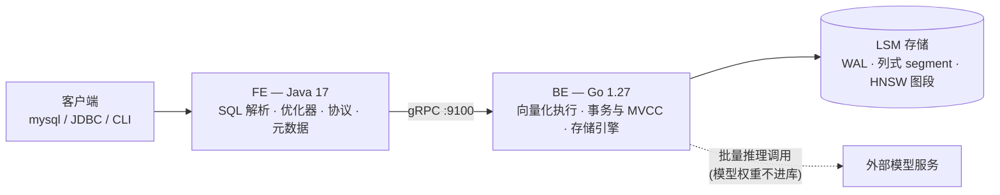

# tang_db

> 自研 **HTAP + AI 原生**数据库 —— 以 OLAP 分析为主干,原生支持 OLTP 事务,并把向量检索与模型推理做成一等公民。

---

## 这是什么

一个从零实现的数据库。存储引擎、事务、查询执行、优化器、SQL 协议层、向量索引,**全部自己写**,不引入任何现成的存储引擎或执行引擎。

目标不是玩具:它要能建表、能跑事务、能跑分析查询、能存向量做语义检索、能让现成的 MySQL 客户端直接连上来。

## 核心设计

- **单引擎统一双负载** —— 一套 LSM 基座同时支撑 OLTP 与 OLAP:写入时走行式内存(memtable),落盘时转列式 segment。写要快、读要少,两者的诉求在不同时刻分别满足。
- **FE / BE 分层** —— FE(Java)负责 SQL 解析、优化、协议;BE(Go)负责执行与存储。两者是两个独立进程,只通过 gRPC 通信,边界不可穿透。
- **MVCC + 快照隔离** —— 读写互不阻塞;LSM 天然多版本,事务与存储共用一套版本体系。
- **向量与普通列同权** —— 向量列一样享受原子写入、MVCC 可见性、崩溃恢复与后台合并。

## 创新点

1. **HTAP + 向量 + 推理三合一,共用同一套引擎**
   事务写入、分析聚合、语义检索、模型推理,同一个库、同一份数据、同一个事务体系 —— 而不是拼四套系统加三条同步链路。

2. **HNSW 图索引做进 LSM**
   不搞常驻内存的全局大图,而是让每个 segment 自带一段图,随 compaction 增量重建。于是向量索引**天生可持久化、天然崩溃安全**,重启不需要重建。

3. **混合查询在优化器里做代价决策**
   "结构化条件 + 向量相似度"的查询,在 `先过滤后检索` 与 `先检索后过滤` 之间按选择率自动选择 —— 现成向量库普遍只能走一条路径,选错就差几十倍。

4. **模型推理下推,与向量化执行共用 batch 语义**
   `ai_embed(text)` 这样的函数下推到 BE 按批执行,一次 1024 行;模型权重不进库,库只认一个推理端点配置。

## 架构

## 路线图

| 期 | 主题 | 目标 |
|---|---|---|
| **P1** | 基座 | FE → BE 跨语言链路打通;最小可用 LSM;崩溃后数据不丢 |
| **P2** | 表与 SQL | DDL / DML / 条件查询,SQL 解析与元数据 |
| **P3** | 事务与 MVCC | 并发写、快照隔离、原子批写、崩溃一致性 |
| **P4** | 索引 | 主键、二级索引、唯一索引、索引选择 |
| **P5** | 分析引擎 | 列式 segment、向量化执行、聚合、JOIN、子查询 |
| **P6** | 优化器 | 统计信息、CBO、谓词下推、连接顺序 |
| **P7** | AI 能力 | `VECTOR` 类型、HNSW 分段图、混合查询、推理下推 |
| **P8** | 生产化 | MySQL 协议兼容、监控、慢查询、备份恢复 |

每期都能独立跑起来、独立演示;上一期没跑通,下一期不开工。

## 技术栈

| 层 | 技术 |
|---|---|
| FE(客户端层) | Java 17 + Maven |
| BE(数据层) | Go 1.27 |
| 服务间通信 | gRPC + Protocol Buffers 3 |
| 存储结构 | LSM-Tree(写时行式、存时列式) |
| 事务 | MVCC + 快照隔离 |
| 向量索引 | HNSW(分段式) |
| 客户端接入 | 自实现 MySQL 协议 |

## 设计原则

**不借外力。** 存储引擎、执行引擎、优化器、向量索引、协议层,全部自己实现。以下这些以及它们的任何绑定,一律不引入:

> RocksDB · LevelDB · Badger · Pebble · SQLite · bbolt · DuckDB · Velox · hnswlib · faiss

借了外力,这个项目就没有存在意义了。

## 状态

**开发中** —— P1(基座)阶段。代码尚未提交,README 先落地。

---

本仓库只包含源码。设计文档、规约等过程产物保留在本地,不入库。
