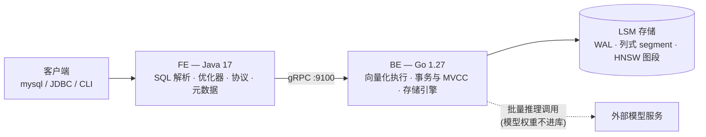

# tang_db

> 自研 **HTAP + AI 原生**数据库 —— 以 OLAP 分析为主干,原生支持 OLTP 事务,并把向量检索与模型推理做成一等公民。

---

## 这是什么

一个从零实现的数据库。存储引擎、事务、查询执行、优化器、SQL 协议层、向量索引,**全部自己写**,不引入任何现成的存储引擎或执行引擎。

目标不是玩具:它要能建表、能跑事务、能跑分析查询、能存向量做语义检索、能让现成的 MySQL 客户端直接连上来。

## 核心设计

- **单引擎统一双负载** —— 一套 LSM 基座同时支撑 OLTP 与 OLAP:写入时走行式内存(memtable),落盘时转列式 segment。写要快、读要少,两者的诉求在不同时刻分别满足。
- **FE / BE 分层** —— FE(Java)负责 SQL 解析、优化、协议;BE(Go)负责执行与存储。两者是两个独立进程,只通过 gRPC 通信,边界不可穿透。
- **MVCC + 快照隔离** —— 读写互不阻塞;LSM 天然多版本,事务与存储共用一套版本体系。
- **向量与普通列同权** —— 向量列一样享受原子写入、MVCC 可见性、崩溃恢复与后台合并。

## 创新点

1. **HTAP + 向量 + 推理三合一,共用同一套引擎**
   事务写入、分析聚合、语义检索、模型推理,同一个库、同一份数据、同一个事务体系 —— 而不是拼四套系统加三条同步链路。

2. **HNSW 图索引做进 LSM**
   不搞常驻内存的全局大图,而是让每个 segment 自带一段图,随 compaction 增量重建。于是向量索引**天生可持久化、天然崩溃安全**,重启不需要重建。

3. **混合查询在优化器里做代价决策**
   "结构化条件 + 向量相似度"的查询,在 `先过滤后检索` 与 `先检索后过滤` 之间按选择率自动选择 —— 现成向量库普遍只能走一条路径,选错就差几十倍。

4. **模型推理下推,与向量化执行共用 batch 语义**
   `ai_embed(text)` 这样的函数下推到 BE 按批执行,一次 1024 行;模型权重不进库,库只认一个推理端点配置。

## 架构



## 路线图

| 期 | 主题 | 目标 |
|---|---|---|
| **P1** | 基座 | FE → BE 跨语言链路打通;最小可用 LSM;崩溃后数据不丢 |
| **P2** | 表与 SQL | DDL / DML / 条件查询,SQL 解析与元数据 |
| **P3** | 事务与 MVCC | 并发写、快照隔离、原子批写、崩溃一致性 |
| **P4** | 索引 | 主键、二级索引、唯一索引、索引选择 |
| **P5** | 分析引擎 | 列式 segment、向量化执行、聚合、JOIN、子查询 |
| **P6** | 优化器 | 统计信息、CBO、谓词下推、连接顺序 |
| **P7** | AI 能力 | `VECTOR` 类型、HNSW 分段图、混合查询、推理下推 |
| **P8** | 生产化 | MySQL 协议兼容、监控、慢查询、备份恢复 |

每期都能独立跑起来、独立演示;上一期没跑通,下一期不开工。

## 技术栈

| 层 | 技术 |
|---|---|
| FE(客户端层) | Java 17 + Maven |
| BE(数据层) | Go 1.27 |
| 服务间通信 | gRPC + Protocol Buffers 3 |
| 存储结构 | LSM-Tree(写时行式、存时列式) |
| 事务 | MVCC + 快照隔离 |
| 向量索引 | HNSW(分段式) |
| 客户端接入 | 自实现 MySQL 协议 |

## 项目结构

```
tang_db/
├── config/                     两个进程的配置(一行一项 key = value)
│   ├── be.conf                 数据层:data_dir / port / memtable_size / fe_host / fe_port / heartbeat_interval_seconds
│   └── fe.conf                 客户端层:be_host / be_port / heartbeat_listen_port / be_offline_cycles
├── proto/tangdb.proto          FE 与 BE 之间唯一的接口契约
├── be/                         Go —— 数据层
│   ├── go.mod
│   ├── cmd/be/                 服务入口
│   └── internal/
│       ├── config/             配置文件解析(标准库手写,零第三方依赖)
│       ├── wal/                预写日志、批写、校验
│       ├── memtable/           跳表、版本链
│       ├── segment/            列式文件读写、编码压缩、zone map
│       ├── compaction/         分层合并、GC 水位
│       ├── manifest/           版本管理、原子切换
│       ├── store/              引擎主干:Put/Get/Scan、刷盘调度、WAL 回收
│       ├── txn/                事务、MVCC、冲突检测
│       ├── index/              主键 / 二级 / 唯一 / 分段 HNSW
│       ├── exec/               向量化算子、范围扫描迭代器
│       ├── ai/                 推理客户端、批量调度、缓存
│       └── server/             gRPC 服务实现、心跳上报
├── fe/                         Java —— 客户端层
│   ├── pom.xml
│   └── src/main/java/com/wangyu/tangdb/
│       ├── protocol/           MySQL 协议
│       ├── parser/             词法、语法、AST
│       ├── catalog/            元数据(存进 BE 的系统表)
│       ├── planner/            逻辑计划、优化器
│       ├── execute/            计划切分与调度
│       ├── storage/            key 保序编码、行值/墓碑编码
│       ├── server/             FE 侧服务:BE 注册与心跳接收
│       ├── txn/                事务协调、快照
│       └── client/             gRPC 客户端封装、CLI、配置文件加载
├── tools/                      导入与基准工具
│   ├── importer/               CSV 批量导入
│   ├── bench-tpcc/             OLTP 基准
│   ├── bench-tph/              OLAP 基准
│   └── recall-check/           向量召回率校验
└── scripts/                    启动、一键验收、崩溃测试
```

## 设计原则

**不借外力。** 存储引擎、执行引擎、优化器、向量索引、协议层,全部自己实现。以下这些以及它们的任何绑定,一律不引入:

> RocksDB · LevelDB · Badger · Pebble · SQLite · bbolt · DuckDB · Velox · hnswlib · faiss

借了外力,这个项目就没有存在意义了。

## 快速开始

### 环境要求

- Go 1.27+(Windows: 装在 `C:\Program Files\Go`)
- Java 17 + Maven 3.9+
- Windows 上执行构建命令请在 git-bash 中;**Maven 必须用 `mvn.cmd`**(POSIX 版 `mvn` 在本机不可用)

### 配置文件

两个进程的配置都在 `config/` 下,与 `fe/`、`be/` 同级,各自一份:

```
config/
├── be.conf     数据层:data_dir / port / memtable_size
└── fe.conf     客户端层:be_host / be_port
```

格式是一行一项 `key = value`,`#` 开头为注释。取值优先级:**命令行参数 > 配置文件 > 内置默认值**。

```bash
./scripts/start-be.sh                      # 读 config/be.conf
./scripts/start-be.sh --port=9200          # 临时换端口,不改文件
./scripts/start-be.sh --config=其他/be.conf # 换一份配置(也可设 TANGDB_BE_CONFIG)
```

配置写错(未知项、格式错、取值非法)会**直接启动失败并指出第几行**,不会静默用默认值跑起来。

### 启动(开两个终端)

终端 A —— 起数据层:

```bash
./scripts/start-be.sh
# === Building BE ===
# === Starting BE (config: ...\config\be.conf) ===
# 2026-10-22 ... INFO 正在启动 tang_db BE version=P1-0.1.0 config=...\config\be.conf data_dir=./data/BE port=9100 memtable_size=67108864
# 2026-10-22 ... INFO 恢复完成 segments_loaded=0 wal_replayed=0
# 2026-10-22 ... INFO BE 已就绪 listen=127.0.0.1:9100
```

终端 B —— 起客户端:

```bash
./scripts/start-fe.sh
# tangdb> put name wangyu
# OK
# tangdb> get name
# wangyu
# tangdb> get no-such-key
# 错误:键不存在
```

### 用 SQL:建表、写入、查询、改、删(P2)

同一个 CLI,输入 SQL 以 `;` 结束(可跨多行)。下面这段取自实际运行的输出(为便于阅读,合并了几次会话):

```sql
tangdb> CREATE TABLE users (id BIGINT PRIMARY KEY, name VARCHAR(32), city VARCHAR(32), age INT);
OK, 表 users 已创建(表 ID 16)

tangdb> INSERT INTO users (id, name, city, age) VALUES (1, 'wangyu', '北京', 26);
OK, 1 row affected

tangdb> INSERT INTO users (id, name, city, age) VALUES (2, 'lisi', '北京', 20), (3, 'zhangsan', '上海', 30);
OK, 2 rows affected

tangdb> SELECT name, city FROM users WHERE city = '北京' AND age > 25;
+--------+------+
| name   | city |
+--------+------+
| wangyu | 北京 |
+--------+------+
(1 row)

tangdb> UPDATE users SET city = '上海' WHERE id = 1;
OK, 1 row affected

tangdb> DELETE FROM users WHERE id = 2;
OK, 1 row affected

tangdb> SELECT * FROM users WHERE id = 2;
+----+------+------+-----+
| id | name | city | age |
+----+------+------+-----+
+----+------+------+-----+
(0 rows)

tangdb> SHOW TABLES;
+------------+----------+---------------------+
| table_name | table_id | created_at          |
+------------+----------+---------------------+
| users      | 16       | 2026-10-22T15:44:39 |
+------------+----------+---------------------+
(1 row)

tangdb> DESC users;
+--------+-------------+-------------+----------+
| column | type        | primary_key | nullable |
+--------+-------------+-------------+----------+
| id     | BIGINT      | YES         | NO       |
| name   | VARCHAR(32) | NO          | YES      |
| city   | VARCHAR(32) | NO          | YES      |
| age    | INT         | NO          | YES      |
+--------+-------------+-------------+----------+
(4 rows)

tangdb> SHOW BACKENDS;
+--------------------------------------+----------------+----------+--------+---------------------+----------------+---------------+-----------+-----------+
| be_id                                | endpoint       | version  | status | last_heartbeat      | memtable_bytes | segment_count | put_count | get_count |
+--------------------------------------+----------------+----------+--------+---------------------+----------------+---------------+-----------+-----------+
| 46ea4a79-5017-446b-9baf-daeb7bd9b93c | 127.0.0.1:9200 | P2-0.1.0 | 可用   | 2026-10-22 15:52:45 | 0              | 1             | 17        | 17        |
+--------------------------------------+----------------+----------+--------+---------------------+----------------+---------------+-----------+-----------+
(1 row)
```

元数据(表、列)存在**库里自己的系统表**里,不依赖任何外部数据库;重启 BE 与 FE 之后 `SHOW TABLES` / `DESC` 与数据都还在。

### P2.1 补充的三类写法(反引号列名 / 省略列名 / SHOW DATABASES)

下面三段都是**实际运行**的输入与输出(合并自同一次会话)。

**① 反引号标识符** —— `select`、`from` 这类关键字可以当列名;反引号内除反引号外任意字符都合法(空格、中划线、中文、数字开头),双写反引号表示一个反引号。反引号**不改变大小写语义**,也不能用来包裹语句关键字或列类型。

```sql
tangdb> CREATE TABLE `order` (`id` INT PRIMARY KEY, `select` VARCHAR(16), `from` INT);
OK, 表 order 已创建(表 ID 16)

tangdb> INSERT INTO `order` (`id`, `select`, `from`) VALUES (1, 'first', 10);
OK, 1 row affected

tangdb> SELECT `id`, `select`, `from` FROM `order` WHERE `id` = 1;
+----+--------+------+
| id | select | from |
+----+--------+------+
| 1  | first  | 10   |
+----+--------+------+
(1 row)
```

**② INSERT 省略列名列表** —— 值按**表定义顺序**给全所有列;少给/多给会指出第几组。

```sql
tangdb> CREATE TABLE users (id BIGINT PRIMARY KEY, name VARCHAR(32), city VARCHAR(32), age INT);
OK, 表 users 已创建(表 ID 17)

tangdb> INSERT INTO users VALUES (1, 'wangyu', '北京', 26);
OK, 1 row affected

tangdb> INSERT INTO users VALUES (2, 'lisi', '上海', 20), (3, 'zhangsan', '北京', 30);
OK, 2 rows affected

tangdb> SELECT * FROM users;
+----+----------+------+-----+
| id | name     | city | age |
+----+----------+------+-----+
| 1  | wangyu   | 北京 | 26  |
| 2  | lisi     | 上海 | 20  |
| 3  | zhangsan | 北京 | 30  |
+----+----------+------+-----+
(3 rows)

tangdb> INSERT INTO users VALUES (5, 'sunqi');
错误：第 1 组取值个数(2)与列数(4)不一致
```

显式列名(`INSERT INTO users (id, name) VALUES (...)`)行为不变,两种写法可以混用;`INSERT INTO users () VALUES (...)` 报 `列名列表不能为空`。

**③ SHOW DATABASES** —— 只有默认库 `default`;由 FE 直接回答,**不访问 BE**,BE 停着也照常输出。

```sql
tangdb> SHOW DATABASES;
+----------+
| Database |
+----------+
| default  |
+----------+
(1 row)
```

P2 的 SQL 边界(一期一期加,别当成完整 SQL):

- 支持:`CREATE / DROP / TRUNCATE TABLE`、`SHOW TABLES` / `SHOW DATABASES`、`DESC`、`INSERT`(多行,可省略列名列表)、`UPDATE`、`DELETE`、`SELECT 列/*/AS` + `WHERE`(`=` `<>` `<` `<=` `>` `>=`、`AND`/`OR`、`IN`)+ `LIMIT`;标识符可用反引号包裹
- 不做(留给后面几期):JOIN、聚合、GROUP BY、子查询、ORDER BY、表达式与函数、二级索引;`NOT` / `IS [NOT] NULL` / `LIKE` / `BETWEEN` 归 P5
- 主键:单列,类型限 `INT` / `BIGINT` / `VARCHAR` / `DATE`
- 一条端到端功能测试:`bash scripts/p2-test.sh`(11 个场景 + P2.1 兼容性断言,52 条断言,含强杀重启、心跳判死、跨内存/磁盘)

### 最强的那个动作:强杀后重启,数据还在

```bash
taskkill /F /IM be.exe      # 强杀,不给它正常退出的机会
./scripts/start-be.sh
# 恢复完成 segments_loaded=2 wal_replayed=37
# 再 get,数据一条没少
```

### 崩溃测试(一键)

```bash
bash scripts/crash-test.sh                # 默认写入 1000 条随机 KV
COUNT=5000 bash scripts/crash-test.sh     # 自定义条数
```

流程:写入 N 条 → 打印数据目录状态 → 强杀 BE → 重启 → 逐条校验 → 输出报告到 `tmp/crash-test/report.txt`。

### 重新生成接口桩代码

```bash
bash scripts/gen-proto.sh
```

## 状态

**P1(基座)已完成并通过独立验收。P2(表与 SQL)已实现完成并通过独立核验。P2.1(SQL 兼容性补齐:反引号 / 省略列名 / SHOW DATABASES)已实现。**

核验口径(真实执行,不看实现方自述):

- `bash scripts/p2-test.sh` —— 11 个场景 + P2.1 断言组 / 52 条断言全 PASS(含 4 个 ★:元数据重启不丢、心跳判死与自动恢复、跨内存/磁盘查询、强杀后零丢失)
- `bash scripts/crash-test.sh` —— P1 回归:1000 条随机 KV,强杀重启后**丢失 0 条**
- `cd be && go build ./... && go vet ./... && go test ./...` —— 全绿
- `cd fe && mvn.cmd test` —— 133 个用例全绿

已知缺口(记在 `specs/P2-table-and-sql.md` §11 待补充,未修):

- `put` / `get` 裸命令被 SQL 取代(与 P1 规约 FR-028 冲突,待拍板)
- BE 在 FE 重启后不会重新注册,`SHOW BACKENDS` 会一直为空
- FE 心跳端口硬绑定,同时只能跑一个 FE/CLI

已完成:

- 仓库初始化、README、`.gitignore`
- 项目结构骨架:`config/` `proto/` `be/` `fe/` `tools/` `scripts/`
- **配置**:两个进程的配置放进 `config/be.conf`、`config/fe.conf`,命令行参数可覆盖(2026-10-22 修订)
- 接口契约 `proto/tangdb.proto`(`Ping` / `Put` / `Get`)
- **BE 最小可用 LSM**:WAL(CRC32C + fsync)、跳表 memtable、列式 segment、MANIFEST 原子版本管理
- **崩溃恢复**:启动时载入 segment + 重放 WAL,尾部坏记录就地截断
- **FE**:gRPC 客户端封装 + 命令行客户端
- **崩溃测试**:1000 条随机 KV,强杀两个进程后重启逐条校验,**丢失 0 条**

下一步:**P2 · 表与 SQL** —— 引入元数据(存进 BE 自身系统表)、DDL/DML/条件查询、BE 注册与心跳上报。

---

本仓库只包含源码。设计文档、规约等过程产物保留在本地,不入库。
