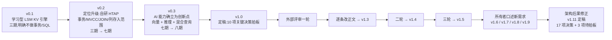
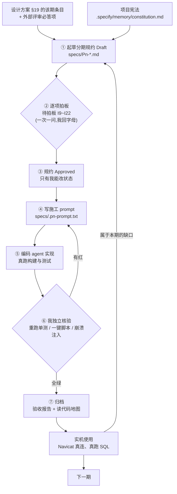

# 我是怎么用 vibecoding 把一个数据库写出来的

> 一句话:**我不写代码,我写规约。代码由编码 agent 按规约实现,我负责独立核验;核验不过,不算做完。**

这个仓库里有个反直觉的地方:一个从零实现的 HTAP 数据库,FE(Java)/BE(Go)两个进程、LSM 存储、MVCC 事务、二级索引、MySQL 协议,加起来两万多行 —— 但**我一行代码都没手写**。

这篇文档记录的是**完整链路**:一个想法怎么长成总体设计文档、文档怎么被多个模型互相提问打磨出来、每一期怎么落地、测试怎么证明、结果怎么算数。

想读代码,从 [docs/读代码地图](docs/读代码地图) 开始;想读规矩,从 [specs/README.md](specs/README.md) 开始;想看能干什么,看 [README.md](README.md)。

---

## 0. 两件必须先说清的事

### 0.1 这套方法的唯一硬规则

不是"让 AI 随便写,能跑就算赢"。全部差别只有一条:

> **AI 的自述不作为证据。凡是"已完成""测试已通过",都要能被我自己的终端重跑出来。**

围绕这一条,才长出后面所有东西:为什么先写规约、为什么所有条目都要编号、为什么核验必须换一个 agent、为什么交付物里必须贴真实命令回显。

一句话概括分工:**我把工程判断压进文档,AI 把打字活干完,我用能重跑的命令验它。**

### 0.2 这是演示项目:规约为什么不删、反而入库

**这个仓库有演示性质。** 实际开发里,下面这些东西**不会进仓库**:

- `specs/`(分期规约 + 每期施工 prompt)
- `docs/`(验收报告、读代码地图)
- `.specify/`(项目宪法与模板)

真实项目里它们只在本地、只给人和 agent 看,提交历史里只会留下代码、测试和 README。这里我把它们**故意一起提交**,原因很直接:

> 光看代码看不出这套方法 —— **方法是过程文档里的,代码只是它的产物。** 要看清楚"AI 为什么会做对",必须看到它当时被要求做什么、我怎么验的、哪里验不了。

另外,`.gitignore` 里原本这三个目录是被忽略的(注释写着"内部过程产物 —— 不进公开仓库"),这次为了演示把它们放开了。你要把这个仓库当模板用,建议照着原来的口径再忽略回去 —— 留 `AGENTS.md` 和 `README` 给外部看就够了。

---

## 1. 结果先摆出来(数字都是真的)

| 项 | 数值 | 怎么取的 |
|---|---|---|
| 周期 | **6 天**(2026-10-21 → 10-27),P1 到 P4 落地,P5 施工中 | `git log` |
| 提交 | 9 次(骨架 + P1/P2/P2.1/P3/P3.5/P4 + 配置改造) | `git log` |
| BE 代码 | Go **7 689 行**(不含 protoc 生成码;含生成 9 749 行),10 个测试文件 | `find be -name '*.go' \| xargs wc -l` |
| FE 代码 | Java **16 826 行** main + **5 611 行** test,33 个测试文件 | `find fe/src -name '*.java' \| xargs wc -l` |
| 测试脚本 | shell **3 286 行**(一键验收 + 崩溃注入) | `find scripts -name '*.sh' \| xargs wc -l` |
| 总体设计文档 | 1 852 行,**v0.1 → v1.11 共 15 条版本记录**,17 项关键决策拍板 | `docs/tang_db-设计方案.md` 变更记录 |
| 分期规约 | **7 份**(P1 / P2 / P2.1 / P3 / P3.5 / P4 / P5) | `specs/` |
| 编号条目 | FR **395**、SC **113**、K 决策 **60**、不变量 **18** | `grep -ho 'FR-[0-9]*' specs/*.md \| sort -u \| wc -l` |
| P4 验收 | FE 单测 **260** 全绿;`p4-test.sh` PASS=**118** FAIL=0;内嵌回归 p2=52 / p3=62 / p35=46 | [docs/验收报告/P4-验收报告.md](docs/验收报告/P4-验收报告.md) |
| 崩溃测试 | 1 000 条随机 KV → `taskkill /F` → 重启 → 丢失 **0** 条 | `scripts/tests/crash-test.sh`(`COUNT=1000`) |

---

# 第一部分 · 从一个想法到总体设计文档

## 2. 想法是怎么长出来的:四个阶段

设计文档自己的版本记录就是这个过程,不是我事后回忆:



| 版本 | 变了什么 | 触发原因 |
|---|---|---|
| **v0.1** | 定位"学习型 LSM KV 引擎",三期,明确不做事务 / SQL / 分析 | 最初的念头:练手,别把范围铺太大 |
| **v0.2** | 改成"自研 HTAP 数据库",事务、MVCC、JOIN、聚合、二级索引、列存、向量化全进范围,三期 → 七期 | 想清楚"练手 LSM"没有差异化,HTAP 才是主干 |
| **v0.3** | 加 AI 能力并**确立为创新点**:向量类型 + ANN 索引、混合查询、推理下推,七期 → 八期 | 找到"别人没同时做到"的那一点 |
| **v1.0** | §20 的 10 项关键决策全部拍板:单机多核、手写递归下降解析器、HNSW 分段图、外部推理端点、SI 收口、自定义文件格式、性能档位、交付含 Docker、代码交给 opencode、Markdown 为唯一主文档 | 第一次"可以动手"的门槛 |
| **v1.1** | D11 元数据存进 BE 自身系统表;D12 BE 主动上报心跳 | 想清楚"不借外部数据库"的后果 |
| **v1.2** | D13 Web 控制台(P8)、D14 大数据生态接入(P9,最低优先级) | 补齐产品形态 |
| **v1.3** | 采纳行业评审:全文检索单列 P10、性能表补写放大/读放大/内存/恢复四项、慢查询升级为诊断建议、八维自查表 | **外部评审第一轮** |
| **v1.4** | 把二轮评审的可借鉴处**逐条写进正文**(11 处),并修正两处决策口径冲突 | **外部评审第二轮** |
| **v1.5** | 再补四处不变量级细节,**并交付《内核不变量与故障注入验收清单》** | **外部评审第三轮** |
| **v1.6~v1.9** | 函数体系 / 导入导出任务化 / JSON / MySQL 协议提前 / 多库命名空间(D19) | 我口述需求,agent 逐条给可行性判定与建议期次 |
| **v1.11** | **D20:FE 的进程形态改为常驻 `fed` + 瘦客户端 CLI**,P3.5 由两步扩为三步 | 我指出一处架构后果:MySQL 协议天然要求常驻服务 |

这里最值得注意的是:**从 v0.1 到 v1.11 只用了三天(2026-10-21 → 10-23),但 15 条版本记录里有 8 条是评审与口述需求逼出来的。** 定稿不是终点 —— 一份设计文档真正的价值,在于它能不能被反复敲打而不塌。

---

## 3. 多个 Agent 互相提问:文档是被"审"出来的

这是整套方法里最容易被忽略、却最值钱的一环。**一个模型写的文档,自己看不出自己的问题。**

### 3.1 机制:三个角色围着同一份文档转

| 角色 | 谁 | 干什么 |
|---|---|---|
| 起草 | 我这边的 agent(Hermes) | 按我的口述与判断写初稿、补章节、维护版本记录 |
| **评审** | **外部模型(GPT,按行业评审框架提问)** | 不问"写得好不好",只问**"这块崩溃了怎么办""这个承诺你验证得了吗""这条和那条冲突"** |
| 裁决 | 我 | 每条意见**当场判**:吸收 / 不吸收(写明理由)/ 推迟到某一期 |

评审不是我一个人点几下就完事的:外部评审连评三轮(2026-10-22)**都是我先起草,我把文档贴给外部模型,拿回意见后逐条改正文**,改完再送一轮。三个模型各自看不到对方的输出,只看**仓库现状** —— 这是防"互相附和"的唯一办法。

### 3.2 三条吸收规则(比机制更重要)

1. **不记待办,只改正文。** 评审说"这里少了一个提交协议",我不是在文档末尾加一条"TODO:补提交协议",而是**当场写出 §6.2.1**。待办会烂掉,正文会被人读到。
2. **不吸收必须给理由。** 评审提的东西里,有超出八期范围、有和依赖红线冲突、有在当前期次验证不了的。这些要么写清"归 P9/P10",要么写清"不做,因为 X"。
3. **评审提的问题,变成后续期次必须正面回答的"必答项"。** 有些问题当期答不了(比如 HNSW 召回率),就登记进 [specs/README.md](specs/README.md) 的必答项表,标好归属期次,**立那份规约时必须逐条回答,不许绕过去**。

### 3.3 评审到底改出了什么(四条实例)

| 评审提的问题 | 落到文档哪 | 实际影响 |
|---|---|---|
| "WAL 记录完整 ≠ 事务已提交,你们靠什么判定重放还是丢弃?" | 新增 **§6.2.1 提交协议** | 把"提交标记放在批记录里"写成硬约定,顺带证明评审担心的两类危险在单记录设计里不存在 |
| "快照读只保一个版本够吗?compaction 会不会把该留的版本删掉?" | 新增 **§8.1.1 版本可见性与保留** | 给出基版本保底规则 + 三条并发保护(冻结输入 / 原子切换 / 旧文件等读者退出) |
| "过滤条件下每段取 Top-K,取不满 K 条怎么办?" | 补 **§9.3** | 从"候选量放大 1.5 倍"改成可迭代扩展 + 暴力兜底 + 召回矩阵,并承认"凑够 K 条 ≠ Top-K 正确" |
| "推理下推失败时,数据库能回滚外部调用吗?" | 补 **§10.1 幂等与副作用** | 幂等键、批次 ID、内容哈希缓存、维度校验、外部服务不可用时的行为 |

还有一个反向效果:**评审不只改内容,还改了流程。** 八维自查表(定位差异化 / 架构边界 / 存储索引 / 事务可靠性 / 查询执行 / 性能验证 / 工程化 / 开发路线)本来是行业评审框架里的东西,我把它挂进 `specs/README.md`,变成**每一期验收前的固定自查**;故障注入清单则单独落成 [specs/invariants.md](specs/invariants.md) 的 18 条不变量。

### 3.4 怎么防"模型互捧"

这件事的现实风险是:让 A 写、B 评,B 会夸 A 写得好。三条对策:

- **评审方只拿到文档,不拿到起草方的解释** —— 没有辩解的余地。
- **要求每条意见给到章节级 + 反例**,说"这里不够健壮"不算意见,说"§8.1 的快照水位在长事务挂住 + compaction 并发时会读到被回收的版本,反例:V1@10 被 compaction 合并后……"才算。
- **最终裁决权在我**,不在任何一个 agent。判断标准只有一条:**这条意见能不能变成一条可失败的测试?** 能,就吸收;不能,就不要为了显得严谨把它写进文档。

顺带说一句:这套"互相提问"的做法,和我后来对编码 agent 的做法是同一条原则的两种形态 —— **起草者不给自己打分**。

---

## 4. 总体文档最后长成什么样

1 852 行、20 章,骨架稳定不轻易动,动的都是章节内部:

| 章节 | 内容 | 后面被引用最多的是 |
|---|---|---|
| §1 项目定位 | 现实里要拼几套系统 → 本项目的四条创新点 → 对标系统(借鉴什么/差异化在哪) | 创新点四条,是每期验收"定位差异化"自查的锚 |
| §2 能力清单 | 分析 / 事务 / AI / 数据与索引 / 接口运维 / **明确不做** / 生态 / 函数体系 | "明确不在设计范围内"那一节(诚实边界) |
| §3 最终效果 | 事务型 / 分析型 / AI 场景 / 三者同时发生 / 官方客户端连 / Web 控制台,**都写成能跑的样子** | 每期"做完能看到什么"从这里抄 |
| §4 总体架构 | FE / BE 职责边界(铁律)、语言选择、不借外力、元数据在哪、注册心跳、进程形态 | FE/BE 边界,是 AGENTS.md 的原型 |
| §5 核心设计决策 | 单引擎不做双引擎、写时行式存时列式、向量索引随 LSM 演进、先不分布式、模型权重不进库 | "为什么这么设计"的全部答案 |
| §6~§10 | 存储引擎 / key 编码 / 事务与 MVCC / 向量索引 / 推理下推与混合查询 | 三期评审改动最集中的地方 |
| §11 优化器 | 逻辑 → 物理、向量化约定、自适应档红线 | P6 的输入 |
| §12~§17 | 索引体系 / 目录结构 / 数据模型 / 错误码 / 项目结构 | 编码 agent 的落地依据 |
| §18 性能 | 目标档位 + **基准条件模板**(报数必须同报条件) | 防"性能数字是目标不是结论" |
| §19 路线图 | P1~P15,每期写清"目标 / 做完能看到 / 验收" | 立规约的唯一上游 |
| §20 决策表 | D1~D20,每条带理由 | 拍板结果的落点 |
| §21 候选能力池 | 17 项逐条判定(能融入 / 有前提 / 不融入) | 防"想法丢了",也防"想法偷偷进范围" |

**这里有个刻意的设计:设计文档写"要什么",不写"怎么做完"。** 后者是规约的活。所以设计文档能一直保持 1 800 行量级,而规约每期 330~750 行 —— 两者不重复,也不需要同步。

---

# 第二部分 · 从总体文档到每一期

## 5. 切期:为什么一期一停

八期主线(P1 基座 → P2 表与 SQL → P3 事务 → P4 索引 → P5 分析引擎 → P6 优化器 → P7 AI → P8 生产化),外加两个实践出来的补充:

- **P2.1 / P3.5 这类小数期**:一期做大了就拆。P3.5 是"常驻 FE + 多库 + MySQL 协议",原本排在 P8,因为"只用自带 CLI 太麻烦"提前;但它必须先有常驻服务形态,所以又拆成第零步/第一步/第二步。
- **补丁期(G 组 / H 组)**:实机反馈暴露的缺口,属本期的就在本期补,不往后推。P4 因此从 v0.1 升到 v0.1i。

**每期都必须能独立跑起来、独立演示、独立验收。上一期没跑通,下一期不开工。** 原因很实在:AI 的失真是累积的 —— 第一期边界穿了一毫米,到第四期就是整层塌掉。

## 6. 一期七步:只有一步交给 AI



七步里只有第⑤步交给 AI。**前面四步决定它能不能做对,后面两步决定它做的算不算数。**

## 7. 规约:十二节骨架 + 五套编号

每份分期规约结构相同(P4 是最全的一份,748 行):

| 章节 | 内容 | 为什么必须有 |
|---|---|---|
| 1 目标 | 这期做完,库比上期多了什么 | 防范围膨胀 |
| 2 范围 | **2.1 做(按 A/B/C 组)** + **2.2 不做及归属期次** | 后者比前者重要 |
| 3 用户场景与验收 | **BDD 写法**,★ 标必验场景 | 见下一节,单独讲 |
| 4 功能需求 | **FR-nnn**,一条一行,可观测 | 验收核对清单 |
| 5 数据与格式 | key 布局 / value 布局 / 文件结构 / 错误码 | 让 AI 在字节层面没有自由发挥空间 |
| 6 外部评审必答项 | 每条问题正面回答协议,不许绕 | 评审提的问题不能靠回避过去 |
| 7 关键技术决策 | **K-nn**,本期默认值 + 理由 | 拍板结果的落点,后续期次引用它 |
| 8 验收标准 | **SC-nnn**,带判定方式 | 一键脚本的断言就从这来 |
| 9 边界与异常清单 | 逐条编号(P4 有 40 条) | 客户端兼容问题的真正来源 |
| 10 交付物清单 | 代码 / 配置 / 脚本 / 文档 | 防漏交付 |
| 11 代码由谁写 | 角色分工(沿用 D9) | 每次重述,防角色漂移 |
| 12 待拍板事项 | 编号 + 我的建议 + **已拍板结论** | 见 §9 |
| 13 变更记录 | 版本 + 日期 + 变更 | 规约不许静默改 |

编号的作用不是好看,是**让"没做"变成一条红**:规约写 FR-555~FR-558,验收脚本就有 SC-344/345,测试就有对应用例 —— 缺一环,报告里露出来。

而 `2.2 不做及归属` 是防"顺手多做"的:复合索引 → 归 P6;`ALTER TABLE` → 不提前;`SUM(DISTINCT)` → 归 P6。写了归属期次,AI 就不会"反正顺手"塞半成品进来;真塞了,也是一条能直接指认的违规。

## 8. BDD 那一节到底怎么写(用 P4 的真实场景)

这是我认为**最该被抄走**的一节。规约里写完"要做什么"之后,必须再写一遍"**怎么演给人看**" —— 用可执行的自然语言,而不是"支持二级索引"这种功能清单。

### 8.1 格式:给 / 当 / 那么 + 反例 + 验收方式

P4 里 11 个场景,全是这个格式。原文(场景 3):

```
### 场景 3 · ★ 唯一索引挡住重复(单会话)

- **给** `CREATE UNIQUE INDEX uk_code ON t(code)`,`('A001')` 已存在
- **当** 插入第二行 `code = 'A001'`
- **那么** 报 `1062`,错误信息带**索引名、列名、值、已有主键**;表里仍只有一行
- **验收方式**:断言错误码 + 行数 + 值
```

四个字段各有用处:

- **给(Given)** 把前置状态写成**能直接复制去执行**的语句,不写"已有一些数据";
- **当(When)** 只写一个动作;
- **那么(Then)** 写**可观测**的结果 —— 错误码、列名、行数,不写"正确处理";
- **反例** 是我额外加的,单独一行写着"必须不出现什么"(场景 4 原文:`- **反例**:两个都成功(唯一约束被并发击穿)`)。**没有反例的场景,AI 很容易写出"看起来通过"的实现。**

### 8.2 ★ 是什么意思

11 个场景里有 4 个带 ★,它们分别是:

- 场景 3 · ★ 唯一索引挡重复(单会话)
- 场景 4 · ★ 唯一索引挡重复(**并发两会话**)
- 场景 5 · ★ **崩溃**:索引与数据同批
- 场景 6 · ★ **崩溃**:回填中途强杀

规律很清楚:**★ 都落在"并发"和"崩溃"上。** 这类场景有两个特点:平时跑不出来,一旦跑不出来就说明数据已经错了。它们也是最容易被"手工跑了一次、看起来没问题"糊过去的地方 —— 所以打 ★,并且在验收标准里给对应的 SC 也打 ★(SC-321~SC-324),让核验时**不可能跳过**。

### 8.3 四跳链路:场景 → FR → SC → 脚本断言

这是整套方法里我最满意的一段闭环。以场景 3 为例,同一个要求在四个地方各出现一次:

**第一跳 · 规约 §3 场景**(上面那段原文)

**第二跳 · 规约 §4 功能需求**(`FR-484` 原文):`INSERT` 唯一索引列已存在(快照下可见且非墓碑)→ 整批不写、不取号,报 `1062`

**第三跳 · 规约 §8 验收标准**:

| 编号 | 验收项 | 判定 |
|---|---|---|
| **SC-321** | ★ 唯一索引挡重复(单会话) | 场景 3 全过:`1062` + 错误信息含索引名/列/值/已有主键 + 行数不变 |

**第四跳 · 一键验收脚本的断言**(`scripts/tests/p4-test.sh:368`,原文):

```bash
log "---------- SC-321 ★ 唯一索引挡重复(单会话) ----------"
run_sql_text "CREATE TABLE t (id INT PRIMARY KEY, code VARCHAR(16)); CREATE UNIQUE INDEX uk_code ON t (code); INSERT INTO t VALUES (1, 'A001'); exit" >/dev/null 2>&1
OUT="$(mysql_code "INSERT INTO t VALUES (2, 'A001')")"
expect "${OUT}" "CODE=1062" "重复插入返回 1062"
expect "${OUT}" "uk_code" "错误信息含索引名"
expect "${OUT}" "code" "错误信息含列名"
expect "${OUT}" "A001" "错误信息含冲突值"
expect "${OUT}" "已有主键 1" "错误信息含已有主键"
ROWS="$(row_count "$(run_sql_text "SELECT * FROM t; exit")")"
if [ "${ROWS}" = "1" ]; then ok "冲突后表里仍只有 1 行"; else bad "冲突后行数异常(${ROWS})"; fi
```

**一个场景 → 6 条断言,连"反例"都在里面。** 这就是为什么我坚持场景里要写那么细:写得含糊,第四跳就写不出来;第四跳写不出来,这条需求就等于没验。

### 8.4 再举一个:对账场景(INV-10)

场景 11 是全期最狠的一条:`5000 次随机 INSERT / UPDATE(含改索引列)/ DELETE` 之后,**按索引路径查出的主键集合 vs 全表扫算出的主键集合,差异必须为 0**。

落到脚本(`p4-test.sh:621`):

```bash
log "---------- SC-329 一致性对账(INV-10,5000 次随机写改删) ----------"
fresh_env "be-sc329.log" "fed-sc329.log" || bad "SC-329 环境启动失败"
run_sql_text "CREATE TABLE inv (id INT PRIMARY KEY, code VARCHAR(16), bucket INT); CREATE UNIQUE INDEX uk_code ON inv (code); CREATE INDEX idx_bucket ON inv (bucket); exit" >/dev/null 2>&1
: > "${TEST_DIR}/random.sql"
for i in $(seq 1 5000); do
    ID=$(( (RANDOM % 400) + 1 ))
    KIND=$(( RANDOM % 100 ))
    # 55% INSERT / 30% UPDATE(一半改索引列)/ 15% DELETE
```

这一条的价值不在"检查了一次",而在它**同时验证了三件很容易各自为政的事**:写入路径维护索引、删除写墓碑、读取路径跳过墓碑。任何一处漏了,差异计数就不会是 0。

### 8.5 BDD 场景写坏的三种样子

| 写坏了 | 长什么样 | 后果 |
|---|---|---|
| 写成功能清单 | "支持二级索引与唯一索引" | 没有判定标准,验收时只能靠感觉 |
| 没有反例 | 只写"那么报 1062" | AI 可能"报 1062 但表里插进去两行",也算通过 |
| 无法观测 | "那么性能良好" | 只能靠嘴证明,不能进脚本 |

判据很简单一条:**这个场景能不能翻译成一行 `expect`?** 不能,就重写。

## 9. 拍板:一次一问,我回字母

规约起草完不停在这里直接开工,而是把需要我决定的点列成表,每项给我的建议:

| 编号 | 事项 | 我的建议 | 结论 |
|---|---|---|---|
| **I16** | 回填期间的新写入怎么保证不丢索引? | A:写入路径对 `BUILDING` 索引也维护,回填只补历史数据 | **已拍板 A(2026-10-26)** |
| **I17** | 唯一索引的 `NULL` 语义 | 不索引 `NULL` 行,允许多行 `NULL` | **已拍板(按建议)** |
| **I22** | `SHOW ENGINES` 报 `InnoDB` 算不算欺骗? | 报,README 写清"仅为客户端兼容" | **已拍板(按建议)** |

P4 的八项(I15~I22)就是这样一条条拍死的。**问的时候一次只问一件**,我回 `A` / `B` / 按建议 —— 不要在聊天里甩一张十项的表让人填,那不是征求意见,那是甩锅。

两条相关规矩:

1. **规约状态只有我能改。** Draft → Approved 这个动作不许自动化。任何 agent(包括起草的那个)不得自行批准 —— 审批动作必须落在人身上,不能变成 agent 的自我宣告。
2. **编码中发现规约缺口,不许用代码覆盖规约。** 先提出来,我决定是补进本期还是推到后面。P4 的 G 组、H 组补丁就是这么来的。

## 10. 施工 prompt:交接单,不是聊天

prompt 原文都在 `specs/.pN-prompt.txt`(随仓库入库),六段固定结构:

**① 必读文档,按顺序读完再动手**

```
1. `AGENTS.md` —— 项目硬约束和构建方式
2. `specs/README.md` —— 规约索引
3. `specs/P1-baseline.md` —— **本期规约,状态 Approved,这是你唯一的施工依据**
4. `.specify/memory/constitution.md` —— 项目宪法(护栏)
```

只给**一份**规约当唯一依据。给两份,它就开始自己融合、自己发明。

**② 实现顺序,按模块排,每步立刻验证**

不是"实现 P1",而是"步骤 1 生成桩代码 → 步骤 2 `be/internal/wal` → 步骤 3 memtable → … → 步骤 10 脚本",每步后面写一句"每完成一步,立刻跑构建/测试确认没坏"。给大目标它会一口气糊完再回头补,给步骤它才会一步步验。

**③ 硬约束,原样重述一遍**

依赖红线、写路径顺序、FE 不许碰数据目录、segment 落盘不可变、`mvn.cmd` 而非 `mvn`、不许 commit。**每次都重述**,哪怕已经写在 `AGENTS.md` 里 —— 重复的成本远低于返工。

**④ 验证要求,写到命令级**

```
- 每一步跑 `cd be && go build ./... && go vet ./...`
- 单元测试真跑,输出真实结果
- 最后跑一次 `scripts/crash-test.sh`;若本机环境跑不通,说明具体原因,不要跳过不提
- 交付时列出:改了哪些文件、**实际执行过的命令与真实输出**、哪些项尚未验证
```

**⑤ 不要做的事(最重要的一段)**

```
- 不要伪造或推测任何测试结果。没跑就写"未验证"。
- 不要超出 P1 规约范围(不实现 compaction、事务、SQL、表、索引)。
- 遇到无法解决的阻塞,停下来在最终输出里说明,不要硬编一个看起来能跑的实现。
```

最后一句是关键。AI 面对阻塞的本能是"编一个看起来能跑的版本",而在这个项目里,一个假实现会污染后面所有期次。所以每次都给它一条**体面的退路:停下来报告,比糊过去得分高。**

**⑥ 环境细节,把坑提前填掉**

端口、日志重定向、不许前台阻塞、不许碰我正在用的 3406 端口、`taskkill /F`、代理已配好。

### 10.1 补丁 prompt:只做这几条,不要顺手

实机反馈的补丁期更严格(`.p4-h-prompt.txt` 原文):

```
## 背景(读完再动手)
P4 主体与 G 组已实现并通过核验(p4-test.sh PASS=97 / FAIL=0,FE 全绿,BE 零改动)。
2026-10-27 所有者用 Navicat 连 3406 的常驻 fed,连接期自检语句报 1235。
所有者拍板"补",**只做这两条,不要顺手做别的**。
```

下面每条都写到**文件级 + 行级依据**:改哪个类的哪个方法、哪几条 FR/边界口径不许动、要补哪些单测、真客户端怎么验。补丁 prompt 宁可写长,也不要留解释空间。

## 11. 编码 agent 的边界

- 模型用 `deepseek/deepseek-flash`。**理由不是省钱,是规约已经写到"照着做就行"的粒度** —— 贵模型在这种任务上买不来额外收益。
- 不让它派子代理(`全程自己顺序完成,不要派子代理`):多 agent 改同一个模块会互相踩,冲突成本高于并行收益。
- 不让它碰规约状态、不让它 commit、不让它写验收报告 —— 报告必须由核验方写。
- 不让它前台起常驻进程(会把会话挂死):一律后台 + 日志重定向,起完单独探活。

---

# 第三部分 · 从实现到测试到结果

## 12. 测试是分层的,每层防不同的病

| 层 | 手段 | 防什么 | P4 的实际数字 |
|---|---|---|---|
| 单元测试 | BE `go test ./...`、FE `mvn.cmd test` | 逻辑写错 | BE 9 个包全绿;FE **260** 个用例 |
| 一键验收 | `scripts/tests/p4-test.sh` | 需求漏做、回归被改坏 | **PASS=118 FAIL=0** |
| 内嵌回归 | 同一个脚本里跑 p2/p3/p35 三期 | 新功能踩坏老功能 | p2=52 / p3=62 / p35=46 全绿 |
| 崩溃注入 | `crash-test.sh` + 各期的 `after_fsync` / `after_memtable` 注入点 | "先日志后数据"被偷偷改成异步 | 1 000 条随机 KV,强杀后丢失 **0** |
| 不变量核对 | [specs/invariants.md](specs/invariants.md) 18 条逐条打勾 | 功能对、内核不可信 | INV-10 转"已验" |
| 真客户端 | 常驻 `fed` + Navicat / `MysqlErrorCheck` | 脚本绿了但客户端连不上 | 连不上就报 1235(于是有了 G/H 组) |
| 边界零改动 | `git status --short be/ proto/` 必须为空 | 该期说好不动 BE,却偷偷动了 | P4 证明 BE 与 `proto/` 零改动 |
| 性能口径 | 同一查询"全表扫 vs 索引"成对记录 | 报个好看数字就算完 | 写进报告,附 §18 基准条件 |

**断言数就是回归基线。** P4 的断言从 97 涨到 118 时,我第一反应不是"通过数变多了",而是核对"多的 21 条是不是正好对应 G 组的两条 SC"。

## 13. 核验 SOP:不信任的部分全部重跑

1. **先清残留进程。** `be.exe` / `fed` 没杀干净,端口被占,整轮验收会假红(吃过一次亏,现在写进报告)。
2. **用独立高位端口。** BE 9900 / MySQL 9906 / 心跳 9991,不碰日常 9100 / 3406 / 9091。
3. **重跑后端**:`go build ./... && go vet ./... && go test ./...`。
4. **重跑前端**:`mvn.cmd test`,看用例总数与失败数。
5. **重跑一键验收**:拿 PASS/FAIL 真数,确认内嵌 p2/p3/p35 也绿。
6. **重跑崩溃测试**。
7. **真客户端抽检**:`MysqlErrorCheck` 或 `fed` + Navicat 手工敲几条,把真实回显贴进报告。
8. **证明边界没破**:`git status --short be/ proto/`。
9. **写报告**:数字原样摘录,**没验的明说**。

报告的三条纪律:

- 所有数字来自**我本人在这个目录下执行的命令**;
- 输出**原样摘录**,不美化、不概括;
- 没跑的项写"未验证",不写"应该没问题"。

P4 报告的结论段原文是这样的 —— 通过归通过,没验的照样写在最显眼的地方:

> **结论:通过。**……老期回归全绿。**未验证项已明示(GUI 全流程、Navicat 本机未装、大表回填性能)。**

> 反面例子是我自己写的宪法第四条:**"凡声称测试已通过,必须能给出实际的执行输出。禁止伪造测试结果。"** 这条不是写给 AI 的,是写给我自己的 —— 我要是采信了 AI 的自述,整条链就废了。

## 14. 实机反馈:AI 写不出来的那部分

规约能保证"按写的做",保证不了"写对了"。真正把项目从"能跑脚本"推到"能日常用"的,是**把真实客户端连上去**:

- Navicat 连上后,连接期自检语句报 **1235** —— 它把 3 条 `SHOW` / `SELECT` 塞进一个 `COM_QUERY`;
- 拉表清单用两列排序(`ORDER BY TABLE_SCHEMA, TABLE_TYPE`)—— 我们只做了单列;
- 翻页用 `LIMIT 0,1000` —— 原排期在 P5,可所有图形客户端都这么写;
- 打开库会发 `SHOW PROCEDURE STATUS WHERE Db = 'def'` —— 没实现。

处理方式固定:**我拍板"属本期就在本期补完" → 规约升版本加 FR/SC/边界 → 写只做这几条的补丁 prompt → 回归全绿 → 变更记录留痕。**

P4 从 v0.1 升到 v0.1i,九次升版,G 组(分页 / 多列排序)与 H 组(客户端语句 7 条)全是实机反馈换来的。**这层 AI 自己想不到**,因为它不知道 Navicat 会发什么 —— 只有我真连上去、真去点。

## 15. 护栏怎么变成可执行的检查

| 红线 | 检查手段 | 判定 |
|---|---|---|
| 不借外力(禁 RocksDB / SQLite / Badger…) | 看 `be/go.mod`,`mvn.cmd dependency:tree` | 依赖只允许 grpc / protobuf(INV-15) |
| FE / BE 边界不可穿透 | `git status --short be/ proto/` + `proto` 逐行核对 | 该期说好不动 BE 就必须为空 |
| 先日志后数据 | `crash-test.sh` 强杀 → 重启 → 逐条校验 | 丢失 0 条(INV-1) |
| 段文件不可变 | 代码审查 + compaction 只写新文件再原子换 MANIFEST | 已落盘 segment 无写入路径 |
| 元数据不许静默损坏 | DDL 中途强杀后重启,错误信息必须指名对象 | INV-11 |
| 事务语义 | 提交各阶段强杀 + 多档快照对拍 | INV-4~INV-8 |
| 索引一致性 | 5 000 次随机写改删后双路径对账 | 差异 0(INV-10) |

## 16. 我踩过的坑

| 现象 | 处置 |
|---|---|
| AI 顺手做规约外的东西 | 规约补 `2.2 不做及归属期次`;prompt 明写"只做这几条" |
| 把没跑的写成"通过" | 交付物硬性要求贴真实回显 + 核验方全部重跑;发现一次就在报告里点名 |
| 端口残留导致整轮假红 | 核验前先清 `be.exe` / `fed`;测试一律独立高位端口 |
| 前台起常驻进程把会话挂死 | prompt 明写"必须后台 + 重定向日志",起完单独探活 |
| 用 `mvn`(sh 脚本版)报 `ClassNotFoundException` | 一律 `mvn.cmd`,写进 `AGENTS.md` 和宪法 |
| 规约没写清的地方 AI 自己决断 | 拍板项收敛成 I 编号;发现缺口升版本补 FR/边界 |
| 一张表甩十个待拍板,我拍不动 | 改成一次一问,我回字母 |
| 代价判断没做,却强行走索引 | 规约里**诚实承认**(K82 本期不做代价判断,基线留给 P6),不装成有 CBO |

最后一条值得单说:AI 会让文档显得比实现更完整。**规约里主动写下"本期不做 / 会变慢 / 未验证",比事后解释便宜一百倍。**

---

## 17. 想照抄的话:最小配方

与数据库无关,任何非玩具项目都能套:

1. 先写**设计文档**(定位 / 架构 / 分期路线),再写**宪法**(5~6 条硬约束 + 每条的理由)。
2. 把文档**送外部模型评审**,要求章节级 + 反例;每条意见**当场改正文**,不记待办;不吸收的写明理由。
3. 评审提的、当期答不了的问题,登记成**必答项 + 归属期次**。
4. 把路线切成**一期一停**,每期都能独立跑起来、独立演示。
5. 每期起草**规约**:目标 / 做 / **不做及归属** / BDD 场景(带反例和 ★) / FR / 数据格式 / 关键决策 / SC / 边界 / 交付物 / 待拍板 / 变更记录。
6. 需要人决定的点收敛成**待拍板表**,一次一问,拍完回写。
7. **只有人能批准。** Draft → Approved 不许自动化。
8. 写**施工交接单**:必读顺序 → 实现顺序(按模块,每步验证)→ 硬约束(重述)→ 验证要求(命令级)→ 不要做的事(含"宁可停下来报告")→ 环境坑。
9. 编码交给 agent,**换一个 agent 独立核验**,只认重跑出来的输出。
10. 核验必须包括:构建、单测、一键脚本、崩溃注入、真客户端抽检、边界零改动证明。
11. 写**验收报告**(真实回显,未验项明示)和**读代码地图**(给未来的自己导航)。
12. 用真实客户端跑,暴露的缺口当补丁期处理,规约升版本,**不许代码覆盖规约**。
13. 一期一个提交,提交信息写清"做了什么 + 怎么验证的"。

## 18. 这套方法不擅长什么

- **探索型任务。** 需要先摸清未知环境(端口、依赖、别人家服务器目录)的活,AI 会编。必须先问、先探测,再动手。
- **性能调优。** 要反复试参数,AI 很容易"给出一个漂亮数",必须自己跑基准。
- **界面审美。** 能出结构,出不了品味。
- **多 agent 并行改同一模块。** 会互相踩。这个项目全程顺序单人链路,只把"起草"和"核验"分开。
- **本质复杂度高的地方**(如 HNSW 在过滤条件下的召回)。规约只能约束行为,保证不了质量 —— 得靠不变量清单 + 召回矩阵这种硬指标。

## 19. 仓库导航:哪个目录对应流程哪一步

| 路径 | 对应流程 | 内容 | 演示才入库? |
|---|---|---|---|
| [AGENTS.md](AGENTS.md) | 每轮都读 | 协作规则与硬约束(给 agent 的入口文件) | 正常也会留 |
| [docs/tang_db-设计方案.md](docs/tang_db-设计方案.md) | 第 1~4 步 | 总体设计文档(v1.11)+ 17 个版本的变更记录 | **是** |
| [.specify/memory/constitution.md](.specify/memory/constitution.md) | 第 0 步 | 项目宪法:6 条硬原则 | **是** |
| [specs/README.md](specs/README.md) | 第 1 步 | 规约索引 / 状态说明 / 必答项表 / 八维自查表 | **是** |
| [specs/P1-baseline.md](specs/P1-baseline.md) … [specs/P5-analytics-engine.md](specs/P5-analytics-engine.md) | 第 1~3 步 | 分期规约(施工唯一依据) | **是** |
| [specs/invariants.md](specs/invariants.md) | 第 6 步 | 18 条内核不变量与故障注入清单 | **是** |
| `specs/.pN-prompt.txt` | 第 4 步 | 每期真实的施工交接单(原文,未删改) | **是** |
| [docs/验收报告](docs/验收报告) | 第 6~7 步 | 验收报告:真实命令回显、结论、未验证项 | **是** |
| [docs/读代码地图](docs/读代码地图) | 第 7 步 | 每期增量代码导航:新增模块、关键跳、踩坑点 | **是** |
| [scripts/tests](scripts/tests) | 第 6 步 | 一键验收 + 崩溃注入(断言数即回归基线) | 正常会留 |
| [scripts/sql](scripts/sql) | 演示 / 回归 | 按期次编号的 SQL 用例(01~45) | 正常会留 |

---

## 最后

这套方法最省力的地方,是把"我觉得 AI 可能做不对"提前变成一条编号;最费力的地方,是每一次都要自己把命令重新敲一遍。

但好处很实在:**这个仓库里的每一个数字,我都能当场重跑出来。** 对一个人的数据库项目来说,这比多写三千行代码值钱。

> 想接着往下看:读 [docs/读代码地图/读代码地图-P4.md](docs/读代码地图/读代码地图-P4.md),它讲索引这一期到底改了哪几跳、哪些坑是踩出来的;想看"场景 → SC → 断言"的完整落地,直接打开 [scripts/tests/p4-test.sh](scripts/tests/p4-test.sh),文件头注释 30 行就是 SC-319~SC-347 的清单。
