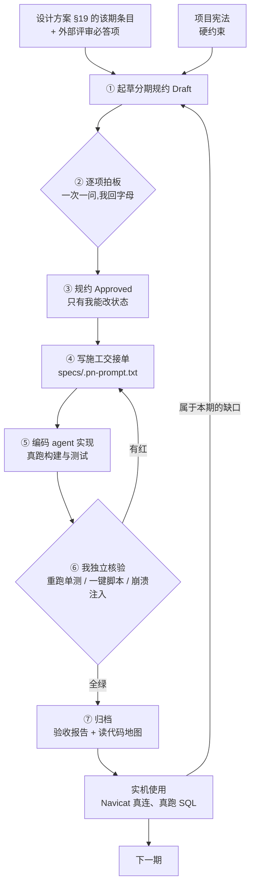

# 我是怎么用 vibecoding 把一个数据库写出来的

> 一句话:**我不写代码,我写规约。代码由编码 agent 按规约实现,我负责独立核验;核验不过,不算做完。**

这个仓库里有个反直觉的地方:一个从零实现的 HTAP 数据库,FE(Java)/BE(Go)两个进程、LSM 存储、MVCC 事务、二级索引、MySQL 协议,加起来两万多行 —— 但**我一行代码都没手写**。

这篇文档记录的是**完整链路**:一份 38 页的白皮书 → 一套 skill → 一份总体设计文档(多轮外部评审打磨)→ 每期规约 → 编码 agent → 独立核验 → 可重跑的结果。

想读代码,从 [docs/读代码地图](docs/读代码地图) 开始;想读规矩,从 [specs/README.md](specs/README.md) 开始;想看能干什么,看 [README.md](README.md)。

---

## 0. 两件必须先说清的事

### 0.1 这套方法的唯一硬规则

不是"让 AI 随便写,能跑就算赢"。全部差别只有一条:

> **AI 的自述不作为证据。凡是"已完成""测试已通过",都要能被我自己的终端重跑出来。**

围绕这一条,才长出后面所有东西:为什么先写规约、为什么所有条目都要编号、为什么核验必须换一个 agent、为什么交付物里必须贴真实命令回显。

### 0.2 这是演示项目:规约为什么不删、反而入库

**这个仓库有演示性质。** 实际开发里,下面这些东西**不会进仓库**:

- `specs/`(分期规约 + 每期施工 prompt,以及这份文档的原始材料 PDF)
- `docs/`(设计方案、验收报告、读代码地图)
- `.specify/`(项目宪法与模板)

真实项目里它们只在本地、只给人和 agent 看,提交历史里只留下代码、测试和 README。这里我把它们**故意一起提交**,原因很直接:

> 光看代码看不出这套方法 —— **方法是过程文档里的,代码只是它的产物。** 要看清楚"AI 为什么会做对",必须看到它当时被要求做什么、我怎么验的、哪里验不了。

`.gitignore` 里原本这三个目录是被忽略的(注释写着"内部过程产物 —— 不进公开仓库"),这次为了演示把它们放开了,并留了一行注释说明"真实项目照旧忽略"。

---

## 1. 结果先摆出来(数字都是真的)

| 项 | 数值 | 怎么取的 |
|---|---|---|
| 周期 | **6 天**(2026-10-21 → 10-27),P1 到 P4 落地,P5 施工中 | `git log` |
| 提交 | 9 次(骨架 + P1/P2/P2.1/P3/P3.5/P4 + 配置改造) | `git log` |
| BE 代码 | Go **7 689 行**(不含 protoc 生成码;含生成 9 749 行),10 个测试文件 | `find be -name '*.go' \| xargs wc -l` |
| FE 代码 | Java **16 826 行** main + **5 611 行** test,33 个测试文件 | `find fe/src -name '*.java' \| xargs wc -l` |
| 测试脚本 | shell **3 286 行**(一键验收 + 崩溃注入) | `find scripts -name '*.sh' \| xargs wc -l` |
| 起点材料 | 白皮书 **38 页** | `specs/Day_5_v3.pdf` |
| 总体设计文档 | 1 852 行,**v0.1 → v1.11 共 15 条版本记录**,17 项关键决策拍板 | 设计文档变更记录 |
| 分期规约 | **7 份**(P1 / P2 / P2.1 / P3 / P3.5 / P4 / P5) | `specs/` |
| 编号条目 | FR **395**、SC **113**、K 决策 **60**、不变量 **18** | `grep -ho 'FR-[0-9]*' specs/*.md \| sort -u \| wc -l` |
| P4 验收 | FE 单测 **260** 全绿;`p4-test.sh` PASS=**118** FAIL=0;内嵌回归 p2=52 / p3=62 / p35=46 | [docs/验收报告/P4-验收报告.md](docs/验收报告/P4-验收报告.md) |
| 崩溃测试 | 1 000 条随机 KV → `taskkill /F` → 重启 → 丢失 **0** 条 | `scripts/tests/crash-test.sh`(`COUNT=1000`) |

---

# 第一部分 · 材料与工具

## 2. 起点:一份 38 页的 PDF 怎么变成这套流程

我一开始手上没有流程,只有一份白皮书:

> **《Spec-Driven Production Grade Development in the Age of Vibe Coding》**
> Lee Boonstra(Google)· 2026-05 · 38 页
> 原文已随仓库放在 [specs/Day_5_v3.pdf](specs/Day_5_v3.pdf)

这份 PDF 讲的就是"在 vibe coding 时代怎么写生产级规格":SDD、好规格的构成、BDD/Gherkin、指令该放在哪、不同用途的不同 prompt、评审与团队流程、零信任护栏(沙箱 / HITL / AI 生成测试覆盖 / 策略服务器 / 上下文卫生)。

**但我不是照着它做,而是把它当原料喂给 agent,先长出一套"规约编程"的 skill,再用 skill 跑这个项目。** 顺序是:


这样做的直接好处:**PDF 里的抽象主张,必须落到"这个仓库里的哪个文件"。** 落不下去的,就老实承认没做。

| PDF 里的主张 | 我落成什么 | 仓库里的实体 |
|---|---|---|
| 代码可丢弃,规格是唯一事实源;规格放 `specs/` 入版本库 | 分期规约,一期一份 | [specs/P1-baseline.md](specs/P1-baseline.md) … [specs/P5-analytics-engine.md](specs/P5-analytics-engine.md) |
| 一份好规格 = 完整技术设计 + 图表 + "为什么" + 场景(含边界) | 总体设计方案(Markdown + Mermaid),每期规约再细化 | [docs/tang_db-设计方案.md](docs/tang_db-设计方案.md) |
| 格式选择:Markdown 承载叙述,结构化数据用 YAML | 我改用**表格**承载结构化数据(字节布局、错误码、决策表)—— 同样是"让人和 agent 都按列读" | 各期规约 §5 数据与格式 |
| BDD / Gherkin:`Scenario / Given / When / Then` | 中文「给 / 当 / 那么」+ 反例 + 验收方式 | 各期规约 §3,落到 §8 的 SC 与脚本 `expect` |
| 指令住在哪:chat(短) / `specs/`(任务) / `AGENTS.md` + skills(方法) | 五层指令体系,见 §8.1 | `AGENTS.md`、Hermes skills、`specs/`、`.pN-prompt.txt` |
| 不同用途要不同 prompt(生成 / 加功能 / 修 bug) | 施工 prompt、补丁 prompt、核验分开写 | [specs/.p1-prompt.txt](specs/.p1-prompt.txt)、`specs/.p4-h-prompt.txt` |
| 库与工具版本号必须显式写死(模型知识有截止日) | 宪法里钉死 Go 1.27 / Java 17 / Maven 3.9.16 / protobuf 3 | [.specify/memory/constitution.md](.specify/memory/constitution.md) |
| 零信任护栏:HITL 检查点、沙箱、边界 | 依赖红线 + 边界零改动证明 + **状态只有人能改** | 宪法 6 条硬原则 + §15 检查表 |
| AI 生成测试覆盖:先让它写失败测试/复现命令,再修 | 每期一键验收脚本 + 崩溃注入,断言数当回归基线 | [scripts/tests](scripts/tests) |
| Evaluation:0-5 打分、容忍带,防"行为漂移" | **不适用**:数据库的输出是确定的,不是生成的 —— 我用**不变量清单 + 双路径对账**替代 | [specs/invariants.md](specs/invariants.md) |
| MCP、Tier1~3 自动代码评审、图原生评审 | **没做**:单人单机,评审由外部模型提问 + 我自己重跑代替 | — |

最后两行是刻意留下的:**一份方法论里,一定有几节对你的场景是没用的。** 把它们标出来,比假装全用上了更可信。

---

## 3. 三个角色,职责不许混

| 角色 | 谁 | 干什么 | 不干什么 |
|---|---|---|---|
| **所有者** | 我 | 定方向、逐项拍板、**只有我能把规约从 Draft 改成 Approved**、看报告 | 不写实现代码、不写测试 |
| **规约 + 核验** | Hermes | 起草分期规约、评审实现、**独立重跑全部验证**、写验收报告与《读代码地图》 | 不自己批准规约;不代改代码 |
| **编码** | opencode(`deepseek/deepseek-flash`) | 按规约写代码与测试,真跑,给出真实输出 | 不碰规约状态;不 commit;不写验收报告 |

最要紧的一条:**编码的 agent 和核验的 agent 不是同一个。** 让写完代码的模型自评"我做完了",等于没有核验 —— 它一定会说做完。

---

## 4. 工具链:用到哪些 skill、插件、命令

这一节是"我到底装了什么、每样干什么用"。**没有神秘工具,全部是能被检查的东西。**

| 组件 | 形态 | 在本项目干什么 | 在哪 / 怎么装 |
|---|---|---|---|
| **Hermes Agent** | agent 运行时 | 起草规约、评审、独立核验、写报告 | 本机 CLI |
| **opencode** | 编码 CLI | 按交接单实现代码与测试 | `opencode run -m deepseek/deepseek-flash` |
| skill · `spec-driven-development-workflow` | Hermes 技能 | 方法论入口:Spec Kit 路线与**手工分期规约路线**怎么选、自研项目的工序(选题 → 设计方案 → 逐项拍板 → 骨架入库 → 分期规约 → 交 opencode → 独立核验 +《读代码地图》) | `~/AppData/Local/hermes/skills/software-development/` |
| skill · `tang-db-phase-delivery`(**v1.4.0**) | Hermes 技能 | **本项目专属 SOP**:单期流程、规约写作约定、核验期的坑、现状锚点(每期能力边界)、本机口径(Windows/git-bash/编码/端口) | 同上 |
| skill · `technical-design-doc` | Hermes 技能 | 设计方案怎么写(Markdown + Mermaid,出完停下等审) | 同上 |
| skill · `speckit-*`(10 个) | Hermes 技能 | `/speckit.specify`、`/speckit.plan`、`/speckit.tasks`、`/speckit.implement` 等 | Spec Kit 集成写进全局技能目录 |
| skill · `opencode-run-delegation-pitfall` | Hermes 技能 | 驱动 opencode 跑大任务时"它会派子代理然后直接退出"的坑 | 同上 |
| **Spec Kit**(`specify init`) | 仓库脚手架 | 生成 `.specify/`(宪法、模板、脚本、workflow)+ opencode 的斜杠命令 | `.specify/integration.json`、`integrations/opencode.manifest.json`(集成 **1.2.2**,2026-10-21 装入) |
| opencode 斜杠命令 × 10 | `.opencode/commands/speckit.*.md` | `speckit.specify` / `plan` / `tasks` / `implement` / `converge` / `clarify` / `analyze` / `checklist` / `constitution` / `taskstoissues` | 随 Spec Kit 集成生成 |
| 插件 · `oh-my-openagent@latest` | opencode 插件 | 给 opencode 挂一整套 subagent(规划 / 审查 / 搜索 / 编排)与 `/start-work` 等命令 | 全局 `~/.config/opencode/opencode.jsonc` 的 `plugin` |
| 插件 SDK · `@opencode-ai/plugin` 1.19.0 | npm 依赖 | opencode 插件依赖版本(决定插件 API 形态) | `.opencode/package.json` |

### 4.1 为什么用 skill,而不是每次写一大段 prompt

三条理由,都是实打实省下来的:

1. **复用**:方法论那套(选题 / 拍板 / 分期 / 核验)跨项目不变,不该每开一个仓库重写一遍。
2. **可演进**:踩过的坑当场写回 skill。举三个真实条目 ——
   - "脚本布局是硬约定:启动只留 `start-be.sh` / `start-fe.sh`,所有测试放 `scripts/tests/`"(嫌脚本太多之后定的);
   - "别按进程名杀 `java.exe`,里面有 IDE 的子进程";
   - "断言总数比上期少,先查 `[PASS]` 有没有降成 `[NOTE]`,别判成断言被删"。
   
   这些**没有一条来自 PDF**,全是这个项目踩出来的。skill 从 v1.0 涨到 **v1.4.0**,涨的就是这些。
3. **一处生效**:改了 skill,后面每一期都按新规矩走;写死在 prompt 里的规则只对那一期有效。

### 4.2 skill 和 prompt 的分工(别混)

| 层 | 放什么 | 例子 | 寿命 |
|---|---|---|---|
| skill | 跨任务的工程习惯 | "先清残留进程再核验""规约编号全局续排" | 长期 |
| `AGENTS.md` | 本项目的硬约束 | 依赖红线、构建命令、不许自动 commit | 项目内长期 |
| `specs/P<n>-*.md` | 这一期要什么 | FR/SC/K/边界 | 一期 |
| `specs/.p<n>-prompt.txt` | 这一次怎么干 | 必读顺序、分步、禁子代理 | 一次 |

### 4.3 一个坑:skill 装错目录等于没装

Spec Kit 的集成会往 `~/.hermes/skills/speckit-*/` 写技能,但 Windows 上 Hermes 真正读的是 `%LOCALAPPDATA%\hermes\skills` —— 两个路径不一致时,装完等于没装。解法是先建目录 junction 让两条路径指向同一处,再用**让 agent 自己列技能**的方式验证(能列出 10 个 `speckit-*` 才算装成),而不是看文件在不在。

---

# 第二部分 · 从一个想法到总体设计文档

## 5. 想法是怎么长出来的:四个阶段

设计文档自己的版本记录就是这个过程,不是我事后回忆:


| 版本 | 变了什么 | 触发原因 |
|---|---|---|
| **v0.1** | 定位"学习型 LSM KV 引擎",三期,明确不做事务 / SQL / 分析 | 最初的念头:练手,别把范围铺太大 |
| **v0.2** | 改成"自研 HTAP 数据库",事务、MVCC、JOIN、聚合、二级索引、列存、向量化全进范围,三期 → 七期 | 想清楚"练手 LSM"没有差异化,HTAP 才是主干 |
| **v0.3** | 加 AI 能力并**确立为创新点**:向量类型 + ANN 索引、混合查询、推理下推,七期 → 八期 | 找到"别人没同时做到"的那一点 |
| **v1.0** | §20 的 10 项关键决策全部拍板:单机多核、手写递归下降解析器、HNSW 分段图、外部推理端点、SI 收口、自定义文件格式、性能档位、交付含 Docker、代码交给 opencode、Markdown 为唯一主文档 | 第一次"可以动手"的门槛 |
| **v1.1** | D11 元数据存进 BE 自身系统表;D12 BE 主动上报心跳 | 想清楚"不借外部数据库"的后果 |
| **v1.2** | D13 Web 控制台(P8)、D14 大数据生态接入(P9,最低优先级) | 补齐产品形态 |
| **v1.3** | 采纳行业评审:全文检索单列 P10、性能表补写放大/读放大/内存/恢复四项、慢查询升级为诊断建议、八维自查表 | **外部评审第一轮** |
| **v1.4** | 把二轮评审的可借鉴处**逐条写进正文**(11 处),并修正两处决策口径冲突 | **外部评审第二轮** |
| **v1.5** | 再补四处不变量级细节,**并交付《内核不变量与故障注入验收清单》** | **外部评审第三轮** |
| **v1.6~v1.9** | 函数体系 / 导入导出任务化 / JSON / MySQL 协议提前 / 多库命名空间(D19) | 我口述需求,agent 逐条给可行性判定与建议期次 |
| **v1.11** | **D20:FE 的进程形态改为常驻 `fed` + 瘦客户端 CLI**,P3.5 由两步扩为三步 | 我指出一处架构后果:MySQL 协议天然要求常驻服务 |

值得注意的是:**从 v0.1 到 v1.11 只用了三天(2026-10-21 → 10-23),但 15 条版本记录里有 8 条是评审与口述需求逼出来的。** 定稿不是终点 —— 一份设计文档真正的价值,在于它能不能被反复敲打而不塌。

## 6. 多个 Agent 互相提问:文档是被"审"出来的

这是整套方法里最容易被忽略、却最值钱的一环。**一个模型写的文档,自己看不出自己的问题。**

### 6.1 机制:三个角色围着同一份文档转

| 角色 | 谁 | 干什么 |
|---|---|---|
| 起草 | 我这边的 agent(Hermes) | 按我的口述与判断写初稿、补章节、维护版本记录 |
| **评审** | **外部模型(GPT,按行业评审框架提问)** | 不问"写得好不好",只问**"这块崩溃了怎么办""这个承诺你验证得了吗""这条和那条冲突"** |
| 裁决 | 我 | 每条意见**当场判**:吸收 / 不吸收(写明理由)/ 推迟到某一期 |

三轮评审(2026-10-22)**都是我先起草,我把文档贴给外部模型,拿回意见后逐条改正文**,改完再送一轮。三个模型各自看不到对方的输出,只看**仓库现状** —— 这是防"互相附和"的唯一办法。

### 6.2 三条吸收规则(比机制更重要)

1. **不记待办,只改正文。** 评审说"这里少了一个提交协议",我不是在文档末尾加一条"TODO:补提交协议",而是**当场写出 §6.2.1**。待办会烂掉,正文会被人读到。
2. **不吸收必须给理由。** 评审提的东西里,有超出八期范围、有和依赖红线冲突、有在当前期次验证不了的。这些要么写清"归 P9/P10",要么写清"不做,因为 X"。
3. **评审提的问题,变成后续期次必须正面回答的"必答项"。** 有些问题当期答不了(比如 HNSW 召回率),就登记进 [specs/README.md](specs/README.md) 的必答项表,标好归属期次,**立那份规约时必须逐条回答,不许绕过去**。

### 6.3 评审到底改出了什么(四条实例)

| 评审提的问题 | 落到文档哪 | 实际影响 |
|---|---|---|
| "WAL 记录完整 ≠ 事务已提交,你们靠什么判定重放还是丢弃?" | 新增 **§6.2.1 提交协议** | 把"提交标记放在批记录里"写成硬约定,顺带证明评审担心的两类危险在单记录设计里不存在 |
| "快照读只保一个版本够吗?compaction 会不会把该留的版本删掉?" | 新增 **§8.1.1 版本可见性与保留** | 给出基版本保底规则 + 三条并发保护(冻结输入 / 原子切换 / 旧文件等读者退出) |
| "过滤条件下每段取 Top-K,取不满 K 条怎么办?" | 补 **§9.3** | 从"候选量放大 1.5 倍"改成可迭代扩展 + 暴力兜底 + 召回矩阵,并承认"凑够 K 条 ≠ Top-K 正确" |
| "推理下推失败时,数据库能回滚外部调用吗?" | 补 **§10.1 幂等与副作用** | 幂等键、批次 ID、内容哈希缓存、维度校验、外部服务不可用时的行为 |

还有一个反向效果:**评审不只改内容,还改了流程。** 八维自查表(定位差异化 / 架构边界 / 存储索引 / 事务可靠性 / 查询执行 / 性能验证 / 工程化 / 开发路线)本来是行业评审框架里的东西,我把它挂进 `specs/README.md`,变成**每一期验收前的固定自查**;故障注入清单则单独落成 [specs/invariants.md](specs/invariants.md) 的 18 条不变量。

### 6.4 怎么防"模型互捧"

- **评审方只拿到文档,不拿到起草方的解释** —— 没有辩解的余地。
- **要求每条意见给到章节级 + 反例**,说"这里不够健壮"不算意见,说"§8.1 的快照水位在长事务挂住 + compaction 并发时会读到被回收的版本,反例:V1@10 被合并后……"才算。
- **最终裁决权在我**,不在任何一个 agent。判断标准只有一条:**这条意见能不能变成一条可失败的测试?** 能,就吸收;不能,就不要为了显得严谨把它写进文档。

这和后面驱动编码 agent 是同一条原则的两种形态:**起草者不给自己打分。**

## 7. 总体文档最后长成什么样

1 852 行、20 章,骨架稳定不轻易动,动的都是章节内部:

| 章节 | 内容 | 后面被引用最多的是 |
|---|---|---|
| §1 项目定位 | 现实里要拼几套系统 → 四条创新点 → 对标系统(借鉴什么/差异化在哪) | 创新点四条,是"定位差异化"自查的锚 |
| §2 能力清单 | 分析 / 事务 / AI / 数据与索引 / 接口运维 / **明确不做** / 生态 / 函数体系 | "明确不在设计范围内"那一节 |
| §3 最终效果 | 事务型 / 分析型 / AI / 三者同时发生 / 官方客户端连 / Web 控制台,**都写成能跑的样子** | 每期"做完能看到什么"从这里抄 |
| §4 总体架构 | FE / BE 职责边界(铁律)、语言选择、不借外力、元数据在哪、注册心跳、进程形态 | FE/BE 边界,是 `AGENTS.md` 的原型 |
| §5 核心设计决策 | 单引擎不做双引擎、写时行式存时列式、向量索引随 LSM 演进、先不分布式、模型权重不进库 | "为什么这么设计"的全部答案 |
| §6~§10 | 存储引擎 / key 编码 / 事务与 MVCC / 向量索引 / 推理下推与混合查询 | 三轮评审改动最集中处 |
| §11 优化器 | 逻辑 → 物理、向量化约定、自适应档红线 | P6 的输入 |
| §12~§17 | 索引体系 / 目录结构 / 数据模型 / 错误码 / 项目结构 | 编码 agent 的落地依据 |
| §18 性能 | 目标档位 + **基准条件模板**(报数必须同报条件) | 防"性能数字是目标不是结论" |
| §19 路线图 | P1~P15,每期写清"目标 / 做完能看到 / 验收" | 立规约的唯一上游 |
| §20 决策表 | D1~D20,每条带理由 | 拍板结果的落点 |
| §21 候选能力池 | 17 项逐条判定(能融入 / 有前提 / 不融入) | 防"想法丢了",也防"想法偷偷进范围" |

**刻意的分工:设计文档写"要什么",不写"怎么做完"。** 后者是规约的活。所以设计文档一直保持在 1 800 行量级,而规约每期 330~750 行 —— 两者不重复,也不需要同步。

---

# 第三部分 · 规约编程(spec-driven development)

这一部分是这套方法的主干。前面都是"怎么把材料变成文档",这里是"**怎么让文档真的驱动 AI 写出能验收的代码**"。

## 8. 什么是规约编程

一句话:**把"要什么、边界在哪、怎么算做完"写进仓库里的文档,代码由 agent 按它生成。**

核心判断来自那份白皮书,我完全认同:**代码是可丢弃的,规约不是。** 一个只存在于聊天里的需求,改一次要重讲一遍;一份写进 `specs/` 的规约,改一行就换一份实现。

由此有三条推论,后面每一节都在落实它们:

1. **评审重心从代码转向规约。** 改一句话比重写三千行便宜,而且改完可复现。
2. **agent 的产出必须能被"仓库现状 + 命令"证伪。** 所以全部条目都要编号、都要有判定方式。
3. **规约必须自包含。** 不依赖聊天上下文 —— 一个全新会话(或换一个 agent)只读 `AGENTS.md` + 一份规约,就能干出同样的活。

### 8.1 五层指令:什么该住在哪里

白皮书里讲"指令不写在一个地方",我落成五层。**把东西放错层,是这套方法最常见的失败原因。**

| 层 | 放什么 | 本仓库实体 | 谁读 | 放错的后果 |
|---|---|---|---|---|
| 个人事实层 | 机器、路径、端口、我的偏好 | agent 的持久记忆 | agent 每个会话 | 写进仓库 = 泄露 + 噪音 |
| 方法层 | 跨任务不变的工序 | skill(`spec-driven-development-workflow`、`tang-db-phase-delivery`) | agent 按需加载 | 写进 prompt = 每期重抄一遍 |
| 项目层 | 硬约束、构建命令、提交纪律 | [AGENTS.md](AGENTS.md)、[宪法](.specify/memory/constitution.md) | 每次进仓库都读 | 不写 = agent 得靠猜 |
| 任务层 | 这一期要什么 | `specs/P<n>-*.md` | 编码前通读 | 塞进聊天 = 上下文碎片化 |
| 本轮层 | 这一次怎么干 | `specs/.p<n>-prompt.txt` | 这一次 | 当归档用 = 下一期照抄过期规则 |

白皮书里有一句我印象很深:**把 100 页的设计文档直接丢进聊天窗口,会迅速烧掉上下文预算、拉高延迟、把上下文撕碎。** 我的对策不是"读少点",而是**分层 + 指定读取顺序**:

```
1. AGENTS.md                → 硬约束(每次都读)
2. specs/README.md          → 找到当前期(每次都读)
3. specs/P<n>-*.md          → 本期规约,唯一施工依据(通读)
4. .specify/memory/constitution.md → 护栏(通读)
—— 设计文档只在需要背景时按章节取,不整份喂
```

**只给一份规约当唯一依据。** 给两份,它就开始自己融合、自己发明。

### 8.2 一份规约的构成

十二个章节 + 五套编号,P4 是最全的一份(748 行):

| 章节 | 内容 | 为什么必须有 |
|---|---|---|
| 1 目标 | 这期做完,库比上期多了什么 | 防范围膨胀 |
| 2 范围 | **2.1 做(按 A/B/C 组)** + **2.2 不做及归属期次** | 后者比前者重要,见 §8.3 第 4 条 |
| 3 用户场景与验收 | **BDD 写法**,★ 标必验场景 | §8.4 单独讲 |
| 4 功能需求 | **FR-nnn**,一条一行,可观测 | 验收核对清单 |
| 5 数据与格式 | key 布局 / value 布局 / 文件结构 / 错误码 | 让 agent 在字节层面没有自由发挥空间 |
| 6 外部评审必答项 | 每条问题正面回答协议,不许绕 | 评审提的问题不能靠回避过去 |
| 7 关键技术决策 | **K-nn**,本期默认值 + 理由 | 拍板结果的落点,后续期次引用它 |
| 8 验收标准 | **SC-nnn**,带判定方式 | 一键脚本的断言就从这来 |
| 9 边界与异常清单 | 逐条编号(P4 有 40 条) | 客户端兼容问题的真正来源 |
| 10 交付物清单 | 代码 / 配置 / 脚本 / 文档 | 防漏交付 |
| 11 代码由谁写 | 角色分工(沿用 D9) | 每次重述,防角色漂移 |
| 12 待拍板事项 | 编号 + 我的建议 + **已拍板结论** | 见 §10 |
| 13 变更记录 | 版本 + 日期 + 变更 | 规约不许静默改 |

五套编号各管一段:**FR**(要求)— **SC**(验收)— **K**(决策)— **边界**(异常)— **INV**(不变量,跨期)。

编号的作用不是好看,是**让"没做"变成一条红**:规约写 FR-555~FR-558,验收脚本就有 SC-344/345,测试就有对应用例 —— 缺一环,报告里露出来。编号**跨期续排**(P4 从 FR-456 起,因为 P3.5 用到 FR-455),补丁期不允许从 1 重开。

### 8.3 写规约的七条硬规则

1. **每条需求一个编号,每条验收一个编号,每个默认值一个编号。** 没有编号的条款,验收时一定漏。
2. **判定必须可观测。** 写"返回 `1062`、错误信息含索引名/列名/值/已有主键、表里仍只有 1 行",不写"正确处理冲突"。
3. **每个场景必须有反例。** 只写"那么报错"的规约,agent 很容易写出"报错但数据也写进去了"的实现。
4. **"不做"必须穷举,并写归属期次。** 只列功能名不够 —— 谓词集合(`NOT` / `IS [NOT] NULL` / `LIKE` / `BETWEEN`)就因为既不在 FR 也没进任何"不做"清单,成了"无归属缺口",实机测试时被当成一堆 bug 报回来。归位之后它们明确写在 P5。
5. **数据格式写到字节。** key 布局、value 布局、编码、错误码、状态机,全部钉死 —— 这是 agent 唯一没有自由发挥空间的地方,也是它最容易"自己发明一套"的地方。
6. **版本号、端口、路径显式写死。** 模型的知识有截止日期,库版本不能靠它记(白皮书专门提醒过这条)。
7. **状态只有人能改,缺口先提不许自己补。** Draft → Approved 不许自动化;编码中发现规约缺口,**用代码覆盖规约是最严重的违规**,必须先提出来。

再加两条检查习惯:

- **规约里不许留占位符。** 写 `FR-xxx` 就是埋雷,发布前 grep 一遍真实编号。
- **数量声明自己核。** 变更记录里写"N 条 FR / K / SC / 边界"时,先跑 `grep -cE '^\| FR-[0-9]+' specs/P<n>-*.md` 数一遍 —— 数字错一个,整份规约的可信度就打折。

### 8.4 BDD 场景:四跳链路,缺一跳等于没验

这一节是我认为**最该被抄走**的。规约写完"要做什么",必须再写一遍"**怎么演给人看**" —— 用可执行的自然语言,而不是"支持二级索引"这种功能清单。

**第一跳:场景。** P4 里 11 个场景,全是这个格式(原文,场景 3):

```
### 场景 3 · ★ 唯一索引挡住重复(单会话)

- **给** `CREATE UNIQUE INDEX uk_code ON t(code)`,`('A001')` 已存在
- **当** 插入第二行 `code = 'A001'`
- **那么** 报 `1062`,错误信息带**索引名、列名、值、已有主键**;表里仍只有一行
- **验收方式**:断言错误码 + 行数 + 值
```

四个字段各有用处:

- **给(Given)** 把前置状态写成**能直接复制去执行**的语句,不写"已有一些数据";
- **当(When)** 只写一个动作;
- **那么(Then)** 只写可观测结果;
- **反例** 单独一行写"必须不出现什么"(场景 4 原文:`- **反例**:两个都成功(唯一约束被并发击穿)`)。

**★ 是什么:** 11 个场景里有 4 个带 ★ —— 唯一索引并发、两处崩溃注入。规律很清楚:**★ 只打在"并发"和"崩溃"这两类上**,因为平时跑不出来、一旦不对就说明数据已经错了,也最容易被"手工跑了一次、看起来没问题"糊过去。对应的验收标准 SC-321~SC-324 也打 ★,核验时不可能跳过。

**第二跳:FR。** §4 里 `FR-484` 原文:`INSERT` 唯一索引列已存在(快照下可见且非墓碑)→ 整批不写、不取号,报 `1062`(K80)。

**第三跳:SC。** §8 里:

| 编号 | 验收项 | 判定 |
|---|---|---|
| **SC-321** | ★ 唯一索引挡重复(单会话) | 场景 3 全过:`1062` + 错误信息含索引名/列/值/已有主键 + 行数不变 |

**第四跳:脚本断言。** `scripts/tests/p4-test.sh:368`(原文):

```bash
log "---------- SC-321 ★ 唯一索引挡重复(单会话) ----------"
run_sql_text "CREATE TABLE t (id INT PRIMARY KEY, code VARCHAR(16)); CREATE UNIQUE INDEX uk_code ON t (code); INSERT INTO t VALUES (1, 'A001'); exit" >/dev/null 2>&1
OUT="$(mysql_code "INSERT INTO t VALUES (2, 'A001')")"
expect "${OUT}" "CODE=1062" "重复插入返回 1062"
expect "${OUT}" "uk_code" "错误信息含索引名"
expect "${OUT}" "code" "错误信息含列名"
expect "${OUT}" "A001" "错误信息含冲突值"
expect "${OUT}" "已有主键 1" "错误信息含已有主键"
ROWS="$(row_count "$(run_sql_text "SELECT * FROM t; exit")")"
if [ "${ROWS}" = "1" ]; then ok "冲突后表里仍只有 1 行"; else bad "冲突后行数异常(${ROWS})"; fi
```

**一个场景 → 6 条断言,连"反例"都在里面。** 这就是为什么场景要写那么细:写得含糊,第四跳写不出来;第四跳写不出来,这条需求等于没验。

再举一条狠的 —— 场景 11(一致性对账):`5000 次随机 INSERT / UPDATE(含改索引列)/ DELETE` 之后,按索引路径查出的主键集合与全表扫算出的主键集合,差异必须为 0。落到 `p4-test.sh:621`:

```bash
log "---------- SC-329 一致性对账(INV-10,5000 次随机写改删) ----------"
fresh_env "be-sc329.log" "fed-sc329.log" || bad "SC-329 环境启动失败"
run_sql_text "CREATE TABLE inv (id INT PRIMARY KEY, code VARCHAR(16), bucket INT); CREATE UNIQUE INDEX uk_code ON inv (code); CREATE INDEX idx_bucket ON inv (bucket); exit" >/dev/null 2>&1
: > "${TEST_DIR}/random.sql"
for i in $(seq 1 5000); do
    ID=$(( (RANDOM % 400) + 1 ))
    KIND=$(( RANDOM % 100 ))
    # 55% INSERT / 30% UPDATE(一半改索引列)/ 15% DELETE
```

它一条同时验证了三件容易各自为政的事:写入路径维护索引、删除写墓碑、读取路径跳过墓碑。任一处漏了,差异计数就不会是 0。

**场景写坏的三种样子:**

| 写坏了 | 长什么样 | 后果 |
|---|---|---|
| 写成功能清单 | "支持二级索引与唯一索引" | 没有判定标准,验收只能靠感觉 |
| 没有反例 | 只写"那么报 1062" | "报 1062 但插进去两行"也算通过 |
| 无法观测 | "那么性能良好" | 只能靠嘴证明,进不了脚本 |

判据只有一句:**这个场景能不能翻译成一行 `expect`?** 不能,就重写。

### 8.5 规约怎么驱动编码:交接单,不是聊天

**不同用途要不同的 prompt。** 白皮书把执行模式分成生成 / 加功能 / 修 bug,我这里对应成三类交接单:

| 用途 | 交接单 | 关键区别 |
|---|---|---|
| 整期实现 | `specs/.p<n>-prompt.txt` | 分步实现 + 每步构建;范围锁死 |
| 实机反馈补丁 | `specs/.p4-h-prompt.txt` 这类 | 逐条到"文件级 + 行级依据",明写"只做这几条,不要顺手做别的" |
| 修 bug | 临时 prompt | 先给复现命令/失败测试,再允许改;"只修根因,不顺手重构" |

整期交接单固定六段:

**① 必读文档,按顺序读完再动手** —— 见 §8.1 那个清单,末句是"这是你唯一的施工依据"。

**② 实现顺序,按模块排,每步立刻验证** —— 不是"实现 P1",而是"步骤 1 生成桩代码 → 步骤 2 `be/internal/wal` → 步骤 3 memtable → … → 步骤 10 脚本",每步后写"立刻跑构建/测试确认没坏"。给大目标它会一口气糊完再回头补,给步骤它才会一步步验。

**③ 硬约束,原样重述一遍** —— 依赖红线、写路径顺序、FE 不许碰数据目录、segment 落盘不可变、`mvn.cmd` 而非 `mvn`、不许 commit。**每次都重述**,哪怕已经写在 `AGENTS.md` 里:重复的成本远低于返工。

**④ 验证要求,写到命令级**

```
- 每一步跑 `cd be && go build ./... && go vet ./...`
- 单元测试真跑,输出真实结果
- 最后跑一次 `scripts/crash-test.sh`;若本机环境跑不通,说明具体原因,不要跳过不提
- 交付时列出:改了哪些文件、**实际执行过的命令与真实输出**、哪些项尚未验证
```

**⑤ 不要做的事(最重要的一段)**

```
- 不要伪造或推测任何测试结果。没跑就写"未验证"。
- 不要超出 P1 规约范围(不实现 compaction、事务、SQL、表、索引)。
- 遇到无法解决的阻塞,停下来在最终输出里说明,不要硬编一个看起来能跑的实现。
```

最后一句是关键。AI 面对阻塞的本能是"编一个看起来能跑的版本",而在这个项目里一个假实现会污染后面所有期次。所以每次都给它一条**体面的退路:停下来报告,比糊过去得分高。**

**⑥ 环境细节,把坑提前填掉** —— 端口、日志重定向、不许前台阻塞、不许碰我正在用的 3406 端口、`taskkill /F`、代理已配好。

补丁交接单更严,要写清上游状态(原文):

```
## 背景(读完再动手)
P4 主体与 G 组已实现并通过核验(p4-test.sh PASS=97 / FAIL=0,FE 全绿,BE 零改动)。
2026-10-27 所有者用 Navicat 连 3406 的常驻 fed,连接期自检语句报 1235。
所有者拍板"补",**只做这两条,不要顺手做别的**。
```

### 8.6 规约怎么验收:断言数就是回归基线

规约的 §8(SC)和 §5(数据格式)一到脚本,就是可数的断言。这套账必须对得上:

- 每条 SC → 至少一个断言块;每个断言块带 SC 编号注释;
- 一键脚本末尾输出 `PASS / FAIL / NOTE` 计数,报告落盘;
- 脚本里**内嵌往期回归**(p4 跑完顺带跑 p2/p3/p35),新功能踩坏老功能当场现形;
- **断言总数比上期少,先查 `[PASS]` 有没有降成 `[NOTE]`**(某条硬指标未达标会降级),不要判成"断言被删"。

P4 的账:断言 97 → **118**,增量 21 条正好对应 G 组补的两条 SC(342 分页三种写法 / 343 虚拟表多列排序)。**对不上就是有问题。**

另外两件只在规约里才能要求的事:

- **边界零改动证明**:规约写"本期的活全在 FE,BE 与 `proto/` 预期零改动" → 核验时 `git status --short be/ proto/` 必须为空。这句话写进 SC-331,才有强制力。
- **性能口径成对记录**:同一查询"全表扫 vs 索引"的耗时与扫描行数必须一起报(SC-333),不许只报一个好看的数字。

### 8.7 规约怎么演进:升版、补丁期、回填承诺

规约不是一次写死的。P4 从 v0.1 升到 **v0.1i**,九次升版,每次都留变更记录:

| 版本 | 变更 | 触发 |
|---|---|---|
| 0.1 | 初稿 Draft:71 条 FR / 16 条 SC / 24 条边界 / 5 项待拍板 | 按设计方案 §19-P4 起草 |
| 0.1a~0.1e | 待拍板逐项收口 → 状态转 Approved | 我拍板 |
| 0.1f | **G 组**:`LIMIT m,n` 从 P5 提前 + 虚拟表多列排序 | **实机反馈**(客户端翻页报 1064) |
| 0.1g~0.1i | **H 组**:`COUNT(*)` 别名、单包多语句、`SHOW PROCEDURE STATUS`、`SELECT 1` 等 | **实机反馈**(Navicat 连接期报 1235) |

三条纪律:

1. **只升版本,不改历史。** 老版本做过什么永远可查。
2. **补偿承诺要回填。** P2 规约写着"不做二级索引",P4 兑现时要在 P4 交付物里明确"SPEC-P2 的这条承诺在此兑现"。
3. **一份规约同时动三处**:正文、变更记录、`specs/README.md` 索引。只改一处 = 下一期照旧版本走。

### 8.8 规约编程的失败模式

| 失败模式 | 症状 | 对策 |
|---|---|---|
| 规约写成许愿单 | 条款翻译不成一行 `expect` | 一条 FR 必须带判定方式,写不出就说明还没想清 |
| 规约与代码不同步 | agent 引用不存在的函数、幻觉出新行为 | 规约变更与代码同一轮交付;删/改名后全库 grep 残留 |
| 一份规约覆盖太多期 | 上下文碎片化,前后条款互相冲突 | 一期一停,每期独立可验收 |
| 自己批准自己 | 核验走过场,报告好看但假 | 状态权限只在人;核验换 agent、重跑命令 |
| 用形容词代替口径 | "性能良好""正确处理" | 换成数字、错误码、差异计数 |
| 评审意见记成待办 | 文档越来越长,问题一个没解决 | 当场改正文;不吸收就写理由 |
| agent 顺手重构 | diff 大到无法审 | prompt 里"只做这几条";补丁期格外强调 |
| 期次顺序≠施工顺序 | 某步的验收依赖后面一步的产物 | 在 prompt 里写清"最小子集提前做",**不改规约正文的期次顺序** |

---

# 第四部分 · 从实现到测试到结果

## 9. 一期七步:只有一步交给 AI



**为什么一期一停:** AI 的失真是累积的 —— 第一期边界穿了一毫米,到第四期就是整层塌掉。每期都独立跑得起来、独立演示、独立验收,上一期没跑通就不开工。

拆分是实践出来的:P2.1 / P3.5 这类小数期是"一期做大了就拆";P3.5 原排在 P8,因为"只用自带 CLI 太麻烦"提前,又必须先有常驻服务形态,所以再拆成第零步/第一步/第二步。

## 10. 拍板:一次一问,我回字母

规约起草完不直接开工,而是把需要我决定的点列成表,每项给我的建议:

| 编号 | 事项 | 我的建议 | 结论 |
|---|---|---|---|
| **I16** | 回填期间的新写入怎么保证不丢索引? | A:写入路径对 `BUILDING` 索引也维护,回填只补历史数据 | **已拍板 A(2026-10-26)** |
| **I17** | 唯一索引的 `NULL` 语义 | 不索引 `NULL` 行,允许多行 `NULL` | **已拍板(按建议)** |
| **I22** | `SHOW ENGINES` 报 `InnoDB` 算不算欺骗? | 报,README 写清"仅为客户端兼容" | **已拍板(按建议)** |

P4 的八项(I15~I22)就是这样一条条拍死的。**问的时候一次只问一件**,我回 `A` / `B` / 按建议 —— 不要在聊天里甩一张十项的表让人填,那不是征求意见,是甩锅。

两条相关规矩:

1. **规约状态只有我能改。** 任何 agent(包括起草的那个)不得自行批准。
2. **编码中发现规约缺口,不许用代码覆盖规约。** 先提出来,我决定是补进本期还是推到后面。

## 11. 编码 agent 的边界

- 模型用 `deepseek/deepseek-flash`。**理由不是省钱,是规约已经写到"照着做就行"的粒度** —— 贵模型在这种任务上买不来额外收益。
- **不让它派子代理**(`全程自己顺序完成,不要派子代理`):opencode 装了 `oh-my-openagent` 插件后天然会拆子任务,而多 agent 改同一个模块会互相踩,冲突成本高于并行收益。
- 不让它碰规约状态、不让它 commit、不让它写验收报告。
- 不让它前台起常驻进程(会把会话挂死):一律后台 + 日志重定向,起完单独探活。

## 12. 测试是分层的,每层防不同的病

| 层 | 手段 | 防什么 | P4 的实际数字 |
|---|---|---|---|
| 单元测试 | BE `go test ./...`、FE `mvn.cmd test` | 逻辑写错 | BE 9 个包全绿;FE **260** 个用例 |
| 一键验收 | `scripts/tests/p4-test.sh` | 需求漏做、回归被改坏 | **PASS=118 FAIL=0** |
| 内嵌回归 | 同一脚本里跑 p2/p3/p35 | 新功能踩坏老功能 | 52 / 62 / 46 全绿 |
| 崩溃注入 | `crash-test.sh` + `after_fsync` / `after_memtable` | "先日志后数据"被偷偷改成异步 | 1 000 条随机 KV,丢失 **0** |
| 不变量核对 | [specs/invariants.md](specs/invariants.md) 18 条 | 功能对、内核不可信 | INV-10 转"已验" |
| 真客户端 | `fed` + Navicat / `MysqlErrorCheck` | 脚本绿了但客户端连不上 | 连不上就报 1235(于是有 G/H 组) |
| 边界零改动 | `git status --short be/ proto/` 必须为空 | 说好不动 BE 却偷偷动了 | P4 证明零改动 |
| 性能口径 | 全表扫 vs 索引成对记录 | 报个好看数字就算完 | 写进报告,附基准条件 |

## 13. 核验 SOP:不信任的部分全部重跑

1. **先清残留进程。** `be.exe` / `fed` 没杀干净,端口被占,整轮验收会假红(吃过一次亏)。
2. **用独立高位端口。** BE 9900 / MySQL 9906 / 心跳 9991,不碰日常 9100 / 3406 / 9091。
3. **重跑后端**:`go build ./... && go vet ./... && go test ./...`。
4. **重跑前端**:`mvn.cmd test`,看用例总数与失败数。
5. **重跑一键验收**:拿 PASS/FAIL 真数,确认内嵌 p2/p3/p35 也绿。
6. **重跑崩溃测试**。
7. **真客户端抽检**:`MysqlErrorCheck` 或 `fed` + Navicat 手工敲几条,真实回显贴进报告。
8. **证明边界没破**:`git status --short be/ proto/`。
9. **写报告**:数字原样摘录,**没验的明说**。

报告的三条纪律:数字来自**我本人的终端**;输出**原样摘录**不美化;没跑的写"未验证",不写"应该没问题"。

P4 报告的结论段原文 —— 通过归通过,没验的照样写在最显眼处:

> **结论:通过。**……老期回归全绿。**未验证项已明示(GUI 全流程、Navicat 本机未装、大表回填性能)。**

> 反面例子是我自己写的宪法第四条:**"凡声称测试已通过,必须能给出实际的执行输出。禁止伪造测试结果。"** 这条不是写给 AI 的,是写给我自己的 —— 我要是采信了 AI 的自述,整条链就废了。

## 14. 实机反馈:AI 写不出来的那部分

规约能保证"按写的做",保证不了"写对了"。真正把项目从"能跑脚本"推到"能日常用"的,是**把真实客户端连上去**:

- Navicat 连接期自检语句报 **1235** —— 它把 3 条 `SHOW` / `SELECT` 塞进一个 `COM_QUERY`;
- 拉表清单用两列排序(`ORDER BY TABLE_SCHEMA, TABLE_TYPE`)—— 我们只做了单列;
- 翻页用 `LIMIT 0,1000` —— 原排期在 P5,可所有图形客户端都这么写;
- 打开库会发 `SHOW PROCEDURE STATUS WHERE Db = 'def'` —— 没实现。

处理方式固定:**我拍板"属本期就在本期补完" → 规约升版本加 FR/SC/边界 → 写只做这几条的补丁交接单 → 回归全绿 → 变更记录留痕。**

**这层 AI 自己想不到**,因为它不知道 Navicat 会发什么 —— 只有我真连上去、真去点。

## 15. 护栏怎么变成可执行的检查

| 红线 | 检查手段 | 判定 |
|---|---|---|
| 不借外力(禁 RocksDB / SQLite / Badger…) | 看 `be/go.mod`,`mvn.cmd dependency:tree` | 依赖只允许 grpc / protobuf(INV-15) |
| FE / BE 边界不可穿透 | `git status --short be/ proto/` + `proto` 逐行核对 | 该期说好不动 BE 就必须为空 |
| 先日志后数据 | `crash-test.sh` 强杀 → 重启 → 逐条校验 | 丢失 0 条(INV-1) |
| 段文件不可变 | 代码审查 + compaction 只写新文件再原子换 MANIFEST | 已落盘 segment 无写入路径 |
| 元数据不许静默损坏 | DDL 中途强杀后重启,错误信息必须指名对象 | INV-11 |
| 事务语义 | 提交各阶段强杀 + 多档快照对拍 | INV-4~INV-8 |
| 索引一致性 | 5 000 次随机写改删后双路径对账 | 差异 0(INV-10) |

## 16. 我踩过的坑

| 现象 | 处置 |
|---|---|
| AI 顺手做规约外的东西 | 规约补 `2.2 不做及归属期次`;交接单明写"只做这几条" |
| 把没跑的写成"通过" | 交付物要求贴真实回显 + 核验方全部重跑;发现一次就在报告里点名 |
| 端口残留导致整轮假红 | 核验前先清 `be.exe` / `fed`;测试一律独立高位端口 |
| 前台起常驻进程把会话挂死 | 交接单明写"必须后台 + 重定向日志",起完单独探活 |
| 用 `mvn`(sh 脚本版)报 `ClassNotFoundException` | 一律 `mvn.cmd`,写进 `AGENTS.md` 和宪法 |
| 规约没写清的地方 AI 自己决断 | 拍板项收敛成 I 编号;发现缺口升版本补 FR/边界 |
| 一张表甩十个待拍板,我拍不动 | 改成一次一问,我回字母 |
| 代价判断没做,却强行走索引 | 规约里**诚实承认**(K82 本期不做代价判断,基线留给 P6),不装成有 CBO |

最后一条值得单说:AI 会让文档显得比实现更完整。**规约里主动写下"本期不做 / 会变慢 / 未验证",比事后解释便宜一百倍。**

## 17. 想照抄的话:最小配方

1. 先写**设计文档**(定位 / 架构 / 分期路线),再写**宪法**(5~6 条硬约束 + 每条的理由)。
2. 把文档**送外部模型评审**,要求章节级 + 反例;每条意见**当场改正文**,不记待办;不吸收的写明理由。
3. 评审提的、当期答不了的问题,登记成**必答项 + 归属期次**。
4. 把路线切成**一期一停**,每期都能独立跑起来、独立演示。
5. 每期起草**规约**:目标 / 做 / **不做及归属** / BDD 场景(带反例和 ★) / FR / 数据格式 / K 决策 / SC / 边界 / 交付物 / 待拍板 / 变更记录。
6. 需要人决定的点收敛成**待拍板表**,一次一问,拍完回写。
7. **只有人能批准。** Draft → Approved 不许自动化。
8. 写**施工交接单**:必读顺序 → 实现顺序(按模块,每步验证)→ 硬约束(重述)→ 验证要求(命令级)→ 不要做的事(含"宁可停下来报告")→ 环境坑。
9. 编码交给 agent,**换一个 agent 独立核验**,只认重跑出来的输出。
10. 核验必须包括:构建、单测、一键脚本、崩溃注入、真客户端抽检、边界零改动证明。
11. 写**验收报告**(真实回显,未验项明示)和**读代码地图**(给未来的自己导航)。
12. 用真实客户端跑,暴露的缺口当补丁期处理,规约升版本,**不许代码覆盖规约**。
13. 一期一个提交,提交信息写清"做了什么 + 怎么验证的"。
14. 踩过的坑**写回 skill**,下一期自动继承。

## 18. 这套方法不擅长什么

- **探索型任务。** 需要先摸清未知环境(端口、依赖、别人家服务器目录)的活,AI 会编。必须先问、先探测,再动手。
- **性能调优。** 要反复试参数,AI 很容易"给出一个漂亮数",必须自己跑基准。
- **界面审美。** 能出结构,出不了品味。
- **多 agent 并行改同一模块。** 会互相踩。这个项目全程顺序单人链路,只把"起草"和"核验"分开。
- **本质复杂度高的地方**(如 HNSW 在过滤条件下的召回)。规约只能约束行为,保证不了质量 —— 得靠不变量清单 + 召回矩阵这种硬指标。
- **"输出是生成的"那类系统。** 白皮书里 Evaluation(打分 / 容忍带)那一套就是给它们准备的;数据库的输出是确定的,用断言就够,我改用不变量和对账来防漂移。

## 19. 仓库导航:哪个目录对应流程哪一步

| 路径 | 对应流程 | 内容 | 演示才入库? |
|---|---|---|---|
| [specs/Day_5_v3.pdf](specs/Day_5_v3.pdf) | 第 0 步 | 起点材料:SDD 白皮书 38 页(生成 skill 的原料) | **是** |
| [AGENTS.md](AGENTS.md) | 每轮都读 | 协作规则与硬约束(给 agent 的入口文件) | 正常也会留 |
| [.specify/memory/constitution.md](.specify/memory/constitution.md) | 第 0 步 | 项目宪法:6 条硬原则 | **是** |
| [docs/tang_db-设计方案.md](docs/tang_db-设计方案.md) | 第 1~4 步 | 总体设计文档(v1.11)+ 15 条版本记录 | **是** |
| [specs/README.md](specs/README.md) | 第 1 步 | 规约索引 / 状态说明 / 必答项表 / 八维自查表 | **是** |
| [specs/P1-baseline.md](specs/P1-baseline.md) … [specs/P5-analytics-engine.md](specs/P5-analytics-engine.md) | 第 1~3 步 | 分期规约(施工唯一依据) | **是** |
| [specs/invariants.md](specs/invariants.md) | 第 6 步 | 18 条内核不变量与故障注入清单 | **是** |
| `specs/.pN-prompt.txt` | 第 4 步 | 每期真实的施工交接单(原文,未删改) | **是** |
| [docs/验收报告](docs/验收报告) | 第 6~7 步 | 验收报告:真实命令回显、结论、未验证项 | **是** |
| [docs/读代码地图](docs/读代码地图) | 第 7 步 | 每期增量代码导航:新增模块、关键跳、踩坑点 | **是** |
| [scripts/tests](scripts/tests) | 第 6 步 | 一键验收 + 崩溃注入(断言数即回归基线) | 正常会留 |
| [scripts/sql](scripts/sql) | 演示 / 回归 | 按期次编号的 SQL 用例(01~45) | 正常会留 |

---

## 最后

这套方法最省力的地方,是把"我觉得 AI 可能做不对"提前变成一条编号;最费力的地方,是每一次都要自己把命令重新敲一遍。

但好处很实在:**这个仓库里的每一个数字,我都能当场重跑出来。** 对一个人的数据库项目来说,这比多写三千行代码值钱。

> 想接着往下看:读 [docs/读代码地图/读代码地图-P4.md](docs/读代码地图/读代码地图-P4.md),它讲索引这一期到底改了哪几跳、哪些坑是踩出来的;想看"场景 → SC → 断言"的完整落地,直接打开 [scripts/tests/p4-test.sh](scripts/tests/p4-test.sh),文件头注释 30 行就是 SC-319~SC-347 的清单;想看这套方法的原始出处,翻 [specs/Day_5_v3.pdf](specs/Day_5_v3.pdf) 的第 7~11 页(SDD / 好规格 / BDD / 指令住在哪)。
