# tang_db 设计方案

> 自研 **HTAP + AI 原生**数据库 —— 以 OLAP 分析为主干,原生支持 OLTP 事务,并把向量检索与模型推理做成一等公民
>
> 文档状态:**已定稿 v1.11** · 17 项关键决策已拍板(见 §20;§21 另有 3 项待拍板)· 作者:王禹 · 日期:2026-10-23

---

## 版本与变更记录

| 版本 | 变更内容 |
|---|---|
| v0.1 | 初版:定位为"学习型 LSM KV 引擎",分三期,明确不做事务 / SQL / 分析能力 |
| v0.2 | 范围升级:定位改为"自研 HTAP 数据库"。事务、MVCC、并发写、JOIN、聚合、子查询、二级索引、列存、向量化执行全部纳入目标;分期 3 期 → 7 期 |
| **v0.3** | **加入 AI 能力并确立为项目创新点**:向量类型与 ANN 索引、结构化+向量的混合查询、模型推理下推(AI 函数)、向量数据纳入事务与崩溃恢复;分期 7 期 → 8 期。v0.1 的 HTML 稿作废 |
| **v1.0** | **定稿**:§20 的 10 项关键决策全部拍板 —— 单机多核、手写递归下降解析器、HNSW 分段图、外部推理端点、SI 收口、自定义文件格式、性能目标档位、交付形态含 Docker、代码交给 opencode、Markdown 为唯一主文档 |
| **v1.1** | 补充两项设计决策:**D11** FE 元数据存进 BE 自身系统表(不用任何外部数据库);**D12** BE 主动向 FE 上报心跳与状态。两者实现期次均为 **P2**。新增 §4.4 / §4.5 两节 |
| **v1.2** | 加入两项总体需求并落期次:①**FE 自带 Web 控制台**(左侧库/表树 + 上方 SQL 输入 + 下方结果 + 自身状态信息,风格对齐 Doris FE),见 §2.5-I-09 / §3.6,期次 **P8**;②**大数据生态接入**(Kafka / Flink / Hadoop),见 §2.7,期次 **P9,优先级最低,先记录后实现**。新增决策 **D13 / D14** |
| **v1.3** | 采纳行业评审(GPT)后的四项补充,均经所有者拍板:①新增 **AI-11 全文/关键词检索**(自研倒排索引 + 打分),单列 **P10**,执行顺序 P8 → P10 → P9,新增决策 **D15**;②§18 性能目标表补 **写放大 / 读放大 / 内存峰值 / 恢复时间** 四项(P5 之前只记录不设门限);③P8 的慢查询从"记录"升格为"**诊断建议**";④§11.4 优化器演进加"**自适应**"档(P8 之后候选,红线:建议可验证、模型不参与正确性)。另把评审的"八维自查"挂进 `specs/README.md` 作为每期验收前的自查表 |
| **v1.4** | 按第二轮外部评审(2026-10-22)把可借鉴处**逐条写进正文**,不是记在待办里:①新增 **§6.2.1 提交协议** —— 提交标记就在批记录里(记录完整即已提交),写集提交前不落盘,`MANIFEST` 持久化 `last_commit_ts` 保证序号不回退;②**§8.1 版本与快照**精确化(快照取已提交水位、提交点串行取号、同事务同行只留最终版本、写写冲突判定、回滚=丢弃写集);③**§6.3.1 点查路径**写清现状与四级优化阶梯;④**§6.5 GC 水位**给出精确口径;⑤**§9.3** 补"过滤条件下取不满 K"的解法(可迭代扩展 + 暴力兜底 + 精确模式 + 召回矩阵);⑥**§10.1** 推理幂等与副作用(幂等键、批次 ID、缓存、维度校验、一致性边界);⑦**§10.2** 混合查询语义(精确→ANN→CBO 的顺序、允许集下推、统计过期不赌、小表暴力);⑧**§4.4** 澄清 BE 不需要理解系统表 + 权威副本在 BE;⑨**I-01** MySQL 兼容收口为可测子集;⑩**§18** 新增基准条件模板;⑪**§19** 明确每期过八维自查表。另修正 D8 与 D13 的口径冲突(Web 控制台为 P8 必做) |
| **v1.5a** | 补漏:§17 项目结构与 README 的目录树补上 **`config/`**(P1 v0.2 引入的配置文件目录:be.conf / fe.conf,与 fe/ be/ 同级),并注明配置读取优先级与"写错即启动失败";同时把已实现的目录(`be/internal/{config,store}`、`be/internal/exec` 的扫描迭代器、`fe/.../{storage,server}`)在 README 目录树里对齐到实际代码 |
| **v1.5** | 按第三轮外部评审(2026-10-22)再补四处不变量级细节:①**§6.2.1** 补部分写判定、**序号空洞无害不填补**、返回成功的唯一条件,并指出"COMMIT 未持久化 / COMMIT 引用的写记录不完整"这两类危险是**两条记录设计才有的**,单记录设计里不存在;②新增 **§8.1.1 版本可见性与保留** —— 快照 15/20/25/30 各读哪版的示例表、**基版本保底规则**(同 key 只需保住水位以下最大那一个版本)、墓碑回收条件、compaction 与并发写的三条保护(冻结输入 / 原子切换 / **旧文件等读者退出**)、`MANIFEST.last_commit_ts` 的维护义务与序号回退风险;③**§6.3.1** 补读放大观测四项(`chunk_reads`/`key_compares`/`bytes_read` × 数据量),并澄清布隆是补充不是替代;④**§9.3** 把 HNSW 停止条件拆成数量/预算/质量三类,规定预算耗尽的行为(回退精确或显式 `partial=true`)、结果自描述字段与召回回归要求。另 **§4.4** 把 P2 的 DDL 原子性缺口写成可注入的故障模型(建表/删表/TRUNCATE 中途杀 + 绝不自动重建 + 报错给出可操作修复线索)。并交付《内核不变量与故障注入验收清单》(`specs/invariants.md`) |
| **v1.6** | 按项目所有者 2026-10-23 的口述需求,把两项**要实现的功能**写进正文(期次待确认,建议值写在条目里):①**函数体系** —— §2.1 增 **A-13 内置标量函数库**;新增 **§2.8 函数体系与自定义函数(UDF)**(F-01 内置标量函数 / F-02 聚合函数补齐 / F-03 UDF 注册与生命周期 / F-04 UDF 沙箱与安全边界 + 三条设计要点);**并把"自定义函数"从 §2.6 的"不做"范围移出**(原文与本次需求直接冲突,故一并修正)。②**导入导出任务化** —— §2.7 增 **E-04**(一次性任务 + 常驻任务、任务列表与状态查询、失败可查原因、任务元数据走库自身持久化、不引外部调度器),并在 §2.7 接入原则里要求 CSV 导入(A-09)、备份恢复(I-06)与大数据通道(E-01~E-03)**共用同一套任务模型** |
| **v1.7** | 再次按项目所有者 2026-10-23 的口述需求成批补入(共 15 项),并**逐条给出可行性判定与建议期次**:①**数据类型** —— §2.4 增 **S-08 `JSON(Binary JSON)`**(二进制编码、不做路径级列存、不做主键)与 **§2.4.1 数据类型清单**(已实现 / 计划 / 候选三档,含 `VECTOR(n)`、`TIMESTAMP`、`DECIMAL`、`TEXT/BLOB`);②**MySQL 协议提前** —— §2.5-I-01 标注"要求提前",新增 **P3.5** 期次条目;③**Windows 原生启动/运维脚本** —— 新增 **I-10**(建议随 P3 收尾小补丁立刻做);④**AI 能力** —— §2.3 增 **AI-12 text2sql**(生成的 SQL 必须可见可改、默认只读)与 **AI-13 数据语义标签库 + 语义检索**(与向量/全文共用召回通道);⑤**模型训练** —— §2.6 补注"讨论过、**确认暂不做**、列为将来候选";⑥**新增后续期次 P11~P15**:多模态与半结构化 / 空间与时序 / 治理(权限·血缘·脱敏)/ 智能运维(智能索引 + 根因诊断)/ 冷热分层;⑦**新增 §21 候选能力池与可行性评估** —— 17 项逐条判定(能融入 / 能融入但有前提 / 不融入)+ 依赖与红线 + 执行顺序,并列出**三处待拍板边界**(D16 最小 RBAC、D17 冷热分层介质范围、D18 自动索引红线) |
| **v1.8** | 按项目所有者要求,把 §21 的能力**就地融入正文对应章节**(不再只躺在附录里),并新增 **§21.4 正文融入点索引**逐条对照:①**§4.4** 增「元数据族与系统表保留区」—— 语义标签 / 任务 / 血缘 / 角色与脱敏策略 / 索引推荐与审计各自成为一族元数据,全走普通表机制,系统表保留 ID 由 `1~15` 扩到 **`1~63`**(用户表起点 16 → 64,在 P4 前调整一次);②**§11.4** 把"自适应档"从"P8 之后候选"细化为 **P14 两件事**(智能索引 + 异常根因诊断)并写死 D18 红线;③**§12** 增「索引类型演进登记」(表达式/路径索引、空间索引、可休眠索引 + 三条共同约束);④**§13.1** 增「后续目录登记」(`blob/`、`geo/`,并明确任务/血缘/脱敏/推荐**不落独立文件**而是系统表;时序不新增目录);⑤**§15** 增四条与实现对齐的说明(以 proto 为准、MySQL 协议不进 gRPC、新能力优先做成 SQL 命令、text2sql 不新增 RPC);⑥**§17** 增「后续代码目录登记」(`be/internal/{blob,geo}`、`fe/.../govern`、`scripts/*.cmd`);⑦**§18** 增自动类能力的验收硬口径(**结果集逐行对拍**、诊断可复现);⑧**§2.6** 模型训练明确为"**保留该想法、不实现**" |
| **v1.9** | 按项目所有者拍板新增 **决策 D19:引入库命名空间(多库)** —— §2.4 增 **S-09**、**S-02** 补库级 DDL;§19 把 **P3.5 改写为「多库命名空间 + MySQL 协议」**并明确**先做多库再做协议**;§2.5-I-01 补 `COM_INIT_DB` 与"与多库同做一期";§4.4 元数据族表补 `sys_databases`;§15 补第⑤条(库级语句走 SQL 通道);§21.1 增第 18 项判定、§21.2 增融入点。**D19 覆盖 SPEC-P2 的 K22("不做多库")** —— 关键收益:表 ID 仍全局唯一,故 **key 布局与 BE 零改动**,只动 FE 的元数据、名字解析与会话当前库 |
| **v1.11** | 按项目所有者指出的一处架构后果,新增 **决策 D20:FE 的进程形态 = 常驻服务 `fed` + 瘦客户端 CLI** —— 因为 MySQL 协议天然要求常驻服务(JDBC 长连接、会话状态在服务端、端口要一直在),"跑一次就是一次会话"的 CLI 形态撑不住。新增 **§4.6**(为什么改、两个角色的职责表、顺带关掉的四个问题与三处代价);**§2.5-I-02** CLI 定位改为瘦客户端;**§19-P3.5 由两步扩为三步**:第零步 常驻 FE 与会话层 → 第一步 多库(D19) → 第二步 MySQL 协议,顺序不可颠倒。顺带关掉的两个已登记缺口:**跨进程 DDL 不可见**、**心跳端口被 CLI 抢占(G3)** |

> 本文档以 Markdown 编写,Mermaid 图形在 Obsidian / Typora / VS Code 中可直接渲染。

---

## 1. 项目定位

**tang_db 是一个自研的 HTAP + AI 原生数据库:分析能力为主干,原生支持事务型负载,并把「向量检索」与「模型推理」做成数据库的一等公民——三者共用同一套存储引擎、同一份数据、同一个事务体系。**

### 1.1 现实里要拼几套系统

| 需求 | 现在通常的做法 | 代价 |
|---|---|---|
| 业务写入 | 线上 MySQL / PostgreSQL | OLAP 与 OLTP 必须分开 |
| 数据分析 | 数仓(同步过来的 T+1 数据) | 数据永远慢一天,同步链路要人维护 |
| 语义检索(RAG) | 单独一套向量库(Milvus / Qdrant / pgvector) | 又一份数据,还要和主库保持一致 |
| 模型推理 | 应用层调 API,再把结果写回库 | 数据要出库再入库,吞吐差、链路长 |

结果是:一个业务场景要维护四套东西、四份数据、三条同步链路。**tang_db 要把这些合并成一个库。**

### 1.2 这个项目的创新点(核心卖点)

这四条是它区别于"又一个练手数据库"的地方,也是写出来能拿得出手的东西:

**创新点一:HTAP + 向量 + 推理,三合一,共用一套引擎**

市面上 TiDB、Doris、StarRocks 都在加向量能力,但**同时**做到"HTAP 双负载 + 向量检索 + 模型推理下推,且共用同一套 LSM 存储与事务"的系统极少。大多数方案是把向量库外挂,或者在原引擎上补一个独立的向量索引模块。我们的做法是让向量列与普通列**完全同权**:享受事务、MVCC、崩溃恢复、列式压缩和后台合并。

**创新点二:把 HNSW 图索引做进 LSM,而不是做在旁边**

现成的向量库几乎都是"独立引擎 + 常驻内存的图索引",于是带来三个老问题:数据量大就要重建、进程一崩图就丢、写入与索引更新很难保证一致。

我们的设计是**让向量索引随 LSM 的分层数据一起演进**:图索引按 segment 分段构建,compaction 时增量重建受影响的片段,索引本身的变更也走同一份 WAL 和事务 —— 于是**向量索引天生可持久化、天然崩溃安全**。这是这个项目里最有技术含量的研究点。

**创新点三:混合查询在优化器里联合决策,而不是简单拼两个条件**

"结构化条件 + 向量相似度"的查询(例如:在 `category='健康'` 且近一年的文档里,找与这句话最像的 10 条),现成向量库普遍做法是先按条件过滤再算距离,或者反过来——选错一边性能就差几十倍。

我们把它做成**一个物理计划里的两种可选项**:`先过滤后检索` 与 `先检索后过滤`,由优化器根据谓词选择率与向量索引的召回特性,基于代价自动选。这是真能做出差异的地方。

**创新点四:模型推理下推,与向量化执行共用同一套 batch 语义**

`ai_embed(content)` 这样的函数,不放在应用层调用,而是**下推到 BE 用批处理执行**:一次取 1024 行文本,一次 HTTP/gRPC 调用批量送进模型服务,回来直接进入下一级算子。模型权重不进数据库,库只认一个"推理端点"配置——这既让数据库保持轻量,又把"数据出库再入库"这段链路彻底省掉。

一句话:`INSERT INTO docs SELECT ai_embed(content) FROM raw` 能一条 SQL 跑完的事,不该让应用层写一百行代码。

### 1.3 对标系统

| 系统 | 它做了什么 | 我们借鉴 / 差异化 |
|---|---|---|
| **Apache Doris** | FE(Java)+ BE(C++) 分层;LSM 写入 + 列式 segment;近年加了倒排与向量索引 | **借鉴架构分层与"写时行式、存时列式"的转换**;差异化在于把向量索引与事务深度结合 |
| **StarRocks** | 主键模型 + 全面向量化 + CBO | 借鉴向量化执行与代价优化;差异化在 AI 能力的一等公民地位 |
| **TiDB + TiFlash** | 行存与列存双引擎,靠 Raft Learner 同步 | 借鉴行列分工;反面教材是双引擎的一致性同步成本极高 → 我们坚持单引擎 |
| **TiDB + 向量插件 / HeatWave** | 在 HTAP 库上补向量能力 | 借鉴方向;差异化在于索引随 LSM 演进与混合查询的代价决策 |
| **Milvus / Qdrant / Weaviate** | 专业向量库 | **反面参照**:它们是独立引擎,不支持事务、不支持 SQL 生态、结构化过滤弱 |
| **pgvector** | 在 Postgres 里加向量类型与索引 | 借鉴"向量进 SQL"的路径;差异化在于我们是从存储层就支持向量,且具备 OLAP 分析能力 |
| **PostgresML / Snowflake Cortex** | 把模型调用做成 SQL 函数 | 借鉴推理下推思路;差异化在于批量推理与向量化执行引擎打通 |
| **DuckDB** | 单机向量化 OLAP | 借鉴单机能走多远、向量化算子实现方式 |

### 1.4 名字

`tang_db` —— 取自"大唐"。

---

## 2. 能力清单

本节是**验收底稿**:下面每一条最终都要有对应的自动化测试和一条能演示的命令。

### 2.1 分析能力(OLAP)—— 项目主干

| 编号 | 能力 | 说明 |
|---|---|---|
| A-01 | 列式存储 | 数据按列组织与压缩,分析时只读用到的列 |
| A-02 | 向量化执行 | 算子按批处理(建议 1024~4096 行/批),而非逐行循环 |
| A-03 | 聚合 | `COUNT / SUM / AVG / MIN / MAX`、`GROUP BY`、`HAVING` |
| A-04 | 多表连接 | `INNER / LEFT / RIGHT JOIN`;实现 Hash Join 与 Sort-Merge Join |
| A-05 | 子查询 | 标量子查询、`IN / EXISTS`、派生表 |
| A-06 | 排序与分页 | `ORDER BY` 多列升降序、`LIMIT / OFFSET` |
| A-07 | 去重聚合 | `COUNT(DISTINCT x)` |
| A-08 | 谓词下推与列裁剪 | 过滤下推到扫描层;只读实际用到的列 |
| A-09 | 批量导入 | CSV 流式导入,不整文件读进内存 |
| A-10 | 并行扫描 | 单查询按数据分片并行,吃满多核 |
| A-11 | 列存压缩 | 字典编码 + 位图/游程编码,压缩率可观测 |
| A-12 | 统计信息 | 行数、列 min/max/ndv,供优化器使用 |
| A-13 | **内置标量函数库** | 数值 / 字符串 / 日期时间 / 条件与类型转换等**标量函数**(与 A-03 的聚合函数共同构成表达式体系);**常用优先,不追求 MySQL 全量**;同时也是 AI 函数(AI-05)的求值基础。详见 **§2.8**(期次建议 **P5**,与表达式体系、向量化算子同期 —— 待所有者确认) |

### 2.2 事务能力(OLTP)

| 编号 | 能力 | 说明 |
|---|---|---|
| T-01 | 事务 ACID | `BEGIN / COMMIT / ROLLBACK` |
| T-02 | MVCC 多版本 | 读不挡写、写不挡读 |
| T-03 | 隔离级别 | 起步**快照隔离(SI)**;目标**可串行化(SSI)** |
| T-04 | 写冲突检测 | 并发改同一行报冲突,不静默覆盖 |
| T-05 | 崩溃一致性 | 提交到一半被杀:重启后要么全生效、要么全不发生 |
| T-06 | 高并发写入 | 多客户端并发写,吞吐可测、正确性可验 |
| T-07 | 点查/点写 | 主键读写延迟毫秒级 |

### 2.3 AI 能力(**创新点**)

| 编号 | 能力 | 说明 |
|---|---|---|
| AI-01 | `VECTOR(n)` 数据类型 | 定长浮点向量列,与普通列同权 |
| AI-02 | 向量索引 | HNSW 图索引,**构建在 LSM 之上**;支持 L2 距离、余弦相似度、内积 |
| AI-03 | 相似度查询 | `ORDER BY l2_distance(v, ?) LIMIT k` 走索引,不做全表逐行计算 |
| AI-04 | **混合查询** | 结构化谓词 + 向量相似度在同一条 SQL、同一个物理计划里;**优化器按代价在"先过滤"与"先检索"之间决策** |
| AI-05 | **推理下推** | `ai_embed(text)` / `ai_classify(...)` 等 AI 函数在 BE 内按 batch 批量执行 |
| AI-06 | 一条 SQL 向量化入库 | `INSERT INTO docs SELECT ai_embed(content) FROM raw` |
| AI-07 | 模型服务外置 | 库只认"推理端点"配置(HTTP/gRPC),不内置模型权重 |
| AI-08 | **向量数据的事务语义** | 向量列原子写入、MVCC 可见性、崩溃后不丢、随 compaction 演进 |
| AI-09 | 向量索引的持久化 | 图索引随 segment 落盘;重启不重建全量(区别于常驻内存的向量库) |
| AI-10 | 召回率可测 | 提供脚本对比 ANN 召回与暴力计算的结果,量化召回率 |
| AI-11 | **全文 / 关键词检索** | 自己实现**倒排索引 + 关键词打分**(词典 + postings + 跳表/压缩),与向量召回、结构化过滤统一到同一条查询路径做融合排序(**P10 落地**,不引 Lucene / Elasticsearch 类库,见 §19-P10) |
| AI-12 | **Text2SQL(自然语言查数据)** | 用户说人话,库生成 SQL:把「库/表/列的结构 + 列注释 + 语义标签库(AI-13)+ 少量样例」作为上下文,调**外部推理端点**(AI-07)生成 SQL,**回显给用户确认后再执行**。安全口径:①生成的 SQL **必须可见可改**,不静默执行;②默认只生成**只读查询**,不生成 DDL/DML(要写得加显式开关);③执行走正常解析与权限路径,不绕过;④**成本护栏(2026-10-23 外部评审提醒)**:只读 SQL 也可能是全表扫 —— 执行前先做 `EXPLAIN` 式预检,配上**超时、扫描行数上限、结果规模上限**,超阈值就拒绝执行并说明原因,而不是让一个"看起来无害"的自然语言问题把库拖住。**2026-10-23 补入,期次待确认**(建议 P8,与 Web 控制台一起做体验最自然) |
| AI-13 | **数据语义标签库 + 语义检索** | 给**表、列、甚至取值**打语义标签(标签文本 → 向量),形成库内可查询的"语义目录":①用户可问"哪些表是跟订单有关的""哪一列存的是手机号",按**语义**而非名字找数据;②语义标签参与 Text2SQL 的上下文(比纯表名准确得多);③与 AI-01/AI-02 的向量索引、AI-11 的全文检索**共用同一套召回通道**,不另造一套。标签本身用普通表存(元数据走 BE 系统表的同一套机制)。**2026-10-23 补入,期次待确认**(建议 P8,与 AI-12 同期,两者互相成全) |

### 2.4 数据与索引

| 编号 | 能力 | 说明 |
|---|---|---|
| S-01 | 表与数据类型 | 见下方 **§2.4.1 数据类型清单**(已实现:`INT / BIGINT / DOUBLE / VARCHAR / DATE / BOOLEAN`;计划:`VECTOR(n)`、**`JSON(Binary JSON)`**,候选:`TIMESTAMP`、`DECIMAL(p,s)`、`TEXT/BLOB`) |
| S-02 | DDL | 表级:`CREATE / DROP / TRUNCATE TABLE`,可选 `ALTER TABLE ADD COLUMN`;**库级:`CREATE / DROP DATABASE`、`USE <db>`、限定名 `db.tbl`(2026-10-23 纳入,P3.5,见 S-09)** |
| S-03 | 主键 | 唯一性约束、按主键快速定位 |
| S-04 | 二级索引 | 非主键列索引、唯一索引;索引与主键数据**同一事务内原子写入** |
| S-05 | 索引选择 | 优化器决定走主键 / 二级索引 / 向量索引 / 全表扫描 |
| S-06 | 删除语义 | 墓碑 + 后台物理回收,已删数据不出现在任何查询里 |
| S-07 | 统计信息持久化 | 重启不丢 |
| S-08 | **半结构化类型:`JSON(Binary JSON)`** | 存 JSON 文档的**二进制编码**(BSON 式:长度前缀 + 类型标记 + 字段名),取值时**不需要先做文本解析** —— 这是"高效"的关键;支持按路径提取(`json_extract` 一类,见 §2.8-F-01)。**不做**:路径级列存(JSON 列在列存里整体当一列)、任意深度路径索引、整文档替换式更新(2026-10-23 补入,期次待确认,建议 P5) |
| S-09 | **库命名空间(多库)** | `CREATE / DROP DATABASE`、`USE <db>`、限定名 `db.tbl`、`SHOW DATABASES`;默认库 `default` 始终存在;**表名唯一性是"库内唯一"**;**表 ID 仍全局唯一**(所以 key 布局与 BE 完全不用改,见 §19-P3.5)。2026-10-23 由 D19 拍板纳入,**归 P3.5**(先于 MySQL 协议) |

#### 2.4.1 数据类型清单(截至 2026-10-23)

| 类型 | 语义 | 现状 | 备注 |
|---|---|---|---|
| `INT` / `BIGINT` | 32 / 64 位整数 | **P2 已实现** | 可做主键 |
| `DOUBLE` | 双精度浮点 | **P2 已实现** | 不做主键(浮点做键语义易出坑) |
| `VARCHAR(n)` | UTF-8 字符串,上限 65535 字节 | **P2 已实现** | 可做主键 |
| `DATE` | 日期(按天) | **P2 已实现** | 可做主键 |
| `BOOLEAN` | 布尔 | **P2 已实现** | 不做主键 |
| `VECTOR(n)` | 定长浮点向量 | 计划 **P7**(AI-01) | 不做主键;与 HNSW 索引绑定 |
| **`JSON`(Binary JSON)** | 半结构化文档,BSON 式二进制编码 | **2026-10-23 补入,期次待确认**(建议 P5,与表达式/函数体系同期) | **不做主键**(排序语义模糊);列存里整体当一列;路径提取走函数下推 |
| `TIMESTAMP` | 带时分秒的时间戳 | 候选(期次待确认) | 现在只有 `DATE`(按天),做时序/AI 数据不够用 |
| `DECIMAL(p,s)` | 定点小数 | 候选(期次待确认) | 金额与精确计算必需,`DOUBLE` 有精度误差 |
| `TEXT` / `BLOB` | 大文本 / 二进制 | 候选(期次待确认) | 要单独设计"页外存储",不能塞进普通行编码 |

**JSON 类型的三条设计口径**(先立规矩,免得以后乱):

1. **二进制,不是文本**:值编码用 `TAG + 字段名 + 值`+ 长度前缀(BSON 思路),取一个字段不需要把整串解析一遍 —— 否则"支持 JSON"会变成性能黑洞。**但要说准(2026-10-23 外部评审提醒)**:二进制 ≠ **任意路径 O(1)** —— 没有字段偏移表时,取深层路径仍要按长度前缀**跳过**前面的字段(只跳过、不解析)。所以承诺是"**不需要重新解析 JSON 文本**",**不是**"任意路径常数时间访问";字段偏移表(或路径级索引)是后续可选优化,不在本期承诺内
2. **路径下推当函数下推处理**:`json_extract(doc, 'a.b')` 走 §2.8 的函数求值/下推通道,**不做路径级列存**(那要另一套索引与统计,是另一个量级的复杂度)
3. **与 AI 天然衔接**:JSON 正好用来存原始文档(日志、内容),后续一句 `INSERT INTO docs SELECT ai_embed(json_extract(raw,'content')) FROM raw` 就能完成向量化入库(呼应 §2.3-AI-06)

### 2.5 接口与运维

| 编号 | 能力 | 说明 |
|---|---|---|
| I-01 | **MySQL 协议兼容** | 官方 `mysql` 客户端、JDBC、DataGrip / Navicat 直连执行 SQL。**范围限定为可测子集**:握手 + 认证 + `COM_INIT_DB`(选库)+ `COM_QUERY` + 结果集 + 一组明确列出的 SQL 子集,**不承诺兼容整个 MySQL**(2026-10-22 评审后收口,P8 规约里逐条列出)。**2026-10-23:项目所有者要求提前实现**(只用自带 CLI 太麻烦,希望尽早用图形客户端 / JDBC 连上),**并与"多库命名空间"(S-09)同做一期(见 §19-P3.5)** —— 客户端连上来第一件事就是带 database,没有库概念协议层会别扭。**具体插期待定,建议 P3 之后紧随一期** —— 它是纯协议层工作,与存储/事务无耦合,早做则之后每一期都能用真实客户端验收 |
| I-02 | 自带 CLI | 多行输入、结果表格化。**2026-10-23 架构调整(决策 D20)**:CLI 从"自带 FE 的命令行程序"改为**瘦客户端**,连接**常驻 FE 服务进程**(见 §4.6 / §19-P3.5) |
| I-03 | 错误码对齐 | `1064` 语法错、`1146` 表不存在、`1062` 唯一冲突 |
| I-04 | 监控指标 | QPS、延迟分位、memtable 大小、SSTable 数、compaction 进度、事务冲突率、**推理调用耗时与批大小** |
| I-05 | 慢查询日志 | 可配阈值,输出计划摘要 |
| I-06 | 备份与恢复 | 在线备份 + 恢复出一致的库 |
| I-07 | `EXPLAIN` | 输出逻辑/物理计划,能看懂走了哪条路径 |
| I-08 | BE 注册与心跳 | BE 启动向 FE 注册、每 3 秒上报概要状态,FE 维护 BE 存活列表(**P2 落地**,见 §4.5) |
| I-09 | **Web 控制台** | FE 起一个浏览器可打开的界面:左侧库/表树,右上 SQL 输入框,右下结果表格,并展示 FE/BE 自身状态(存活、内存表、segment、QPS 等)。风格对齐 Doris FE 的 Web UI(**P8 落地**,见 §3.6 / 决策 D13) |
| I-10 | **Windows 原生启动与运维脚本** | 现在只有 `.sh`(git-bash 才能跑)。补一套 **Windows 原生**的:`start-be.cmd` / `start-fe.cmd`(或 `.ps1`)、`run-p1/p2/p3-test.cmd`、`crash-test.cmd`,双击即用、不要求装 git-bash;`.sh` 保留(CI 与 Linux 用)。**2026-10-23 补入,建议随 P3 收尾的小补丁立刻做**(开发机就是 Windows,属于每天都要用的东西,不该等期内大版本) |

### 2.6 明确不在本设计范围内(诚实边界)

- **分布式 / 多节点 / 副本**:本项目为**单机多核**设计。**(已拍板,决策 D1)** 分布式会把复杂度放大一个数量级,且对"真正可用"不是前置条件(参考 DuckDB 单机也能很能打)。接口上预留分片概念,但本期不实现。
- 存储过程 / 触发器 / 游标(注:**自定义函数 UDF 已于 2026-10-23 纳入范围**,见 §2.8 与版本记录 v1.6)
- 完整窗口函数、`WITH RECURSIVE`
- 多字符集 / collation 体系:统一 UTF-8
- 权限体系:只做最小认证,不做 grant/revoke
- 模型训练:只做推理调用,**不训练**。(2026-10-23 讨论过"用用户保存在库里的数据训练**专项模型**"这一想法 —— **保留该想法、不实现**:本期与后续已排期次都不做,只作为将来候选留在案上。真要做得先解决训练框架引入、算力调度与模型版本管理,会突破"不借外力"的边界,故仍排除)

### 2.7 大数据生态接入(优先级最低:先记录,后实现)

数据库要真跑分析,数据得进得来、也得出得去。这三样不是"现在做",而是**先把位置占住**:等八期主体功能完整、跑通之后再开工(期次 **P9**,见 §19 与决策 D14)。

| 编号 | 能力 | 说明 | 形态 |
|---|---|---|---|
| E-01 | **Kafka** | 从 Kafka topic 持续入湖:建流式导入任务,批量写入 tang_db;支持从指定 offset 起、记录消费位点 | 外部数据源接入(拉取) |
| E-02 | **Flink** | ① Flink 作为消费者读 tang_db 的变更(Source Connector);② Flink 作业把结果写回 tang_db(Sink Connector) | 生态 connector |
| E-03 | **Hadoop / HDFS** | ① 把 HDFS 上的 CSV/Parquet 批量导入(外部表或 LOAD 命令);② 把 tang_db 的表导出到 HDFS(备份/离线分析) | 批量导入导出 |
| E-04 | **导入导出任务化** | 把"数据进出"做成**任务**而不是一次性命令:①**一次性任务**(CSV 导入、HDFS 导入导出、备份恢复、批量导出);②**常驻任务**(Kafka 持续消费等,可启动 / 停止 / 查看进度)。提供**任务列表 + 状态查询**(排队 / 运行中 / 成功 / 失败 / 已取消),失败能看原因与摘要;任务元数据走**库自身持久化**(可放 BE 系统表),**不引外部调度器** | 任务框架 + 各通道 |

接入原则(先立规矩,免得以后乱):

- **不进 BE**:这些是**外部系统对接层**,不允许把 Kafka 客户端、Hadoop 依赖塞进 BE 的存储引擎 —— BE 的依赖红线(宪法第二条)不因这一期而放宽
- 优先放在 FE 侧或独立的 `tools/` 进程里,通过 gRPC 走正常的批量写入路径
- 导入导出必须是**可断点、可观测、可重跑**的(记录进度、能看速度与错误),不能是"跑一次黑盒"
- **任务抽象要统一**(E-04):一次性与常驻任务共用同一套「任务 ID + 状态机 + 进度 + 错误摘要」;CSV 导入(A-09)、备份恢复(I-06)与 Kafka/HDFS 通道(E-01~E-03)**都走这套任务模型**,不各写一套进度条
- 与 P5 的 CSV 批量导入(A-09)、P8 的备份恢复(I-06)共用同一套批量写入通道,不重复造

### 2.8 函数体系与自定义函数(UDF)

> 2026-10-23 由项目所有者补入(**要实现的功能**,期次待确认;建议值写在条目里)。原来"自定义函数"被 §2.6 列在**不做**范围内,本次一并修正。

SQL 里能用多少函数,直接决定"这个库好不好用"。分两层:**内置函数**(库自带)与**自定义函数**(用户自己扩展)。

| 编号 | 能力 | 说明 |
|---|---|---|
| F-01 | **内置标量函数** | 数值(`ABS / ROUND / CEIL / FLOOR / POWER / MOD`…)、字符串(`LENGTH / UPPER / LOWER / SUBSTR / CONCAT / TRIM / REPLACE`…)、日期时间(`NOW / DATE_ADD / DATE_DIFF / YEAR / MONTH / DAY`…)、条件与类型转换(`COALESCE / IFNULL / CAST / CASE`…)。**常用优先、分批补齐**,不做 MySQL 全量;与 A-13 同属一条表达式求值路径(期次建议 **P5**,与表达式体系、向量化算子同期) |
| F-02 | **聚合函数补齐** | 在 A-03 的 `COUNT / SUM / AVG / MIN / MAX` 之上逐步补 `COUNT(DISTINCT x)`(A-07)、`STDDEV / VARIANCE`、`GROUP_CONCAT` 等(期次建议 **P5**) |
| F-03 | **自定义函数(UDF)—— 分两档,别混称** | **第一版只做「受控扩展函数」**:白名单/预置函数 + 参数化配置(如掩码、正则、单位换算),**进程内求值、只算纯函数**;依赖红线也不允许引脚本引擎或插件框架。**第二版才是「任意代码 UDF」**:用户提交代码(Java/Go/其它),那时**必须有真正的执行隔离**(独立进程 / 独立解释器 + 资源限制),复杂度是一个数量级 —— 明确列为更后期。**文档与实现对用户说的话要一致**:第一版就说"受控扩展函数",不要含糊地叫"UDF"(2026-10-23 外部评审提醒) |
| F-04 | 安全与边界(**任意代码 UDF 的硬前提**) | 求值必须在**沙箱**内(超时、内存上限、不允许访问数据目录),写坏的函数不得拖垮库进程 —— 注意:这不是"加几个检查"就能做到,一旦允许任意代码,隔离边界(语言、独立进程、资源与 IO 限制)必须先定清楚再实现注册机制;内置函数与扩展函数在计划里可区分(`EXPLAIN` 可见),避免"用了之后变慢但没人知道" |

设计要点(先立规矩,免得以后乱):

- **函数是纯求值,不碰存储**:内置函数与 UDF 都只接受列值/常量、返回一个值,不允许在函数里做 I/O 或隐式写库
- **下推要保守**:UDF 默认**不参与谓词下推与常量折叠**(不知道它是否确定、是否可下推),除非显式声明为确定函数
- **UDF 不进 BE 存储引擎**:优先放在 FE 侧求值;确需下推到 BE 批量执行时,走与 AI 函数(AI-05)相同的"函数描述 + 批次"通道,并由规约单独定协议

---

## 3. 最终效果

用一个电商场景贯穿:**订单 / 用户 / 商品 / 帮助文档**四张表,既跑业务写,也跑分析查,还跑语义检索。

### 3.1 事务型场景(OLTP)

```sql
mysql> BEGIN;
mysql> UPDATE items SET stock = stock - 1 WHERE id = 1001;
mysql> INSERT INTO orders (id, user_id, item_id, amount, created_at)
       VALUES (9527, 12, 1001, 299.00, NOW());
mysql> COMMIT;
Query OK, 1 row affected
```

并发会话同时改同一行:

```sql
mysql> BEGIN;
mysql> UPDATE items SET stock = stock - 1 WHERE id = 1001;   -- 等待或报冲突
mysql> ROLLBACK;                                             -- 绝不静默覆盖
```

### 3.2 分析型场景(OLAP)

```sql
mysql> SELECT u.city,
              COUNT(*)      AS order_cnt,
              SUM(o.amount) AS gmv,
              AVG(o.amount) AS avg_amount
       FROM orders o
       JOIN users u ON o.user_id = u.id
       WHERE o.created_at >= '2026-10-01'
         AND o.item_id IN (SELECT id FROM items WHERE category = '数码')
       GROUP BY u.city
       HAVING SUM(o.amount) > 10000
       ORDER BY gmv DESC
       LIMIT 20;
+----------+-----------+-------------+------------+
| city     | order_cnt | gmv         | avg_amount |
+----------+-----------+-------------+------------+
| 北京     |    184203 | 55389012.00 |     300.70 |
| 上海     |    142886 | 42118330.50 |     294.77 |
+----------+-----------+-------------+------------+
20 rows in set (0.412 sec)
```

### 3.3 AI 场景:一条 SQL 完成"向量化入库 + 语义检索 + 结构化过滤"

```sql
-- 建一张带向量列的表
CREATE TABLE docs (
  id        BIGINT PRIMARY KEY,
  title     VARCHAR,
  content   TEXT,
  category  VARCHAR,
  created_at DATE,
  embedding VECTOR(768)
);

-- ① 一条 SQL 把原始文本向量化后写进库(推理下推 + 批量执行)
INSERT INTO docs (id, title, content, category, created_at, embedding)
SELECT id, title, content, category, created_at, ai_embed(content)
FROM   raw_docs;

-- ② 语义检索 + 结构化过滤的混合查询(优化器决定先过滤还是先检索)
SELECT id, title,
       l2_distance(embedding, ai_embed('怎么才能把烟彻底戒掉')) AS dist
FROM   docs
WHERE  category = '健康'
  AND  created_at > '2026-01-01'
ORDER  BY dist
LIMIT  10;
+------+---------------------------+----------+
| id   | title                     | dist     |
+------+---------------------------+----------+
| 812  | 戒烟第一周的身体反应      |    0.214 |
| 1043 | 伐尼克兰用药笔记          |    0.238 |
| 655  | 复吸之后怎么办            |    0.251 |
+------+---------------------------+----------+
10 rows in set (0.028 sec)     ← 千万行里按语义找,28 毫秒
```

### 3.4 HTAP + AI 同时发生的那一下

```
会话 A:持续写入订单(每秒数百笔)
会话 B:同时跑多表聚合分析
会话 C:同时在跑语义检索 + 文档向量化入库
要求:三者互不阻塞;分析看到的是已提交的最新数据;向量入库与结构化写入在同一事务语义下
```

这是整个项目最值得展示的一幕。

### 3.5 用官方客户端连 + 可观测性

```
$ mysql -h 127.0.0.1 -P 9030 -u root -p
Welcome to the MySQL monitor.
mysql> SHOW TABLES;
mysql> EXPLAIN SELECT u.city, SUM(o.amount) FROM orders o JOIN users u ...
+----+------------------+----------+------+---------------------------+
| id | operator         | rows_est | cols | notes                     |
+----+------------------+----------+------+---------------------------+
|  0 | Project          |          | 3    |                           |
|  1 | HashAggregate    |   120000 | 3    | group by u.city           |
|  2 | HashJoin(inner)  |  1200000 | 6    | build: users              |
|  3 | Filter           |  1200000 | 6    | created_at >= '2026-10-01'|
|  4 | Scan(orders)     |  8000000 | 4    | pushdown: 4 cols          |
+----+------------------+----------+------+---------------------------+

-- 混合查询的计划里能看到"先过滤"的决策
mysql> EXPLAIN SELECT id, title FROM docs
       WHERE category='健康' ORDER BY l2_distance(embedding, ?) LIMIT 10;
+----+---------------------+----------+------+--------------------------------+
| id | operator            | rows_est | cols | notes                          |
+----+---------------------+----------+------+--------------------------------+
|  0 | TopN(k=10)          |       10 | 3    | by dist                        |
|  1 | VectorIndexScan     |    12000 | 3    | HNSW ef=64                     |
|  2 | Filter              |   240000 | 3    | category = '健康' (selectivity |
|    |                     |          |      |  ≈ 0.05 → 先过滤后检索)        |
|  3 | Scan(docs)          |  4800000 | 1    | pushdown: category only        |
+----+---------------------+----------+------+--------------------------------+
```

### 3.6 Web 控制台(FE 自带,风格对齐 Doris FE)

FE 启动后除了命令行,还开一个浏览器能直接打开的界面。**不用装任何客户端**,打开即用 —— 一个数据库好不好演示,很多时候就看这一步。

```
┌───────────────────────────────────────────────────────────────────────────────┐
│ tang_db  ·  FE 127.0.0.1:8030   ·  状态:可用   ·  版本 P1-0.1.0              │
├──────────────────┬────────────────────────────────────────────────────────────┤
│ 数据库 / 表       │  SQL                                                        │
│                  │  ┌──────────────────────────────────────────────────────┐   │
│ ▾ default        │  │ SELECT city, COUNT(*) FROM users                     │   │
│   ▾ users        │  │ WHERE age > 25 GROUP BY city;                        │   │
│     • id BIGINT  │  └──────────────────────────────────────────────────────┘   │
│     • name VARC… │                                        [ 执行 ]  [ 清空 ]   │
│     • city VARC… │  ── 结果 ────────────────────────────────────────────────  │
│     • age INT    │  +----------+-----------+                                  │
│   ▸ orders       │  | city     | count(*)  |                                  │
│   ▸ items        │  +----------+-----------+                                  │
│                  │  | 北京     |    184203  |                                  │
│  [刷新]          │  | 上海     |    142886  |                                  │
│                  │  +----------+-----------+    2 rows in set (0.031 sec)      │
├──────────────────┴────────────────────────────────────────────────────────────┤
│ 自身状态: BE 存活 1/1 · memtable 42MB · segment 12 个 / 380MB · WAL 6MB        │
│          QPS 读 1.2k / 写 340 · 最近心跳 2.4s 前 · 慢查询 3 条                │
└───────────────────────────────────────────────────────────────────────────────┘
```

四块内容,和需求一一对应:

| 区域 | 内容 | 数据来源 |
|---|---|---|
| 左侧 | 库 → 表 → 列 的树,点表名可折叠看列定义 | FE catalog(P2 起就有,自己的系统表) |
| 右上 | SQL 输入框 + 执行 / 清空;支持多行语句、`Ctrl+Enter` 执行 | FE 的 parser 与执行链 |
| 右下 | 结果表格(列宽自适应)、影响行数、耗时、错误信息 | 执行结果 |
| 底部 | 自身信息:BE 存活列表、memtable 大小、segment 数、WAL 积压、QPS、最近心跳、慢查询条数 | P2 的心跳上报 + P8 的监控指标 |

**不做的事**:不做用户体系与权限、不做可视化建模、不做仪表盘拖拽 —— 它是一个"能看库、能写 SQL、能看自己状态"的控制台,不是 BI 工具(见 §2.6)。

---

## 4. 总体架构

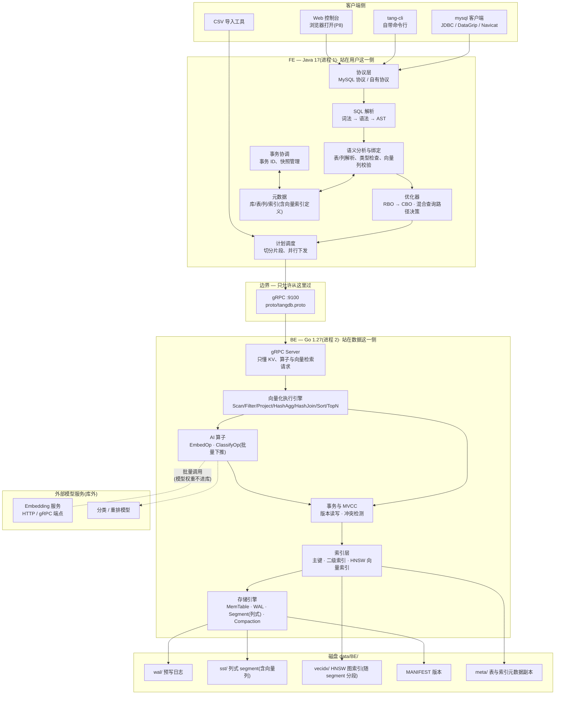

### 4.1 FE 与 BE 的职责边界(铁律)

- **FE 绝不直接读写 BE 的数据文件。** 哪怕只是想"看一眼数据对不对",也必须走 gRPC。
- **BE 绝不知道什么是表、什么是 SQL。** BE 收到的永远是:一段 key 范围 + 一组算子描述(可能包含向量索引检索请求)。表名、列名、join 关系在 FE 就消化完了。
- **模型权重不进库。** BE 只认一个推理端点配置,通过它调用外部模型服务。

任何跨过这条线的实现,跑得再快也算错误实现。理由:Doris 之所以能让 Java 和 C++ 两套东西配合,靠的就是这条线一直没破。

### 4.2 为什么用两种语言

| | FE(Java) | BE(Go) |
|---|---|---|
| 分工 | 翻译用户意图:SQL → 计划 → 算子序列 | 真正搬数据:执行算子、管存储、管事务、管向量索引 |
| 为什么这个语言 | 熟悉、开发效率高;贴近 Doris 的 FE;SQL 解析与协议实现生态丰富 | goroutine 天然适合"前台写 + 后台 compaction";字节与内存布局操作顺手;部署为单个可执行文件 |
| 额外收获 | 协议实现、优化器、代价模型 | 一门新语言、并发、内存布局、图索引算法 |

### 4.3 为什么坚持"不借外力"

存储引擎、执行引擎、优化器、向量索引、协议层,全部自己写。**禁止**引入任何现成引擎或库:RocksDB、LevelDB、Badger、Pebble、SQLite、bbolt、DuckDB、Velox、hnswlib、faiss、Milvus SDK 等,以及它们的任何绑定。

允许的依赖:

- BE:Go 标准库、`google.golang.org/grpc`、`google.golang.org/protobuf`
- FE:`grpc-java`、`protobuf-java`、构建与日志工具
- SQL 解析、HTTP 客户端这类**非核心**能力是否允许引入三方库 → 见 §19 待定项

借了外力,这个项目就没有存在意义。

### 4.4 FE 的元数据存在哪里

**结论:不用任何外部数据库,元数据存进 BE 自己的引擎(系统表)。**

FE 的元数据就是几张表、几列定义、几个索引定义,量极小。为这点数据引入一个外部 MySQL,意味着一整套额外负担:部署要带它、备份要管它、连接要维护、版本还要兼容。更要紧的是——**自己的数据库启动还要依赖别人的数据库,这件事本身就说不通**。

做法:

- BE 预置几张**系统表**(用普通表机制即可实现,不需要特殊代码路径):库、表、列、索引的定义
- FE 启动时读这些系统表,在内存里构建 catalog 缓存
- 任何 DDL 变更,由 FE 组装成一次写入,走 BE 的事务与 WAL 落盘
- 于是元数据**自动**具备:原子写入、崩溃恢复、MVCC 可见性、随 compaction 演进

收获不只是省事:**建表与首次写入数据可以在同一个事务里提交**,DDL 与数据的一致性天然成立,不需要额外的协调机制。

代价只有一个:FE 启动时 BE 必须先起来。这个依赖方向是正常的(Doris、TiDB 同理)——数据层先起,计算层后起。

> 备选方案(不采用):FE 自己维护一套「变更日志 + 定期快照」的文件持久化(类似 Doris FE 的 image)。好处是 FE 不依赖 BE 即可启动;代价是把 WAL + MANIFEST 那套机制在 FE 侧重写一遍,属于重复劳动。

**这条边界要说清两件事**(2026-10-22 评审补强):

1. **BE 不理解系统表,也不需要理解。** 系统表就是**普通 KV**:表 ID 1~15 保留(如 1=表定义、2=列定义、4=计数器),key 由 **FE 编码**、value 由 **FE 序列化**。BE 只认"一段 key 范围",所以"不理解 SQL"和"不需要理解元数据布局"是同一件事的两个说法。
2. **权威数据在哪,恢复就以哪为准。** 元数据的**权威副本在 BE 的系统表里**,FE 内存里的 catalog 只是缓存。所以"FE 写完系统表、还没更新内存 catalog 就崩了"这种担心是不成立的 —— 重启后 FE 从系统表重建缓存即可,不存在需要额外恢复的中间态。

> 原子性边界(P2 期间诚实说明):P2 没有事务,**一次 DDL 写多条元数据记录不保证整体原子**。若在中间崩溃,重启时 FE 加载 catalog 会判定"半套元数据"并**报错停下、指名表**(SPEC-P2 FR-117),不静默忽略、不自动修补。P3 引入批量原子写后,DDL 走一条批记录,这个口子自然关掉。

**P2 的故障模型要写成可注入的用例(评审补强)**:DDL 不是"文档里说不保证原子"就完了,得在**每个持久化步骤之间**强杀并重启验证:

| 注入点 | 期望行为 |
|---|---|
| 建表中途(表定义已写、列定义未写完) | 重启后 FE **启动报错并指名该表**;不静默忽略,不把该表当成"不存在" |
| 建表中途(列定义写了部分) | 同上;错误信息列出**残缺对象**与缺失的列序号 |
| 删表(标 dropped)中途 | 重启后表状态必须明确(要么仍 active、要么已 dropped),不得出现"半 dropped" |
| TRUNCATE(换表 ID)中途 | 重启后表 ID 必须唯一确定;不得出现"新旧 ID 都能查到数据"或"两个 ID 都查不到" |
| 任何失败路径 | **绝不自动重建、绝不把损坏的表当空表重新创建**(这是最容易被"顺手修"掩盖的错误行为) |

**报错要给可操作的修复线索**:错误信息里除了表名,还要给出该表在系统表里的 `table_id` 与涉及的 key 前缀 —— 你手上就有 `put`/`get` 命令行,照这个线索能自己清理掉残记录,而不是只能干看着。

P3 引入原子批写后,验收要升级为:元数据记录 + 数据记录 + 索引记录 + 提交状态**四者在同一批记录内的原子性**(不只是"一次批写整体成功或失败"),以及"批写中途崩溃"的重放判定。

**实现期次:P2**(这一期才引入表与元数据概念;P1 的 FE 只是一个命令行客户端,手上没有元数据)。

**元数据族与系统表保留区(2026-10-23 融入)**

后续期次会长出更多"元数据类"的东西,它们**全部走同一套机制**进来:普通 KV + WAL + 事务 + 崩溃恢复,**不引任何外部元数据库**(D11 不变)。

| 元数据族 | 内容 | 期次 | 用途 |
|---|---|---|---|
| 库/表/列/索引定义 | **库命名空间**(`sys_databases`)+ 库/表/列/索引定义 | P2 起;库表 **P3.5** | catalog 的权威副本 |
| **语义标签** | 表/列/取值的语义标签与其向量 | P8 | 语义检索(AI-13)、text2sql 上下文(AI-12) |
| **任务与任务状态** | 一次性任务、常驻任务、状态机、进度、错误摘要 | P8 | 导入导出任务化(E-04) |
| **血缘** | 表级/列级来源与流向(含导入任务来源) | P13 | 数据血缘自动追踪 |
| **角色与脱敏策略** | 用户/角色/授权、列级掩码与加密策略 | P13 | 最小 RBAC + 策略化脱敏(依赖 D16) |
| **索引推荐与自动动作审计** | 推荐清单、收益估计、每次自动创建/休眠/删除的记录 | P14 | 智能索引(可审计、可回滚) |

两点随之确定的边界:

1. **系统表保留 ID 从 `1~15` 扩到 `1~63`**,用户表自 `64` 起。**但"改常量"不算完,要按下面三条落实(2026-10-23 外部评审提醒)**:
   - **① 维护一张固定的系统表 ID 登记表**(状态分三档:已分配 / 预留 / 未来可能使用);**任何新模块必须来这张表领号,不许自行分配** —— 否则几个模块各占一段、迟早撞号
   - **② 不因为"预留了 63 个"就提前创建一堆空系统表**:只有真正用到的表才在启动时创建(沿用 P2 的幂等创建思路),预留只是**占号**
   - **③ 老数据目录要有明确升级规则,不能只改常量**:P2/P3 期间**已分配的用户表 ID 全部继续有效**(它们不在登记表里);`next_table_id` 只在**新建库**时从 64 起;FE 的表 ID 校验从"`ID ≥ 16` 即用户表"改为"**ID 不在登记表内即用户表**"
2. **这些表都是普通表**:FE 编码 key、BE 只认"一段 key 范围"(与 §4.4 正文同一条边界),所以新增元数据族**不会让 BE 多懂一点 SQL**。

### 4.5 BE 的注册、心跳与状态上报

BE 不是被动等 FE 来查,而是**主动向 FE 汇报自己还活着、以及现在是什么状态**。这是 FE 做任何调度决策的前提。

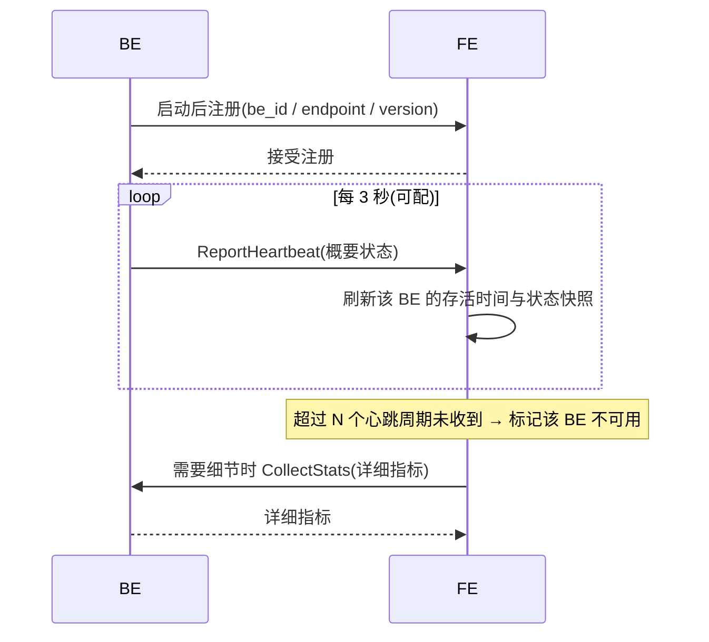

心跳携带的概要状态:

| 分类 | 字段 |
|---|---|
| 身份 | be_id、endpoint、version、启动时间 |
| 存储 | 数据目录、磁盘总量与占用 |
| 内存表 | 当前 memtable 大小、不可变表数量 |
| 磁盘文件 | segment 数量与总大小、WAL 积压量 |
| 后台任务 | flush 进度、compaction 进度 |
| 服务量 | 累计 Put / Get 次数、错误计数 |
| 持久性 | 最后一次成功 fsync 的时间 |

FE 拿这些做什么:

1. **故障感知** —— 超时未上报即标记不可用。这是"BE 挂了"的唯一可靠信号
2. **监控展示** —— P8 的可视化直接吃这份数据
3. **后续调度** —— 负载均衡、副本选择(若将来做分布式)的依据

**推送方向定为 BE → FE**(与 Doris 一致):BE 最清楚自己的实时状态,主动上报比 FE 轮询更及时;FE 也不必为每个 BE 维护定时任务。详细指标按需反向拉取。

**实现期次:P2**(FE 有了元数据、成为真正的协调者之后;P1 的 FE 还只是个命令行壳子)。完整的监控可视化在 P8。


---

### 4.6 FE 的进程形态:常驻服务 + 瘦客户端(2026-10-23,**决策 D20**)

**为什么必须改**:到 P1~P3,FE 一直是"跑一次就是一次会话"的命令行程序 —— 每个 CLI 进程自己持一份 catalog 内存缓存,还顺手兼着监听 BE 心跳。这套形态有两个已登记的毛病:**每个 CLI 各持一份 catalog,跨进程看不到新 DDL**;以及 **每个 CLI 都要抢心跳端口**(P2 §11 的 G3)。

而 **MySQL 协议天然要求一个常驻服务**:JDBC 连接池持有长连接、会话状态(当前库 / 事务 / 会话设置)必须活在服务端、监听端口要一直在。所以 P3.5 起 FE 拆成两个角色:

| 角色 | 进程形态 | 职责 |
|---|---|---|
| **FE 服务进程**(`fed`) | **常驻** | 唯一的 catalog 权威内存缓存;会话管理(每连接一个会话:当前库、事务、写集);SQL 解析 / 计划 / 执行;MySQL 协议监听(多连接);FE 侧 gRPC 服务(BE 注册与心跳);P8 的 Web 控制台、监控、任务列表**都挂在这里** |
| **CLI**(`cli`) | 按需起停 | **瘦客户端**:只负责交互与结果渲染,通过协议连 `fed`(优先复用 MySQL 协议 —— 这样 CLI 与 JDBC 走同一条路,少一套实现) |
| BE | 常驻(不变) | 存储与事务,只听 `fed` 的 gRPC |

一次调整顺带解决四件事:①catalog 只有一个权威内存副本 → **跨会话/跨进程可见性问题消失**;②心跳端口由 `fed` 独占 → **不再"谁先起谁占"**;③`USE db`、事务、会话设置有了正确归属;④P8 的控制台与监控不用再造一个进程。

**代价(别当成零成本)**:

- `fed` 必须处理**真并发会话**(线程池 + 会话隔离)—— 这是新增的一块:P3 的 Executor / catalog 可复用,但要搬进"按会话"的壳里
- **启动形态变了**:起 BE → 起 `fed` → 客户端连接;`scripts/*` 与 Windows 原生脚本(I-10)都按这个顺序写;一键验收脚本改成"连同一个 `fed` 的多个会话",比现在"每条 SQL 起一个新 CLI"更接近真实并发
- 事务与快照语义**不变**:并发验收仍用各自快照的会话做(§18 的对拍口径照旧)

---

## 5. 核心设计决策

这一节把几个"要害选择"摊开,连同不选另一条路的理由。这几条一旦定了,后面所有实现都围绕它们展开。

### 5.1 单引擎,不做行存 + 列存双引擎

| | 双引擎方案(TiDB + TiFlash 式) | 单引擎方案(本项目) |
|---|---|---|
| 做法 | 行存引擎服务 OLTP,另建一套列存引擎服务 OLAP,靠日志同步保持一致 | 一套 LSM 基座,写入时行式、落盘时列式 |
| 优点 | 两个场景都能做到极致性能 | 一套代码、一份数据、一个事务体系 |
| 缺点 | **实现量翻倍;两份数据的一致性同步极复杂;事务跨引擎基本做不了** | 单场景性能不如专用引擎极致 |
| 结论 | ✗ 放弃 | ✓ **采用** |

理由很直接:两套引擎意味着两套存储代码、两套恢复逻辑、两套写入路径,还要解决"什么时候把行存数据同步到列存"这个本质上是分布式一致性的问题。对一个自研项目来说,这是把工作量乘二、把可完成性砍半的做法。

单引擎走通,才有余力去写 AI 能力那部分——而那恰恰是这个项目的差异化所在。

### 5.2 写时行式、存时列式(整个设计的枢纽)

这是 Doris 的做法,也是单引擎能同时撑住两类负载的关键:**写和读对数据布局的诉求正好相反,而在不同时刻满足它们。**

- **写入时**要的是快:一行数据一次性写入,目标是追加、不寻址 → **行式内存(memtable 跳表)**
- **分析时**要的是少读:一次查询可能只看 20 列里的 3 列 → **列式磁盘(每列独立成块)**
- **点查时**要的是精准:按主键定位一行 → 内存里行式跳表直接命中;磁盘上通过主键的 zone map + 索引块定位

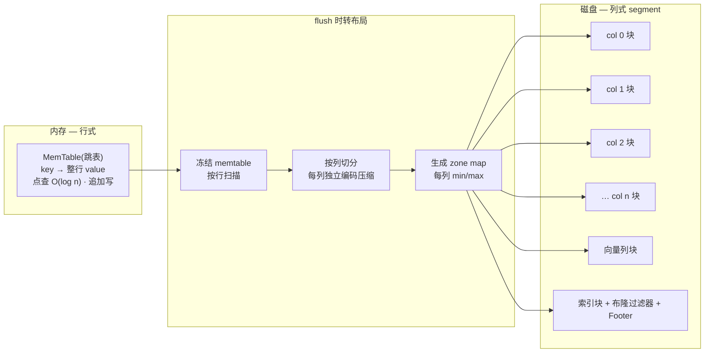

于是同一份数据:写进去是行的形状,落下来是列的形状。**OLTP 的写和 OLAP 的读各取所需,共用一条路径。**

### 5.3 向量索引随 LSM 演进(创新点二的技术核心)

现成向量库的通用做法:一张 HNSW 图常驻内存,数据来了就往图里插。由此产生三个老问题:

1. **内存吃不下** —— 上亿向量就得想办法分片或者放弃
2. **崩了要重建** —— 图在内存里,进程一挂就得从头重建索引,重建期间检索不可用
3. **写与索引难一致** —— 数据写成功但图没更新,或者反过来

我们的做法:**不搞全局大图,而是让每个 segment 自带一段图。**

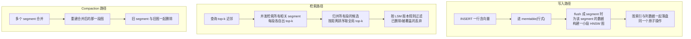

这么设计换来四件好事:

- **持久化天然成立**:图和数据在一个文件体系里,落盘即持久
- **崩溃安全天然成立**:恢复靠 WAL + segment,不需要单独设计索引恢复
- **写入不阻塞检索**:新数据在 memtable 里,检索时作为"最近一小段"参与归并
- **规模可伸缩**:没有一张必须常驻内存的全局大图

代价也很清楚:**查询要跨多个 segment 归并**。所以 segment 数量必须靠 compaction 压住——这正好和 LSM 的目标一致。

### 5.4 为什么先不分布式

"真正可用"不等于"必须分布式"。分布式一旦引入,要面对的是:分片路由、跨节点事务、副本一致性、故障转移、网络分区——复杂度相对单机是指数级上升,而且这些和"把 HTAP 与 AI 做进一个引擎"这个核心目标没有关系。

参考 DuckDB:单机也能成为被广泛使用的分析数据库。

所以:**设计上预留分片概念(key 编码里已经带表 id,天然可扩展为分片键),但本期不实现。**

### 5.5 模型权重不进库

数据库不该背模型文件。设计上只认一个配置:

```toml
[ai]
embedding.endpoint = "http://39.96.62.247:8502/v1/embeddings"   # 外部推理端点
embedding.model    = "bge-large-zh"
embedding.dim      = 768
embedding.batch    = 1024      # 单次批量行数
embedding.timeout  = "30s"
```

换模型、换端点、换显存机器,都只是改配置——不动数据库一行代码。

---

## 6. 存储引擎设计

### 6.1 内存结构

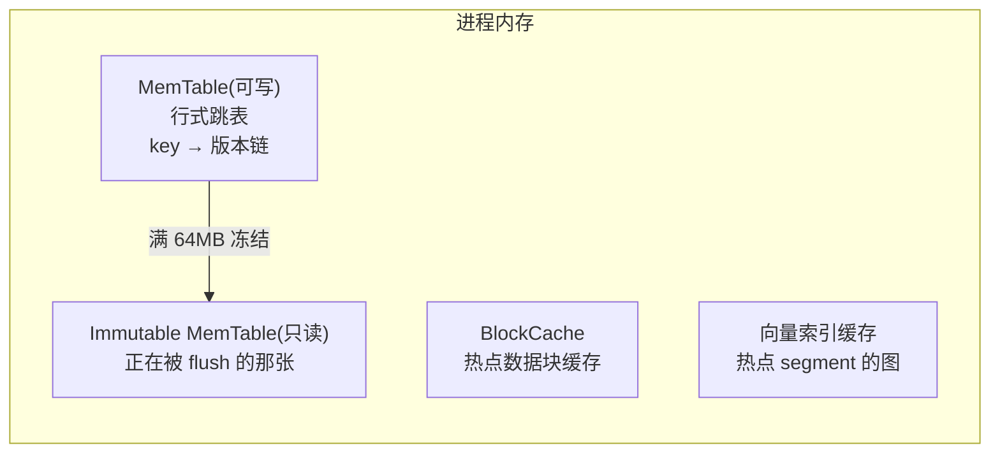

- **MemTable 用跳表**:并发插入友好(锁粒度小)、实现简单、天然有序(范围扫描和有序 flush 都靠它)
- **key → 版本链**:同一个 key 的多个版本存在一起,方便按快照取版本
- **冻结机制**:写满阈值后当前 memtable 变只读,另起一张新的继续写;只读那张交给后台刷盘。**前台写不会因为刷盘而停顿**

### 6.2 WAL 与原子批写(事务的基础设施)

一条 WAL 记录 = **一个 WriteBatch**,里面可以包含任意多个 key 的写入。

这一步是整个事务体系的地基:一个事务要同时改主键记录 + 三个二级索引 + 一处向量列,那就把它们全部塞进同一个 batch 里 —— **一次追加、一次 fsync、要么全在要么全不在**。原子性不需要额外的两阶段提交,靠日志的物理连续性直接拿到。

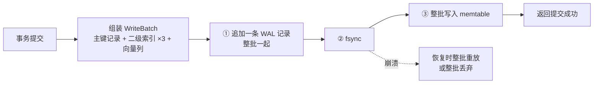

#### 6.2.1 提交协议(2026-10-22 评审补强:**WAL 记录完整 ≠ 事务已提交**)

上面那张图有个容易漏掉的口子:如果"写批记录"和"标记提交"是两步,那么日志刷盘后、提交标记落盘前崩溃,重启时就无法判断该重放还是该丢弃。**所以我们的答案是:不设第二步 —— 提交标记就在批记录里。**

| 要点 | 规则 |
|---|---|
| 提交的唯一判据 | 批记录里带 `commit_ts`(8B)+ 整条 CRC32C。**一条记录完整校验通过 = 这个事务已提交**。除此之外不存在"提交状态"这种东西,也就不存在"记录完整但提交标记缺失"的二义性 |
| `commit_ts` 从哪来 | 提交时从全局原子计数器取号,**写进批记录本身**(不是另写一处);日志里因此自带"序号 → 数据"的完整对应,重放即可重建 |
| 未提交数据的处理 | 事务的写集**先在内存里暂存**,提交那一刻才组装成批记录。也就是说:**未提交的数据压根没有进过 WAL,也没进过 memtable** —— "未提交数据不可见"是天然成立的,不需要可见性标记去事后判定 |
| 恢复判定 | 逐条重放;遇到"读不满一条"或 CRC 不对 → 在此截断、丢弃其后内容(该事务视为未提交),服务照常启动。**不得只凭"这条记录 CRC 成功"就认定提交 —— 要凭整条记录完整** |
| 序号不回退 | `MANIFEST` 里持久化 `last_commit_ts`(每次 flush 与启动时刷新)。即使 WAL 已被回收、重放看不到旧记录,重启后事务序号也从 `max(MANIFEST.last_commit_ts, 重放所见最大 commit_ts) + 1` 续增。**宁可跳号,绝不回退** |
| 索引与数据的一致性 | 主键记录 + 全部受影响的二级索引记录 + 向量列,全部塞进**同一条**批记录 → 原子性来自日志记录的物理连续性,不需要两阶段提交 |
| 崩溃注入验收点 | 提交前崩(应全无)、WAL 已刷盘但 memtable 未写崩(重放后应全有)、memtable 写完但未返回 OK 崩(重放后应全有)、WAL 尾部截断(该事务整体丢弃) |
| 部分写的判定 | 记录头部含**载荷长度**,CRC 覆盖"类型 + 长度 + 载荷"。中途断电只会出现"读不满一条"或"CRC 不符",两者都按未提交整体丢弃 —— 不存在"半条记录被当成完整记录" |
| 序号空洞 | 取号后崩溃(该批未落盘)会留下**空洞**。空洞**无害、不填补**:`commit_ts` 只用于**可见性大小比较**,协议里不存在"序号必须连续"的假设。任何依赖连续性的设计(例如按号段做区间判断)都不允许出现 |
| 返回成功的唯一条件 | 批记录 `fsync` 返回后才向客户端回 OK。**提交成功 = 记录已持久化**,没有第二个开关 |
| 单记录设计的收益 | 因为提交标记与写集在**同一条记录**里,评审提出的两类危险("COMMIT 在文件里但未持久化"、"COMMIT 已持久化但引用的写记录不完整")在我们这里**不存在** —— 它们都是"两条记录"设计才有的故障类 |

> `fsync` 只解决"落盘语义",它本身不是提交协议 —— 提交协议由**记录的原子性 + 序号持久化**这两件事共同保证。

### 6.3 磁盘:SSTable / Segment

每个 flush 生成一个 **segment**(一行 segment 的行数上限建议 100 万行,便于并行)。

segment 内部结构:

```
┌─────────────────────────────────────────────┐
│ Footer(固定 48B)                          │
│   magic · version · 各区块偏移 · 校验和    │
├─────────────────────────────────────────────┤
│ 列块 n(最后一个数据列 / 向量列)          │
├─────────────────────────────────────────────┤
│ …                                           │
├─────────────────────────────────────────────┤
│ 列块 1                                      │
├─────────────────────────────────────────────┤
│ 列块 0                                      │
├─────────────────────────────────────────────┤
│ ZoneMap:每列的 min / max / null 统计      │
├─────────────────────────────────────────────┤
│ Index Block:行号 ↔ 位置                   │
├─────────────────────────────────────────────┤
│ Bloom Filter(按需,主键/高选择性列)      │
└─────────────────────────────────────────────┘
```

关键点:

- **每列独立成块**,查询只读用到的列 → 这就是"列裁剪"的物理基础
- **每个列块内部再切成小 chunk**(如 4096 行/chunk)并带自己的 zone map → 扫描时可以跳过整块不满足谓词的数据
- **向量列特殊处理**:定长浮点数组,按 chunk 连续存放,便于批量计算;不做有损编码(会破坏距离计算精度)
- **文件写完即不可变**:segment 一旦落盘就不再修改,这是崩溃安全的根本前提

#### 6.3.1 点查路径:现在怎么查,以及要补什么(2026-10-22 评审补强)

**现状(P1 已实现,诚实说明)**:`Reader.Get(key)` 是 —— 逐 chunk 看 ZoneMap 的 `[keyMin, keyMax]`,落在区间内才读该 chunk 的 **key 列块 + value 列块**(每块 4096 行),解码后**块内线性比较**。ZoneMap 单独确实不够,但我们也已经有 **Index Block**(每 chunk 首 key + 文件偏移),只是点查路径还没用它做二分。

优化阶梯(登记为 P5 读路径优化,不提前做):

| 级别 | 做法 | 收益 |
|---|---|---|
| ① 已做 | ZoneMap 逐 chunk 过滤;命中即读块;memtable → 不可变表 → segment 新到旧**命中即返回** | 把整文件扫描压到"少数 chunk" |
| ② 待补 | **Index Block 按 chunk 首 key 二分**定位唯一候选 chunk | 免去逐 chunk 的线性比较 |
| ③ 待补 | chunk 内加**每行 key 偏移数组**,块内二分 | 块内从 O(4096) 线性比较降到 O(log 4096) |
| ④ 可选 | **块级布隆过滤器** | 减少"key 不在块里却读了整块"的空读 |

**量化口径**:点查一次最多读 **1 个 chunk × 2 个列块**(约 4096 行 × (key+value)),跨 segment 次数受"读放大 ≤ 2 个 segment"这一 P5 门限约束(见 §18)。

**读放大观测项(P1 起就记录,先不设门限 —— 评审补强)**:优化要能证明"读放大降了多少",而不能只说"变快了"。因此从 P1 起就采集:

| 观测量 | 含义 |
|---|---|
| `chunk_reads` | 单次点查**读取并解码**了多少个 chunk |
| `key_compares` | 单次点查在块内比较 key 的**平均次数** |
| `bytes_read` | 单次查询实际从磁盘读了多少字节 |
| 上述三项 × 数据量 | 数据量从 1 万 → 100 万 → 1000 万行时,P50/P95/P99 与上面三个计数如何变化 |

落点:BE 已有心跳上报通道(§4.5),这三项计数**加进去即可**,不需要新机制。这样到 P5 做②③④级优化时,拿的是同一套口径的前后对比,而不是两套不可比的数据。

> 措辞澄清(评审提出的边界):**布隆过滤器是补充、不是替代** —— 它只能快速判断"key 可能存在",不能定位 chunk、也不能替代块内有序查找。所以阶梯里②(Index Block 二分)与③(块内偏移数组)是**主线**,④(布隆)是可选增益。

### 6.4 Compaction

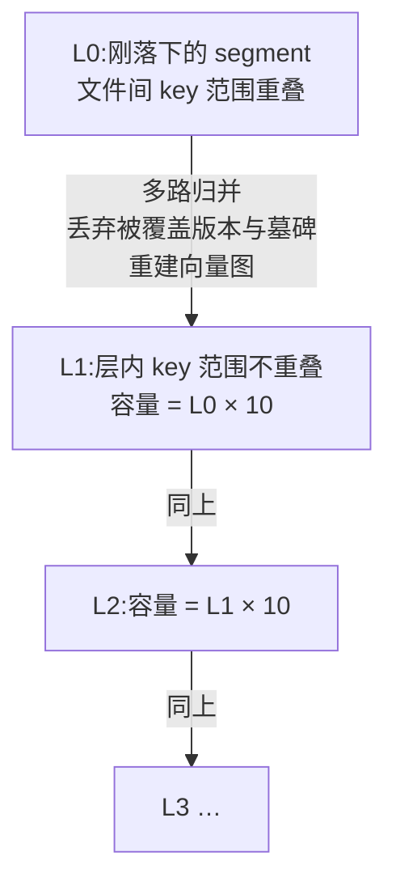

- **触发**:某层文件数/大小超阈值
- **策略**:分层(leveled),同一层内 key 范围不重叠 → 查一层最多命中一个文件,读放大可控
- **合并时做的事**:多路归并排序、丢弃被覆盖的旧版本、丢弃墓碑、**重建受影响的向量图段**
- **不能乱删**:低于最老活跃快照的版本才能回收(见 6.5)

### 6.5 版本清理(GC 水位)

MVCC 意味着同一个 key 会有很多历史版本。清理规则:

> **只回收"早于当前最老活跃快照"的版本。**

如果有个长事务已经跑了十分钟,那么这十分钟内的所有历史版本都必须保留——否则它读到的就是被改过的世界。这是 MVCC 系统里最容易被忽略、也最容易出难查 bug 的地方。

精确口径(2026-10-22 评审补强):

- **GC 水位 = 当前最老活跃快照序号**;compaction 只回收 `版本.commit_ts < 水位` 的版本。等于水位的版本必须保留(边界最容易错一位)
- 水位本身**不持久化**:重启后活跃事务为零,水位即"当前最大 commit_ts" —— 因为没有活跃读者,历史版本可以放心回收
- 墓碑同样按此规则回收:只有当**墓碑之上的所有旧版本都可回收**时,墓碑本身才能删(否则旧的快照会读不到"已删除"这个事实)
- 长事务是水位停滞的唯一来源,所以活跃事务表必须有上限告警(超过阈值打日志),这是后续 P8 监控的一项指标

---

## 7. 数据模型与 key 编码

整个引擎只有一种东西:**有序的 key-value**。表、索引、版本,全部靠 key 编码区分。这一节是引擎的"地址空间规划"。

### 7.1 编码布局

| 段 | 长度 | 含义 |
|---|---|---|
| 表 ID | 4 字节 | 哪张表 |
| 索引 ID | 4 字节 | 0 = 主键索引;1..n = 二级索引;向量索引挂在其所属的索引下 |
| 索引列值 | 变长 | 主键值,或二级索引的列值(有序编码,保序) |
| 主键值 | 变长 | 二级索引里用来指回主键;主键索引里为空 |
| 版本号 | 8 字节 | **倒序存储**(大数在前)→ 新的版本排在前面 |

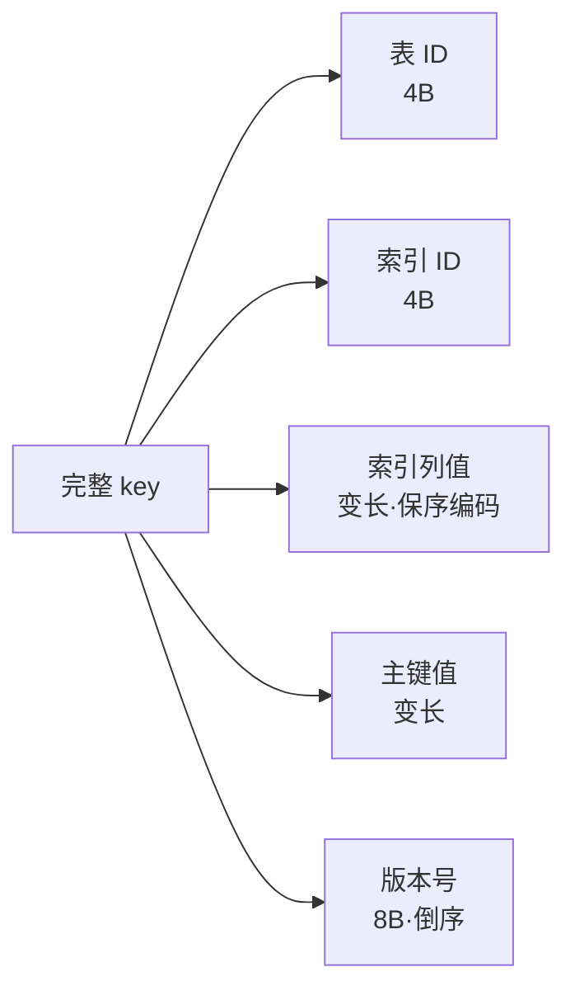

**版本号倒序**是一个关键技巧:同一个 key 的多个版本按时间从新到旧排列,所以

- 读最新版本 = 读第一条
- 按快照读 = 从前往后找第一条"版本号 ≤ 快照"的,通常就是第一条
- 范围扫描时,每个 key 的旧版本自然被跳过

**⚠️ 已知约束(2026-10-23 实现期发现,I7)**:**"原始字节序 = 用户键序"只在"用户键两两互为前缀"不成立时才等价**。完整 key = 用户键 + 8 字节版本段,所以裸 KV 层里 `key-1` 与 `key-10` 这种**互为前缀**的键,其原始字节序与用户键序不一致:

- **SQL 路径是安全的**:FE 的主键保序编码(数值定长 / `VARCHAR` 带 `0x00` 终止符)保证 SQL 生成的用户键**两两不互为前缀**(§5.2 的设计本意就在这里)
- **裸 KV 路径不安全**:P1 的 `crash-test.sh` 用的是 `key-1`/`key-10` 这种原始键 —— 它的**点查与冲突检测**已按"以用户键为前缀的原始区间"额外处理(实测 0 丢失),但**原生范围扫描**在这类键上不保证用户键升序
- **P4 立规约时必须正面回答**(索引 key = 表 ID + 索引 ID + 索引列值 + 主键值 + 版本,级联的边界靠各段的编码本身自定界来保证):要么给用户键加**分隔/转义**保证前缀自由,要么明确"**不支持任意裸 key 的范围扫描**"

### 7.2 具体例子

表 `orders`,表 ID = 1,主键 `order_id`,在 `category` 上建了二级索引(索引 ID = 2):

```
主键记录:
[00 00 00 01][00 00 00 00][…order_id=9527…][][…版本 100…]

二级索引记录(category = '数码'):
[00 00 00 01][00 00 00 02][…'数码'…][…9527…][…版本 100…]
```

查"category='数码' 的所有订单",就是对 `[表1][索引2]['数码']` 前缀做一次范围扫描 —— 有序 key 天然做到这一点。

### 7.3 值(value)的编码

- **正常行**:列值按表定义顺序序列化(NULL 用位图单独标记),写入列块时按列拆开
- **墓碑(tombstone)**:一个特殊标记,表示"这行被删了"

删除不是真的擦掉,而是**追加一条墓碑**。查到墓碑 = 命中,返回"不存在";真正的物理清除留给 compaction。这是 LSM 的既定代价:删除也是写。

---

## 8. 事务与 MVCC

### 8.1 版本与快照

- 全局递增的**提交序号**(TSO 的极简版,单机一个原子计数器;取号时机是**提交时**,见 §6.2.1)
- 每个事务开始时**固定一个快照点**(快照隔离的核心)
- 一个版本对某快照可见的条件:`版本提交序号 ≤ 快照序号`,且该版本未被回滚

精确化(2026-10-22 评审补强,把"简单加个版本号"补成真 SI):

| 问题 | 我们的答案 |
|---|---|
| 快照序号取自哪里 | **已提交水位**,不是事务 ID。事务开始时取"当前最大已提交 commit_ts",因此看不到任何当时尚未提交的版本 |
| 并发提交怎么排序 | 提交点在原子计数器上**串行取号**,取到的号写进批记录(§6.2.1)。号与日志一一对应,重放可重建 |
| 同事务多次改同一行 | 写集在内存里按 key 覆盖,**只落最终版本**,不留中间版本(中间态对任何人也无意义) |
| 写写冲突怎么判 | 提交时对写集里每个 key 检查:"该 key 的**最新已提交版本**是否晚于本事务的快照"。是 → 冲突,报错让调用方决定重试或放弃;不是 → 放行。**绝不静默覆盖** |
| 索引与主键 | 同一条批记录里原子生效(§6.2.1),不存在"索引查得到、数据查不到"的中间态 |
| 长事务与 compaction | 版本保留水位见 §6.5 |
| 崩溃恢复后的序号 | 从 `max(MANIFEST.last_commit_ts, 重放所见最大 commit_ts) + 1` 续增,不回退、可跳号 |
| 回滚 | 回滚 = 写集直接丢弃(**从未落盘**),不需要"反写旧值",也不需要回滚标记 |

#### 8.1.1 版本可见性与保留(把"水位"写成能逐条打勾的规则)

**读规则**:快照 `s` 读到的版本 = 满足 `版本.commit_ts ≤ s` 的**最大**那个版本。用评审给的例子(同一主键 V1@10、V2@20、V3@30):

| 快照水位 s | 读到 | 说明 |
|---|---|---|
| 15 | **V1** | 只有 V1 可见;这就是"活跃快照挡住了回收"的场景 |
| 20 | **V2** | V3 在快照之后,不可见 |
| 25 | **V2** | 水位在两个版本之间,取 ≤ 水位的最新 |
| 30 | **V3** | 最新版本 |

**保留规则(不变量,compaction 必须遵守)**:水位为 `W` 时,对每个主键

1. **必须保留**「`commit_ts ≤ W` 的最大版本」—— 称**基版本**。缺了它,水位读者就永远读不到正确值
2. **必须保留**所有 `commit_ts > W` 的版本(它们对未来快照可见,且随时可能被新读者需要)
3. **可以回收**「`< W` 且非基版本」的中间版本(上例中 W=15 时,V2 与 V3 保留、V1 是基版本必须保留;W=25 时 V2 是基版本必须保留,V1 可回收)

> 这条比"保留水位以下的全部版本"精确得多:同 key 只需保住**一个**基版本,其余中间版本随便回收。这也是写放大能被压住的关键。

**墓碑回收条件**:只有当「墓碑自身 `commit_ts < W`」**且**「该 key 在水位以下已无更早版本」时,墓碑才可删 —— 否则水位读者会把"已删除"读成"不存在过",语义就错了。

**活跃快照结束之后**:水位自然推进到下一个最老活跃快照;下一次 compaction 按新水位回收。**水位本身不持久化**(重启后无活跃事务,水位 = 当前最大 `commit_ts`)。

**compaction 与并发写重叠时的三条保护**(评审点到的风险,补上机制):

1. compaction 的输入**只允许是已冻结、不可变的 segment**,绝不读写"正在被写入的 memtable" —— 因此新写入天然不会被覆盖
2. 产物是**新文件**;MANIFEST 原子切换后才生效(承 P1 的规则:新文件落盘 → 原子更新 MANIFEST → 之后才允许回收旧文件)
3. 旧 segment 与旧图**不能立刻删**:必须等可能仍在读它们的读者退出(读者引用计数/文件句柄),否则正在跑的查询会读到被删文件

**`max(已见 commit_ts) + 1` 的前提(评审要求写明)**:

- 该式成立的前提是"**所有已提交的序号都能从 WAL + MANIFEST 里恢复出来**"。数据一旦进 segment、WAL 被回收,序号信息就只剩 MANIFEST 这一处
- 因此给 MANIFEST 加一条**维护义务**:每次 flush / compaction 产出新 segment 时,`MANIFEST.last_commit_ts` 必须 ≥ 本次产出数据中**最大**的 `commit_ts`;启动恢复时取 `max(MANIFEST.last_commit_ts, 重放所见最大 commit_ts) + 1`
- 违反这条义务的后果是**序号回退** → 旧版本会"看起来比新版本新",属于最危险的一类 bug,必须有专门用例覆盖

### 8.2 提交路径

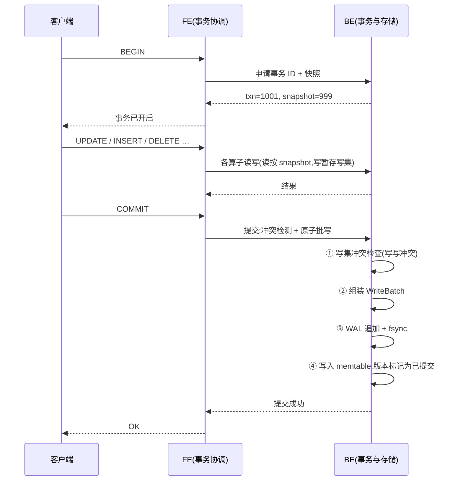

提交的崩溃判定(与 §6.2.1 一致):

- **成功返回过 OK 的事务,重启后必然存在** —— 因为 OK 只在"批记录已 fsync"之后才返回
- **没有成功返回的事务,重启后必然不存在** —— 写集没进日志、没进内存,没有任何残留
- 恢复时"记录完整"即已提交;"不完整/CRC 错"即整条丢弃(未提交)
- 崩溃注入点固定四处:提交前、WAL 刷盘后、memtable 写完后、WAL 尾部截断

### 8.3 隔离级别路线

| 阶段 | 级别 | 备注 |
|---|---|---|
| 起步 | **快照隔离(SI)** | 读写不阻塞;写写冲突检测;不会出现脏读、不可重复读、幻读 |
| 进阶 | **可串行化(SSI)** | 在 SI 基础上追踪读写依赖,发现潜在串行化异常时中止事务 |
| 不做的 | 读未提交、可重复读的间隙锁实现 | SI 已覆盖大部分实际需求 |

### 8.4 并发写:多写者

memtable 用跳表,支持并发插入,所以**多个事务可以同时往同一个 memtable 里写**——这是"高并发写入"这一条能力的实现基础。冲突只发生在"同一行的写写冲突"上,由提交时的冲突检测发现。

---

## 9. 向量索引设计(创新点二)

### 9.1 HNSW 基础

HNSW(Hierarchical Navigable Small World)是一张多层图:

- 上层稀疏、跨度大 → 用来快速跳到目标附近
- 下层稠密、跨度小 → 用来精确找邻居
- 检索:从顶层入口出发,逐层贪心向下,到最底层做带宽度限制的搜索(`ef` 参数控制搜索宽度与召回率的权衡)

### 9.2 我们的改造:分段图 + 归并检索

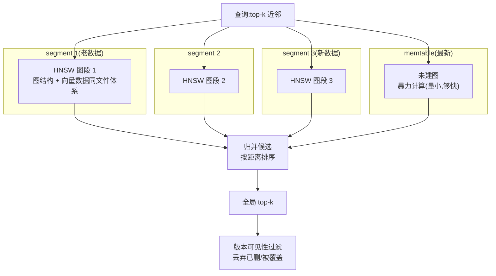

三个设计要点:

1. **新数据不建图**。memtable 里的数据量小,直接暴力算距离反而更快、更准(没有召回损失),也没必要在内存里维护图结构。
2. **每个 segment 一段图**,检索时并发查询所有相关段,各自出 top-k,再归并。
3. **compaction 时重建受影响的图段** —— 这是唯一会做图构建的时机,而且是在后台。

### 9.3 删除与更新的处理(含"过滤条件下取不满 K 条"的解法)

向量数据的删除同样走墓碑:检索结果出来后,用 LSM 的版本可见性规则过滤掉已删除的项。

**评审指出的真问题**(2026-10-22 补强):如果"每段先取 top-k → 再按 MVCC/条件过滤",过滤后可能不足 K 条,而且**把候选量简单放大到 1.5K 并不解决问题** —— 失效比例不固定,可能是 5%,也可能是 95%。解法:

| 手段 | 规则 |
|---|---|
| **可迭代候选扩展** | 每段先取 `ef` 个候选 → 归并 → 过滤 → 若有效候选 < K,**把 `ef` 翻倍重试**(段级候选同步扩大),直到满足 K 或达到上限 `ef_max` |
| **暴力兜底** | 当"候选集合本身已经很小"(如过滤后候选 < 1 万行)或段数很少时,**直接在这批候选上精确计算距离** —— 小集合的暴力是 O(n)、零召回损失,比反复扩图更快也更准 |
| **精确模式开关** | 查询可显式要求精确检索(`exact`),用于对拍与召回率测试;ANN 结果在文档与 `EXPLAIN` 里都标注为**近似** |
| **召回验收矩阵** | 以暴力精确检索为基准,按 **删除率 × 更新率 × segment 数 × 过滤选择率** 组矩阵测召回率,目标 ≥ 95%(AI-10) |

这比维护一张"可变更的全局图"简单得多,也正确得多。真正麻烦的是**图与 segment 的版本绑定**:图段必须与它所属 segment 同生命周期 —— 图构建期间读旧图、新图写完并进 MANIFEST 后才发布、旧图随旧 segment 一起回收,这些顺序在 P7 规约定死。

**停止条件要分三类写清(评审补强 —— "凑够 K 条"不等于"Top-K 正确")**:

| 条件 | 判据 | 说明 |
|---|---|---|
| 数量条件 | 有效候选数 ≥ K | **只说明条数够,不说明质量够**。近似检索里"够 K 条"完全可能是错的 |
| 预算条件 | 扩展轮数 / 访问节点数 / 延迟预算 是否用尽 | 防止为了凑 K 条把查询拖成"暴力扫描的近似版" |
| 质量条件 | 对拍精确检索的 **Recall@K ≥ 目标**(≥95%) | 这是唯一能证明"结果对"的条件;按 §9.3 的矩阵验收 |

**预算用尽仍不足 K 条时的行为**(不允许把近似偷偷包装成完整精确的 Top-K):

1. 默认策略:**按配置回退到精确检索**(数据量在阈值内时);此时候选集合已经很小,暴力的代价可控
2. 无法回退时(数据量超阈值):返回**不足 K 条**的结果,并在结果里**显式标记 `partial = true`** 与"已访问候选数"
3. 无论哪种,**结果自描述**:返回结构里带 `approximate`、`ef_used`、`candidates_examined` 三个字段,让上层(包括 Web 控制台与 `EXPLAIN`)能如实展示这次检索是近似的还是精确的

**回归要求**:任何改动(距离度量、图参数 `ef`、过滤逻辑、MVCC 过滤参与时机)都必须**重跑召回矩阵** —— 召回率是会悄悄退化的指标,不重跑就等于没测。

### 9.4 距离度量与精度

- 支持 **L2(欧氏距离)**、**余弦相似度**、**内积**
- 向量统一用 `float32` 存储,**不做有损压缩**(量化会改变距离关系,影响召回);如果要压缩,只考虑 float16 这类有位宽但保留单调性的方案,并作为可选项
- **召回率可测**:提供脚本用暴力计算的结果做基准,统计 ANN 召回率(对应能力 AI-10)

---

## 10. 推理下推与混合查询

### 10.1 推理下推:A-函数当算子跑

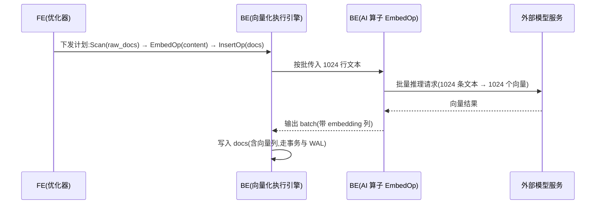

要点:

- **按批调用**,不是一行一次 —— 这是吞吐的关键。1024 行一次 HTTP 请求,和 1024 次请求,差两个数量级
- **模型权重不进库**,只认端点配置
- **失败处理**:超时重试(指数退避 + 重试上限 + 连续失败熔断);单批失败可拆小重试;整批失败则该批次不进入写路径(见下)
- **幂等与副作用**(2026-10-22 评审补强 —— 数据库撤不掉已经完成的外部调用):
  - **幂等键** = `hash(模型版本 + 向量维度 + 规范化后的文本)`;同键请求**永不重复调用模型服务**
  - **批次 ID** = `(算子实例, 批次序号)`,随日志与错误信息一起输出,便于排查"这批到底调过几次模型"
  - **结果缓存**:BE 内存 LRU(按幂等键),重复内容复用结果;缓存命中率作为可观测指标
  - **返回校验**:向量维度 / 数值合法性 / 模型版本与配置不符 → 直接失败,**绝不写入半成品向量**
  - **一致性边界**:推理放在**写之前** —— 推理成功才组装批记录(§6.2.1),推理失败则一个字都不写。所以"外部调用成功但数据没提交"不会产生脏数据,只可能产生一次**可被缓存复用**的多余调用
  - **外部服务不可用**:受超时与事务取消控制,不静默降级成空向量或零向量
  - **可重复性说明**:一条 SQL 的批量推理**不做跨行原子性承诺**(那是 P3 事务的事);但**同一行**的向量与其他列值一定在同一条批记录里,不会拆开
- **可选缓存**:同一条 LRU 即上面说的结果缓存(不再单列)
- **与向量化执行引擎同语义**:EmbedOp 输入输出都是 batch,和 Filter / Project 这些算子完全一致,可以自由组合

### 10.2 混合查询:先过滤还是先检索

这是创新点三。一条查询同时有结构化条件和向量相似度:

```sql
SELECT id, title FROM docs
WHERE  category = '健康'                      -- 结构化条件(选择率约 5%)
  AND  created_at > '2026-01-01'              -- 结构化条件
ORDER  BY l2_distance(embedding, ?) LIMIT 10  -- 向量检索
```

两种执行方式,代价差别巨大:

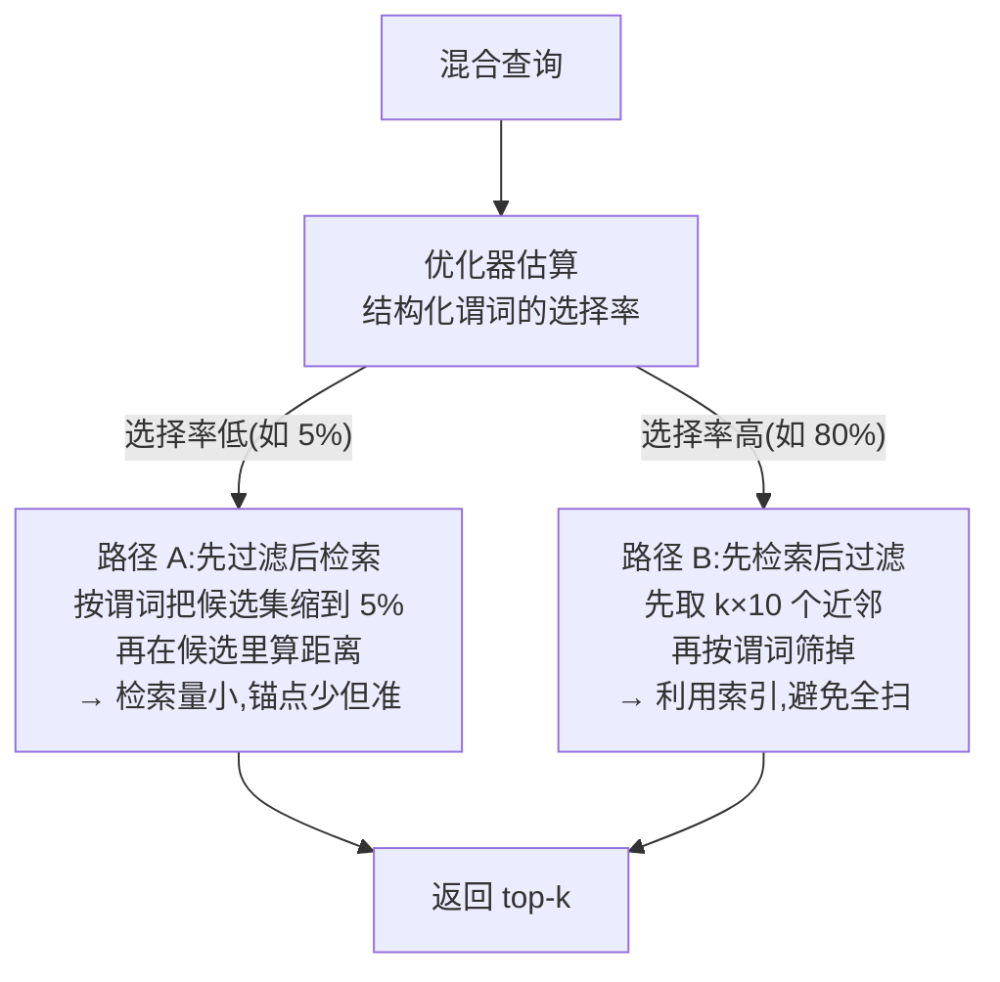

- **谓词很挑数据时**(比如只筛出 5%),先过滤再检索:检索的数据量瞬间小一个数量级
- **谓词不挑数据时**(比如筛掉 20%),先检索再过滤:索引直接把候选缩到几十上百条,比扫全表快得多
- **决策依据**:表统计信息里的选择率估计。这正是 §2.1 里 A-12(统计信息)必须做的原因——没有统计信息,这个决策就是瞎猜

现成向量库做这件事通常只有一条路径(常见是先检索后过滤,或者要求用户自己写 hint),选择错了性能差几十倍。**把它做成优化器的代价决策,是这个项目能讲出差异的地方。**

语义细节(2026-10-22 评审补强 —— 先把语义做对,再谈自动选路):

| 问题 | 我们的答案 |
|---|---|
| 实现顺序 | **精确向量检索(可对拍)→ ANN → 最后才让 CBO 自动选路**。顺序反了,召回问题分不清是 HNSW 的锅还是选路的锅 |
| "先过滤后检索"怎么做 | 把过滤结果作为**允许集**下推给向量检索算子(主键列表/布隆),图遍历只在允许集内展开候选 |
| "先检索后过滤"怎么定量 | 候选扩展量**不写死倍数**:用 §9.3 的可迭代扩展,直到有效候选够 K 为止 |
| 统计信息过期怎么办 | **不赌**。选择率不可信时退化为"先检索后过滤 + 可迭代扩展" —— 这条路只依赖候选量、不依赖选择率估得准不准;而"先过滤后检索"一旦高估了过滤效果就会白扫 |
| 小表/低选择率 | 行数低于阈值(如 1 万行)或过滤后候选低于阈值 → **直接精确暴力计算**,不建图也不选路 |
| ANN 的对外语义 | 结果标注为近似;可显式切精确模式;`EXPLAIN` 里写出走的是图检索还是精确计算 |

---

## 11. 查询执行与优化器

### 11.1 从 SQL 到结果的全链路

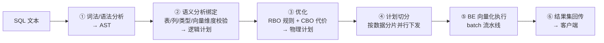

### 11.2 逻辑计划 → 物理计划

先按"怎么写"生成逻辑计划,再按"怎么跑最快"选物理实现:

| 逻辑算子 | 可选物理实现 |
|---|---|
| 扫描 | 主键点查 / 主键范围扫描 / 二级索引扫描 / **向量索引扫描** / 全表列式扫描 |
| 连接 | Hash Join / Sort-Merge Join / Nested Loop Join |
| 聚合 | Hash Aggregate / Sort-based Aggregate |
| 排序 | 内存排序 / 外部归并排序(数据超内存时) |
| 限制 | TopN(堆)/ Full Sort + Limit |

### 11.3 向量化执行的关键约定

- 所有算子**输入输出都是 batch**,统一结构:`{列数, 行数, 每列的数据数组 + 有效性位图}`
- 算子之间**流水线**式拉取(pull 模型),不物化中间结果
- **有效性位图**单独处理 NULL,而不是每行带一个标志位 —— 这是列式执行的经典做法,也让 NULL 判断变成位运算
- 标量函数按列批量计算,而不是按行循环调用

### 11.4 优化器演进

| 阶段 | 能力 |
|---|---|
| 起步 | **RBO**:固定规则(谓词下推、列裁剪、常量折叠、Limit 下推) |
| 进阶 | **CBO**:基于统计信息估算行数与代价,选择连接顺序与物理算子 |
| 特色 | **混合查询的路径决策**(§10.2):这是必须靠 CBO 才能做对的部分 |
| 自适应(**归 P14**,原"P8 之后候选"已细化) | 运行时反馈参与计划:实际行数与估算偏差大时改策略;慢查询驱动的计划摘要与索引建议。红线:建议必须**可验证**,模型不得参与执行正确性判断 |

**自适应档在 P14 落成两件事(2026-10-23 融入)**:

1. **智能索引**:监控 SQL 负载 → 发现"高频且缺索引"的查询 → 生成候选索引 + **代价评估** → 低峰期(用 E-04 的常驻任务)自动创建;低收益索引自动**休眠**(不参与计划、不删数据)、更久不用才删除;全过程给 DBA 推荐清单与依据,可一键回滚。**守卫参数(2026-10-23 外部评审提醒)**:观察期(先只看不动)、**收益阈值**(低于阈值不建)、**冷却期**(刚动过的索引短期内不再动)、**分档开关**(默认"只推荐不自动",确认收益后逐档开自动) —— 防止"来回建删"把库折腾得不稳定
2. **异常根因诊断**:把慢查询、错误率、事务冲突率、磁盘/内存、恢复时长等多信号聚合成「症状 → 证据 → 结论」三段式输出 —— **每条结论必须给证据**,不许给玄学结论。**口径(2026-10-23 外部评审提醒)**:第一版**完全用确定性规则**(模型不参与判断);输出带**证据来源、置信程度、建议操作、规则版本**;证据不足时**显式写"证据不足"**,不许把相关性当因果;相同输入 + 相同规则版本 → 结果可复现

红线(D18 建议稿,待拍板):自动动作**只影响性能、绝不改变查询结果**、可整体关闭、有审计、可回滚,且**不得**自动改动主键/唯一约束。

---

## 12. 索引体系

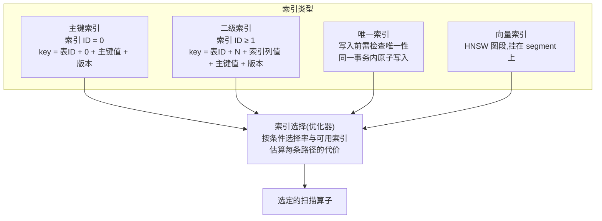

**回表**:二级索引里只有索引列和主键,查询需要其他列时,得拿主键回主键索引再取一次。这是所有二级索引的固有代价,优化器要把它算进代价里。

**原子性**:修改一行数据时,主键记录和所有受影响的二级索引记录、向量列,全部进同一个 WriteBatch —— 保证"索引和数据永远一致",不会出现查得到索引却查不到数据的鬼状态。

**索引类型的演进登记(2026-10-23 融入)**:

| 新增索引 | 说明 | 期次 |
|---|---|---|
| **表达式 / 路径索引** | 对 `json_extract(doc,'a.b')` 这类**确定函数**的表达式值建索引(不是对 JSON 整体) | P11 之后 |
| **空间索引** | `GEOMETRY` 用 geohash 网格 + 前缀范围扫描(或自研简易 R 树);与向量索引**并列**,不是它的特例 | P12 |
| **可休眠索引(生命周期机制,不是新算法)** | 索引的"启用 / 休眠"是一种**状态管理 + 优化器可见性**机制,对**所有索引类型通用**(主键 / 二级 / 唯一 / 向量 / 空间 / 表达式都适用),不是又造一种索引 —— 休眠时不参与计划选择但不删数据,重新启用即刻生效;这是 P14 智能索引的执行底座 | P14 |

三条共同约束(对所有索引一律成立):**随 segment 落盘、随 compaction 演进、崩溃重启后直接可用**;**与数据同一批原子写入**(上一条);**任何索引的存在与否都不得改变查询结果**(只影响代价)。

**统一什么、不统一什么(2026-10-23 外部评审提醒)**:上面几种索引的**底层结构本来就不同**(表达式索引用"表达式值的有序编码"、空间索引用网格/简化 R 树、可休眠是状态位)—— 该统一的是**生命周期、元数据、持久化与恢复协议**,不必、也不应该强求它们共享同一套索引实现。

---

## 13. 磁盘布局与文件格式

### 13.1 目录结构

```
data/BE/
├── MANIFEST-000007              版本记录:当前有效的 segment 与 WAL 位置
├── CURRENT                      指向当前 MANIFEST
├── wal/
│   └── 000012.wal               预写日志(可滚动、可删除)
├── sst/
│   ├── L0/
│   │   ├── 000045.seg           列式 segment
│   │   └── 000046.seg
│   └── L1/
│       └── 000044.seg
├── vecidx/
│   └── 000045.hnsw              与 segment 对应的 HNSW 图段
└── meta/
    └── catalog.json             FE 元数据的本地副本(用于恢复校验)
```

**后续目录的登记(2026-10-23 融入;未开工的一律标"计划")**:

| 路径 | 内容 | 期次 |
|---|---|---|
| `blob/` | **大对象溢出页**:超过阈值的 `TEXT/BLOB` 值单独成页,行里只存指针 + 长度 + 校验和(计划) | P11 |
| `geo/` | **空间索引文件**:与 segment 对应的空间网格/索引段(计划) | P12 |
| `meta/*.json` | 任务、血缘、脱敏策略、索引推荐**不落独立文件** —— 它们都是**系统表**(走 `sst/` 与 `wal/`),见 §4.4 的元数据族表 | P8/P13/P14 |

> 时序优化**不新增目录**:时间列的 delta 编码写在 segment 的列块里(与既有列存同一套文件格式,只是编码方式不同)。

### 13.2 WAL 记录格式

```
┌──────────┬────────┬──────────┬──────┬──────────────────────────────┐
│ CRC32C   │ 类型   │ 长度     │ txn  │ 载荷:一批 KV(可含多个 key)  │
│ 4 字节   │ 1 字节 │ 4 字节   │ 8B   │ batch: [klen|k|vlen|v] × n   │
└──────────┴────────┴──────────┴──────┴──────────────────────────────┘
```

- **CRC32C**:恢复时逐条校验;校验失败说明这是崩溃时写坏的最后一条,就此停止重放
- **事务 ID**:恢复时用来判定该批是已提交还是未提交
- **一批多 KV**:事务原子性的物理基础

### 13.3 Segment 格式

见 §6.3 的结构图。要点回顾:列块独立、块内分 chunk 带 zone map、向量列连续存放不做有损编码、Footer 固定长度放在文件尾部(便于快速定位元数据)。

### 13.4 HNSW 图段格式

```
┌──────────────────────────────────────────┐
│ 元信息:层数、入口点、M / efConstruction   │
├──────────────────────────────────────────┤
│ 第 0 层图:每个节点的邻居列表(定长+变长) │
├──────────────────────────────────────────┤
│ 第 1 层图                                 │
├──────────────────────────────────────────┤
│ …                                         │
├──────────────────────────────────────────┤
│ 向量数据(与 segment 里的向量列共享/引用) │
└──────────────────────────────────────────┘
```

---

## 14. 崩溃恢复

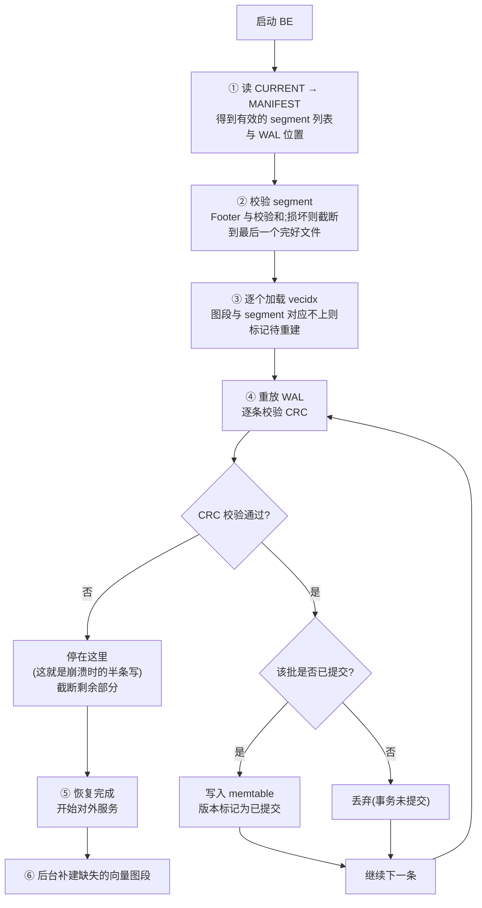

**核心保证**:凡是对客户端返回过"提交成功"的事务,它的整批写入一定已经 fsync 到 WAL —— 所以恢复时必然能重放出来。**返回成功 = 一定不丢。**

---

## 15. 接口设计(proto 概览)

> **2026-10-23 融入**(与实现对齐的说明):① 本节是**概览**,逐字段的契约以 `proto/tangdb.proto` 为准;**P3 已落地**的形态是 `BeginTxn` / `CommitTxn` / `AbortTxn` + `Get/Scan` 带 `snapshot`(本节示意图保留早期命名 `BatchWrite`/`RollbackTxn`,以实际 proto 为准)。② **MySQL 协议不进 gRPC**:它是 FE 侧独立的一个协议监听(P3.5 落地,见 §2.5-I-01),复用同一个执行入口,不新增服务端契约。③ **新能力优先做成 SQL 命令**,而不是继续往 proto 里加 RPC —— 任务、血缘、语义标签、索引推荐都走 SQL:`SHOW TASKS` / `PAUSE|RESUME TASK <id>` / `SHOW LINEAGE [FOR <table>]` / `SHOW INDEX_RECOMMENDATIONS` / `SHOW SEMANTIC TAGS` 等,由 FE 解析、BE 只提供它已有的 KV 能力。④ **text2sql 不新增 RPC**:FE 直接调外部推理端点(AI-07),生成的 SQL 走正常解析与执行路径。⑤ **库级语句也走 SQL 通道**:`CREATE / DROP DATABASE`、`USE <db>`、`SHOW DATABASES`(以及 MySQL 协议侧的 `COM_INIT_DB`)最终都落到"FE 会话当前库 + `sys_databases` 元数据",BE 依旧只认 key 范围(见 §19-P3.5、§2.4-S-09)。

```protobuf
syntax = "proto3";
package tangdb;

service TangDb {
  // —— 基础 KV 与存储 ——
  rpc Put        (PutRequest)        returns (PutResponse);
  rpc Get        (GetRequest)        returns (GetResponse);
  rpc BatchWrite (BatchWriteRequest) returns (BatchWriteResponse);  // 事务原子批写
  rpc Scan       (ScanRequest)       returns (stream RowBatch);

  // —— 事务 ——
  rpc BeginTxn   (BeginTxnRequest)   returns (TxnContext);
  rpc CommitTxn  (CommitTxnRequest)  returns (CommitTxnResponse);
  rpc RollbackTxn(RollbackTxnRequest) returns (RollbackTxnResponse);

  // —— 执行(算子下推)——  二期以后逐步启用
  rpc ExecuteFragment (ExecuteFragmentRequest) returns (stream RowBatch);

  // —— AI / 向量 ——
  rpc VectorSearch (VectorSearchRequest) returns (VectorSearchResponse); // 单段向量检索
  rpc Embed        (stream EmbedRequest)  returns (stream EmbedResponse); // 批量推理下推

  // —— 元数据与运维 ——
  rpc CreateTable  (CreateTableRequest)  returns (CreateTableResponse);
  rpc DropTable    (DropTableRequest)    returns (DropTableResponse);
  rpc Stats        (StatsRequest)        returns (StatsResponse);
}
```

**设计原则**:BE 的接口里没有任何"表名""列名""SQL"的概念。FE 传过来的是 key 范围、算子描述、向量检索参数。表名到表 ID 的映射,在 FE 就完成了。

---

## 16. 技术选型与理由

| 项 | 选择 | 理由 |
|---|---|---|
| BE 语言 | Go 1.27 | goroutine 适合"前台写 + 后台 compaction";字节操作顺手;单文件部署 |
| FE 语言 | Java 17 | 熟悉;贴近 Doris FE;协议与优化器生态好 |
| 服务间通信 | gRPC + Protobuf 3 | IDL 先行、两侧代码自动生成;支持流式(大结果集必需) |
| 存储结构 | LSM-Tree | 写优化;分层可独立验证;天然多版本(MVCC 友好);贴近 Doris |
| 内存结构 | 跳表 | 并发插入友好、有序、实现简单 |
| SQL 解析器 | **手写递归下降** | 无外部依赖;SQL 子集完全可控(决策 D2) |
| 数据文件格式 | **自定义 segment 格式** | 学习重点;不做生态兼容(决策 D6) |
| 磁盘布局 | 列式 segment | OLAP 只读需要的列;压缩率高 |
| 事务 | MVCC + 快照隔离 | 读写不阻塞;LSM 天然多版本 |
| 向量索引 | HNSW,**分段式** | 召回率高;分段设计才能与 LSM 及事务结合 |
| 协议 | 自实现 MySQL 协议 | 让现成客户端直接可用,是"真正可用"的门槛 |
| 构建 | Maven(`mvn.cmd`)/ `go build` | 本机环境;注意本机 `mvn` sh 脚本不可用 |
| Web 控制台 | **JDK 自带 HTTP 服务 + 手写 HTML/CSS/JS**,不引 Spring Boot / 前端框架 | 与"不借外力"同一个立场:界面自己写,依赖不膨胀;页面走同一套 SQL 执行链,不另开一条通道 |
| 测试 | JUnit 5 / Go `testing` | 标准工具 |
| 基准 | 简化版 TPC-C(OLTP)+ 简化版 TPC-H(OLAP)+ 向量召回率脚本 | 用公开基准说话,而不是自说自话 |

---

## 17. 项目结构

```
tang_db/
├── config/                             # 两个进程的配置(一行一项 key = value,与 fe/ be/ 同级)
│   ├── be.conf                         # data_dir / port / memtable_size / fe_host / fe_port / heartbeat_interval_seconds
│   └── fe.conf                         # be_host / be_port / heartbeat_listen_port / be_offline_cycles
├── proto/
│   └── tangdb.proto                    # 唯一的接口定义源
├── be/                                 # Go —— 数据层
│   ├── go.mod
│   ├── cmd/be/main.go
│   └── internal/
│       ├── wal/                        # 预写日志、批写、校验
│       ├── memtable/                   # 跳表、版本链
│       ├── segment/                    # 列式文件读写、编码压缩、zone map
│       ├── compaction/                 # 分层合并、GC 水位
│       ├── manifest/                   # 版本管理、原子切换
│       ├── txn/                        # 事务、MVCC、冲突检测
│       ├── index/                      # 主键 / 二级 / 唯一 / 分段 HNSW
│       ├── exec/                       # 向量化算子:Scan/Filter/Project/HashAgg/HashJoin/Sort/TopN
│       ├── ai/                         # 推理客户端、批量调度、缓存
│       └── server/                     # gRPC 服务实现
├── fe/                                 # Java —— 客户端层
│   ├── pom.xml
│   └── src/main/java/com/wangyu/tangdb/
│       ├── protocol/                   # MySQL 协议:握手、认证、COM_QUERY、结果集
│       ├── parser/                     # 词法、语法、AST
│       ├── catalog/                    # 库/表/列/索引元数据
│       ├── planner/                    # 逻辑计划、RBO、CBO、混合查询决策
│       ├── execute/                    # 计划切分与调度
│       ├── txn/                        # 事务协调、快照
│       └── client/                     # gRPC 客户端封装
├── tools/
│   ├── importer/                       # CSV 批量导入
│   ├── bench-tpcc/                     # OLTP 基准
│   ├── bench-tph/                      # OLAP 基准
│   ├── recall-check/                   # 向量召回率校验
│   ├── job-runner/                     # 任务执行器(一次性/常驻,P8 计划)
│   └── lineage-check/                  # 血缘与脱敏策略抽查(P13 计划)
├── scripts/                            # 启动、一键验收、崩溃测试、压测
│   └── *.cmd / *.ps1                   # Windows 原生版(I-10,P3 收尾即做)
└── docs/                               # 设计文档、读代码地图、使用说明
```

**后续代码目录的登记(2026-10-23 融入;未开工的标"计划")**:

| 目录 | 内容 | 期次 |
|---|---|---|
| `be/internal/blob/` | 大对象溢出页读写 | P11 |
| `be/internal/geo/` | 空间类型编码与空间索引 | P12 |
| `fe/.../protocol/` | MySQL 协议层(握手/认证/COM_QUERY/结果集)—— 目录树里早有位置,提前到 P3.5 落地 | P3.5 |
| `fe/.../govern/` | 任务、血缘、语义标签、脱敏策略的 FE 侧逻辑(元数据都在 BE 系统表) | P8/P13 |

> **配置怎么读**:每个进程只读自己那一份(BE → `config/be.conf`,FE → `config/fe.conf`),取值优先级固定为**命令行参数 > 配置文件 > 内置默认值**;配置项写错(未知项、格式错、取值非法)一律**启动失败并指出行号**,不静默忽略。BE 侧配置解析在 `be/internal/config/`,只用标准库(不引第三方,见 §16)。

---

## 18. 验收方式(判断"是不是真做出来了")

每一类能力都要有**可复现的自动化验收**,而不是"我跑了一下看起来没问题"。

> **2026-10-23 融入**:对**自动类能力**(智能索引、根因诊断)额外加一条硬口径 —— **自动动作前后必须做结果集逐行对拍**,证明"只变快、不变结果";诊断类输出必须可复现(同一份指标输入 → 同一份结论)。各能力的验收口径逐条写在 §21.1。

| 验收类型 | 内容 | 判定标准 |
|---|---|---|
| 功能测试 | 能力清单 §2 的每一条对应用例 | 全绿 |
| **崩溃测试** | 循环 `kill -9`(写入中途、提交中途、compaction 中途),重启后逐条校验 | 已提交数据**零丢失**;未提交数据**零出现** |
| 并发测试 | N 个客户端并发事务(含对同一行的冲突写) | 无脏读、无丢失更新;冲突被正确检测 |
| 数据一致性 | 主键与二级索引、向量列三者交叉校验 | 任意时刻三者一致 |
| 向量召回率 | ANN 结果 vs 暴力计算结果 | 召回率 ≥ 95%(参数可调) |
| OLTP 基准 | 简化 TPC-C | 输出 TPS 与延迟分位 |
| OLAP 基准 | 简化 TPC-H | 输出各查询耗时,与数据量一起记录 |
| **HTAP 混合负载** | 同时跑写、聚合、向量检索 | 三者互不阻塞;写入不受分析拖累 |
| AI 下推 | 批量推理吞吐 | 记录 batch 大小与每秒处理行数 |

**一条命令跑完全部**:`scripts/acceptance.sh`,输出一份报告(文本 + 表格),报告进 Git。

### 性能目标(验收基准,决策 D7)

| 场景 | 指标 | 目标值 |
|---|---|---|
| OLTP 点查 | P99 延迟 | < 10 ms |
| OLTP 并发写 | TPS(单机) | > 5000 |
| OLAP 多表聚合 | 千万行,§3.2 那条查询 | < 3 s |
| OLAP 单表聚合 | 千万行全表扫描 | < 1.5 s |
| 向量检索 | 千万级向量,top-10 | < 50 ms |
| 向量召回率 | ANN vs 暴力计算 | ≥ 95% |
| 崩溃恢复 | 10 万条 WAL 重放 | < 30 s |
| HTAP 混合负载 | 读+写+向量检索同时进行 | 写入 TPS 下降 < 30% |
| **写放大** | 连续写入 5GB 有效数据后,数据目录总增长 / 有效数据量 | < 3×(含 WAL、旧版本与未合并的 segment) |
| **读放大** | 单次主键点查实际触碰的 segment 文件数(可观测) | 平均 ≤ 2 个;全表扫描只读用到的列 |
| **内存峰值** | 批量导入与查询期间进程峰值 RSS | < memtable 阈值 × 3 |
| **恢复时间** | 100 万行数据(含 segment 与 WAL)启动恢复到可服务 | < 60 s |

> **写放大 / 读放大 / 内存峰值 / 恢复时间**这四项是 LSM 实现的照妖镜,单列出来是为了暴露问题而不只是跑得快。
> 注意:P5(compaction 与列式压缩)之前,写放大与读放大**只记录、不设门限** —— P1~P4 的 segment 只增不合,指标必然难看,这是已知的、写进规约的技术债。门限从 P5 起生效。

> 这些数字不是"达不到就重做",而是**给出一个判断标准**:哪一项差得远,就说明瓶颈在哪一层。数字随硬件变化,每次测试同时记录机器配置。

**基准条件模板(2026-10-22 评审补强:性能数字是目标,不是结论 —— 报数必须同报条件)**

每次性能测试,以下条件必须一并记录,缺一项则该次结果不可比:

| 类别 | 必记项 |
|---|---|
| 机器 | CPU 型号与核数、内存容量与频率、磁盘类型(SSD/NVMe/HDD)、操作系统与版本 |
| 数据 | 表结构、行宽与字段类型、索引数量、数据量与数据分布(是否倾斜)、是否有向量列及其维度 |
| 负载 | 并发客户端数、读写比例、事务大小、批大小、查询语句原文 |
| 缓存 | 热缓存 / 冷缓存(是否重启后首测)、预热时长与预热数据量 |
| 统计口径 | P50 / P95 / P99 的算法与采样窗口、持续测试时长、是否去掉前 N 秒的抖动 |
| 向量专项 | 距离度量、`ef` 等 HNSW 参数、过滤比例、召回率计算方式(基准是什么) |
| 后台干扰 | 是否包含 WAL 刷盘、索引维护、compaction、后台推理调用(默认必须包含,除非明确标注排除) |

---

## 19. 分期路线

八期。每期都能独立跑起来、独立演示;上一期没跑通,下一期不开工。

**每期的质量门槛**:该期的验收标准全部跑通 + 崩溃测试不回归 + **过一遍《每期验收前的自查表》(八维,见 `specs/README.md`)**,结论写进该期验收报告。哪一维答不上来,就说明这期没做完。

```mermaid
flowchart LR
    P1["P1 基座<br/>链路 + LSM + 恢复"] --> P2["P2 表与 SQL<br/>DDL / DML / 查询"]
    P2 --> P3["P3 事务与 MVCC<br/>并发写 / 快照隔离"]
    P3 --> P4["P4 索引<br/>主键 / 二级 / 唯一"]
    P4 --> P5["P5 分析引擎<br/>列式 + 向量化 + JOIN"]
    P5 --> P6["P6 优化器<br/>统计信息 / CBO"]
    P6 --> P7["P7 AI 能力<br/>向量 / HNSW / 推理下推"]
    P7 --> P8["P8 生产化<br/>协议 / 监控 / 备份 / Web 控制台"]
    P8 --> P10["P10 全文检索<br/>倒排索引 + 关键词/向量混合"]
    P10 -.->|"优先级最低,先记录"| P9["P9 生态接入<br/>Kafka / Flink / Hadoop"]
```

### P1 · 基座:链路 + 最小可用 LSM + 崩溃恢复

- **目标**:打通 FE → BE 跨语言链路;BE 把数据真正落到磁盘;崩溃后完整恢复
- **做完能看到**:命令行 `put` / `get`;数据目录里出现 WAL 与 segment 文件;`kill -9` 两个进程重启后数据仍在;1000 条随机 KV 强杀重启**零丢失**
- **验收**:崩溃测试脚本跑通

### P2 · 表与 SQL:能建能写能查

- **目标**:FE 有 SQL 解析与元数据(**元数据存进 BE 自身系统表,见 §4.4**);BE 提供 KV 之上的范围扫描;打通 DDL/DML/查询;**建立 BE 注册与心跳上报(见 §4.5)**
- **做完能看到**:`CREATE TABLE` / `INSERT` / `SELECT ... WHERE` / `UPDATE` / `DELETE`;`SHOW TABLES`;README 里那段 SQL 能跑;**BE 每 3 秒向 FE 上报心跳,杀掉 BE 后 FE 立刻标记其不可用;元数据重启后不丢且与数据在同一事务语义下**
- **验收**:功能测试覆盖 DDL 与 DML;查询结果正确

### P3 · 事务与 MVCC:并发写不再是灾难

- **目标**:事务 ID 与快照、读写路径与版本结合、原子批写、写写冲突检测、崩溃一致性
- **做完能看到**:并发会话改同一行,**后到的要么等要么报冲突,绝不静默覆盖**;`ROLLBACK` 之后数据回到原样;提交中途 `kill -9`,重启后要么全生效要么全不发生
- **验收**:并发测试 + 崩溃测试(提交中途杀)

### P4 · 索引:主键之外的路

- **目标**:二级索引与唯一索引的写入、回表、索引选择
- **做完能看到**:非主键列上建索引后查询明显变快;唯一索引能挡住重复;`EXPLAIN` 显示走了哪条索引
- **验收**:索引与主键数据一致性交叉校验

### P5 · 分析引擎:从"能查"到"查得动"

- **目标**:列式 segment、向量化算子、聚合、JOIN、子查询、排序分页、count(distinct)
- **做完能看到**:千万行表上跑 §3.2 那条多表聚合,**秒级出结果**;CSV 批量导入;列式压缩率可观测
- **验收**:简化 TPC-H 查询集能跑完并输出耗时

### P6 · 优化器:让它自己变快

- **目标**:统计信息采集与持久化、CBO 代价模型、谓词下推、列裁剪、连接顺序选择
- **做完能看到**:`EXPLAIN` 显示合理的计划;同样的查询在加统计信息后自动选到更优路径;连接顺序会随表大小变化而调整
- **验收**:计划正确性 + 典型查询性能改善可量化

### P7 · AI 能力(创新点落地)

- **目标**:`VECTOR(n)` 类型、分段 HNSW 图与持久化、相似度查询、混合查询路径决策、AI 函数下推与批量推理、向量化入库
- **做完能看到**:§3.3 那两条 SQL 真能跑;语义检索毫秒级返回;`INSERT ... SELECT ai_embed(content)` 一条 SQL 完成向量化入库;**杀掉进程重启后向量索引直接可用,不需要重建**
- **验收**:召回率 ≥ 95%;向量列的事务与崩溃一致性通过;推理吞吐可量化

### P8 · 生产化:让别人也能用

- **目标**:MySQL 协议兼容、监控指标、慢查询日志(**并给出诊断建议**:计划摘要 + 可能的谓词/索引建议)、备份恢复、`EXPLAIN` 完善、并发压测、**自带 Web 控制台**(左侧库/表树 + 上方 SQL + 下方结果 + 自身状态,见 §3.6)
- **做完能看到**:`mysql -h 127.0.0.1 -P 9030 -u root` 直连并执行 SQL;DataGrip 能连;**浏览器打开 FE 的地址就能看库、写 SQL、看 BE 存活与内存表/segment/QPS**;监控能看 QPS 与延迟;在线备份后能恢复出一致的库
- **验收**:官方客户端连通性测试 + 混合负载压测报告 + Web 控制台在真实浏览器里跑通四块内容(库表树 / SQL 执行 / 结果表格 / 自身状态)

### P9 · 生态接入:让数据进得来、出得去(优先级最低,先记录)

- **目标**:Kafka 流式导入、Flink Source/Sink connector、HDFS 批量导入导出(见 §2.7)
- **做完能看到**:一个 Kafka topic 的数据能持续写进表里并记录消费位点;Flink 作业能读变更、也能把结果写回;HDFS 上的文件能批量导进来、表能导出去
- **验收**:导入导出的正确性(条数与内容对得上)+ 断点续传 + 过程中可见进度
- **排期原则**:**八期主体功能完整并跑通之前不开工**。这一期的存在意义是"位置先占住",不是"现在做"
- **候选扩展**:开放表格式(读 Iceberg / Hudi)与外部表 / 联邦查询 —— 与 E-03 同源,先记录在案

### P10 · 全文检索:关键词与向量的混合检索

- **目标**:自己实现**倒排索引**(词典 + postings + 跳表/压缩,不引 Lucene / Elasticsearch 类库)与关键词打分,并把「关键词召回 + 向量召回 + 结构化过滤」统一到同一条查询路径做融合排序
- **做完能看到**:`SELECT id, title, score FROM docs WHERE MATCH(content, '戒烟') AND category = '健康' ORDER BY score DESC LIMIT 10` 这类查询能跑;同一批数据上,纯关键词、纯向量、混合三条路的召回与排序可对比
- **验收**:关键词检索召回/排序可量化;混合检索在"关键词敏感"与"语义敏感"两类查询上都能看到收益;倒排索引随 segment 落盘、随 compaction 演进、**崩溃重启后直接可用、不重建全量**
- **为什么单列一期**:倒排索引是一套独立的存储结构(词典、postings、压缩与跳表),不是 P7 的增量 —— 塞进 P7 会把那期拖垮
- **执行顺序**:**P8 → P10 → P9**。编号是登记顺序;生态接入(P9)的优先级仍然最低

### P3.5(提前项,2026-10-23 补)· 常驻 FE + 多库命名空间 + MySQL 协议

> 2026-10-23 项目所有者拍板:**D19 引入库命名空间**、**D20 FE 拆成常驻服务 + 瘦客户端**。三步合做一期,顺序不能颠倒:**先有常驻 FE,才有地方挂协议监听;先有多库,协议客户端的 `database` / `COM_INIT_DB` 才有去处。**

**第零步 · FE 常驻服务与瘦客户端(架构调整,D20)**

- **目标**:FE 拆成 `fed`(常驻服务)与 `cli`(瘦客户端);`fed` 持有唯一 catalog 权威缓存 + 会话层(每连接一个会话:当前库 / 事务 / 写集)+ MySQL 协议监听 + 心跳监听;CLI 通过协议连 `fed`
- **做完能看到**:起 BE → 起 `fed` → 多个 `cli` 同时连上并看到**同一份** catalog(一个会话建表,另一个会话立即可见);`fed` 是唯一持有心跳端口的进程
- **验收**:两个长驻会话的 DDL 可见性(关掉 P2/P3 的那个缺口);`fed` 重启后会话全部失效但库与数据一致;并发会话的事务互不串味(各自快照)
- **代价**:真并发会话 + 线程隔离是新增的一块(P3 的 Executor/catalog 复用,搬进按会话的壳)

**第一步 · 多库命名空间(D19)**

- **目标**:`CREATE DATABASE` / `DROP DATABASE` / `USE <db>` / 限定名 `db.tbl`;表名唯一性由"全库唯一"收紧为"**库内唯一**";空库默认库 `default` 始终存在
- **存储层零改动**:key 仍是 `[表 ID 4B][索引 ID 4B][...]`,**表 ID 保持全局唯一**;库只是元数据里的一层命名空间 → 不需要改 key 布局、不需要动 BE(这是它便宜的根本原因)
- **要动的只有 FE 四件事**:① 新增 `sys_databases` 系统表(元数据族见 §4.4);② 表记录加 `db_id`,`sys_tables` 的名字唯一性按库判定;③ 名字解析支持限定名与会话当前库;④ `SHOW TABLES` / `SHOW DATABASES` / `DROP DATABASE` 按库作用域(沿用既有的"标 dropped、不物理删"思路)
- **做完能看到**:`CREATE DATABASE shop; USE shop; CREATE TABLE orders(...)`;另一个库能建同名表且互不干扰;`DROP DATABASE shop` 后该库的表全部不可见、其它库不受影响
- **验收**:两库同名表互不干扰;跨库查询必须用限定名(不带限定名的表名只按当前库解析);重启后库与当前库语义一致;`default` 库始终在

**第二步 · MySQL 协议(重的一半)**

- **目标**:按 §2.5-I-01 收口过的**可测子集**实现 MySQL 协议:握手 + 认证 + `COM_INIT_DB`(选库)+ `COM_QUERY` + 结果集 + `COM_PING` / `COM_QUIT`;不做预处理语句(`COM_STMT_*`)、不承诺兼容整个 MySQL
- **做完能看到**:`mysql -h 127.0.0.1 -P <port> -u <user> -D shop`、DataGrip / Navicat、JDBC 三种方式直连,执行 P3 已有的 SQL(含 `BEGIN / COMMIT / ROLLBACK`)与库级 DDL
- **验收**:官方 `mysql` 客户端 + 一个 JDBC 小程序 + 一个图形客户端各跑通一组 SQL(含切库);错误码按 I-03 对齐
- **为什么提前**:只用自带 CLI 太麻烦;**提前的收益立刻兑现** —— 之后每一期都能用真实客户端验收,不必每次靠 CLI。代价:P4 顺延
- **位置**:P3(事务)完成之后、P4(索引)之前;**三步顺序固定:第零步常驻 FE → 第一步多库 → 第二步 MySQL 协议**(都动 FE 的会话与名字解析层,顺序反过来会返工)

### P11 · 多模态与半结构化:图片 / 音频 / 文档都进得来

- **目标**:① **大对象页外存储**(`TEXT` / `BLOB`):超过阈值的值单独成页,行里只存指针 + 长度 + 校验和;② **媒体数据组合形态**:原文件(大对象或外部路径)+ 元数据(`JSON`)+ 向量(`VECTOR(n)`),检索走 P7 的向量索引;③ `json_extract` 等路径函数与下推完善;④ 加密/掩码**函数**基础(`mask_*` / 摘要 / AEAD 列值加解密,用 Go 标准库,不引第三方)
- **做完能看到**:一张 `docs(id, raw BLOB, meta JSON, vec VECTOR(768))` 表:批量导入上万个文件,按向量检索命中后**能把原文件取回来**;大对象不会把行编码撑爆
- **验收**:点查只读指针、取原文件才读数据页(读放大可观测);混合检索行为与 P7 一致;导入过程崩溃重启不丢
- **红线**:不做图像/音频**解码**与格式转换(库只负责"存、取、按向量找");**先把大对象页外存储做对再谈别的**(2026-10-23 外部评审提醒):大对象会同时放大 **WAL、备份与恢复**的复杂度 —— 页外存储的值进 WAL 要不要也走页外、备份时怎么带上、恢复时怎么校验,这些在本期必须一次说清,不要一开始就扩展到媒体解析

### P12 · 空间与时序:地理与时间维

- **目标**:① `GEOMETRY` 类型(点/线/面,自研 WKB 风格二进制)+ 空间索引(geohash 网格 + 前缀范围扫描,或自研简易 R 树)+ 空间函数(`distance` / `contains` / `within` / `intersects`);② **时序优化**:`TIMESTAMP` 类型、时间列的范围裁剪、列存里时间戳按 delta 编码 + 数值 delta-of-delta、可选保留策略(按时间丢弃旧数据)
- **做完能看到**:`WHERE within(geo, ?) AND ts BETWEEN ? AND ?` 走"空间 + 时间"双裁剪而不是全表;时序列压缩率可观测
- **验收**:空间查询与暴力计算**对拍**;时序给出压缩率与查询耗时数字;保留策略执行后数据不可见且不破坏其它表
- **红线**:不做坐标系转换(PROJ)、不做栅格/影像、不做专用时序库那套复杂降采样(保留策略做成配置)

### P13 · 治理:权限、血缘与脱敏

- **目标**:① **最小权限模型(RBAC)**:用户 / 角色 / 库表级授权,足以支撑"谁能看脱敏列";② **数据血缘自动追踪**:表级 + 列级(从 parser AST 推导 `INSERT ... SELECT`、导入任务的来源),血缘关系可查询(存普通表,复用系统表机制);③ **策略化脱敏**:按列定义掩码/加密策略,按角色决定返回原文还是掩码值
- **做完能看到**:查血缘能回答"这张表的数据从哪来、往下流到哪";无权限用户查手机号列得到 `138****1234`,有权限用户得到原文
- **验收**:可解析场景的血缘与人工对账一致,**不可解析的场景显式标注"无法确定"而不是猜**;脱敏只改返回值、不改存储值(从存储侧读仍是原文/密文)
- **⚠️ 边界变更**:§2.6 现在明确"权限体系:只做最小认证,不做 grant/revoke" —— 本期的①需要把它改成"做**最小 RBAC**"(入口见 §21.3 待拍板项)。**D16 拍板之前,本期的权限/策略化脱敏部分不进入施工**(血缘与掩码函数可以先做,它们不依赖权限模型)

### P14 · 智能运维:智能索引与异常根因诊断

- **目标**:① **智能索引(自适应)**:监控 SQL 负载 → 发现"高频且缺索引"的查询 → 生成候选索引与**代价评估** → **低峰期**(用 E-04 的常驻任务)自动创建;长期低收益的索引自动**休眠**(不参与计划、不删除),更久不用才**自动删除**;全过程给 DBA **推荐清单 + 依据 + 预计收益**,可一键回滚。② **异常根因自动诊断**:把慢查询、错误率、事务冲突率、磁盘/内存、恢复时长等多信号聚合成「症状 → 证据 → 结论」三段式输出
- **做完能看到**:`SHOW INDEX_RECOMMENDATIONS` 给出"该建哪个索引、为什么、预计收益";压测中自动建索引后该查询 P99 下降可量化;负载消失后索引自动休眠;慢查询能给出带证据的根因结论
- **验收**:自动建索引前后的**结果集逐行完全一致**;推荐质量(命中率)可统计;诊断结论的证据链完整(人工抽查);关掉开关后不再有任何自动动作
- **红线(必须写死)**:自动动作**只影响性能、绝不改变查询结果**;**可整体关闭**;每步动作**有审计记录**;**不得**自动改动主键/唯一约束;诊断只给结论与证据,**不自动改配置**

### P15 · 冷热分层:让老数据便宜地躺着

- **目标**:① **多介质/多目录分层**:热层(本地 SSD 目录)与冷层(可挂 HDD / 网络盘 / 低优先级目录),segment 按**访问频次 + 数据年龄**迁移;② **压缩分级**:冷层用更高压缩率的列编码;③ 迁移走 E-04 任务框架(可停、可续、可观测)
- **做完能看到**:一张老表整体迁到冷目录后热层占用下降可量化,查询结果不变(慢一点)
- **验收**:迁移中途强杀 → 重启后不丢数据、不出现"半迁移"状态;迁移前后查询结果逐行一致
- **红线**:**不引对象存储 SDK**(S3 / MinIO 客户端会破依赖红线)—— 只做"本地多目录/多盘 + 压缩分级";若要接对象存储,必须先立决策破例(见 §21.3 待拍板项)
- **并发与原子性(2026-10-23 外部评审提醒)**:迁移要与 **compaction、备份、并发读者**和平共处 —— 迁移必须是**原子切换**(新位置就绪并落 MANIFEST 后才改指向)、**旧文件要等读者退出**才能删(承 P1/P3 的规则),中途崩溃不得留下"半迁移"状态;与备份的交叠要有明确口径(备份期间禁迁移或迁移期间禁备份,二选一写清)

---

## 20. 已拍板的关键决策

10 项决策已于 2026-10-21 全部确定。后续实现以本节为准。

| 编号 | 决策点 | 结论 | 影响 |
|---|---|---|---|
| **D1** | 部署形态 | **单机多核**。分片概念在 key 编码中预留;分布式不做,如需则作为 P8 之后的独立一期 | 架构复杂度上限 |
| **D2** | SQL 解析器 | **手写递归下降** | 无外部依赖;SQL 子集完全可控 |
| **D3** | 向量索引 | **直接做 HNSW 分段图** | 创新点二一次性做对,避免 IVF 过渡后重做持久化设计 |
| **D4** | 推理端点 | **用算力服务器 `39.96.62.247` 上的推理服务**,配置里填端点 | 模型权重不进库;换模型只改配置 |
| **D5** | 隔离级别终点 | **快照隔离(SI)收口**;可串行化(SSI)作为 P8 之后可选加分项 | 决定 P3 的范围 |
| **D6** | 数据文件格式 | **自定义格式** | 学习重点;不做生态兼容 |
| **D7** | 性能目标 | 见 §18 性能目标表(点查 P99 < 10ms;并发写 TPS > 5000;千万行多表聚合 < 3s;千万级向量 top-10 < 50ms) | 验收基准 |
| **D8** | 交付形态 | **源码 + 设计文档 + 一键验收脚本 +《读代码地图》+ Docker 镜像**(P8 产出);**Web 控制台已由 D13 明确为 P8 必做**(不再是"可选后续") | 决定 P8 范围 |
| **D9** | 代码由谁写 | **全部交给 opencode 实现**;我方负责规约起草与评审、产物核验,并每期另出《读代码地图》 | 决定 P1 的启动方式 |
| **D11** | FE 元数据存储 | **不用任何外部数据库**;元数据存进 BE 自身的系统表,走自己的事务与 WAL(P2 落地,§4.4) | 元数据自动获得事务与崩溃恢复;DDL 与数据可在同一事务提交 |
| **D12** | BE 状态上报 | **BE 主动 push 心跳**(默认 3 秒)到 FE,携带概要状态;细节按需 pull(P2 落地,§4.5) | FE 的故障感知、监控、后续调度都以此为基础 |
| **D10** | 文档形态 | **本 Markdown 文档为唯一方案主文档**,不额外导出 HTML | 单一事实来源 |
| **D13** | Web 控制台 | **FE 自带**,落在 **P8**;形态 = 左侧库/表树 + 右上 SQL + 右下结果 + 自身状态(§3.6);技术上用 JDK 自带 HTTP 服务 + 手写页面,**不引 Spring Boot / 前端框架** | 演示与运维的入口;依赖不膨胀 |
| **D14** | 大数据生态接入 | Kafka / Flink / Hadoop 三样**列入总体需求、期次排在最后(P9)**,八期主体功能完整前不开工(§2.7);接入层放在 FE 或 `tools/`,**不得给 BE 增加依赖** | 承认 OLAP 需要生态,但先把主体做对 |
| **D15** | 全文/关键词检索 | **自己实现倒排索引与关键词打分**(不引 Lucene / ES 类库),与向量召回、结构化过滤在一条查询路径里融合排序;期次 **P10**(执行顺序 P8 → P10 → P9) | 保持"不借外力";"AI 数据库 ≠ 向量数据库",关键词与向量一起用才是完整形态(见 §2.3-AI-11) |
| **D19** | 库命名空间(多库) | **引入多库**:`CREATE / DROP DATABASE`、`USE <db>`、限定名 `db.tbl`;表名唯一性 = **库内唯一**;**表 ID 仍全局唯一**(key 布局与 BE 零改动);默认库 `default` 始终存在。**归 P3.5**,先于 MySQL 协议(客户端连上来第一件事就是选库)。**覆盖 SPEC-P2 的 K22("不做多库")** | 从"只有 default"到"多库"是廉价的一步(纯 FE 元数据 + 语法),但拖到 P8 会让协议层与权限都别扭 |
| **D20** | **FE 的进程形态** | **FE 拆成「常驻服务进程 `fed`」+「瘦客户端 CLI」**:`fed` 常驻、持有唯一 catalog 权威缓存与会话层、监听 MySQL 协议端口与心跳端口;CLI 只做交互,**通过协议连 `fed`**(优先复用 MySQL 协议);BE 不变。**归 P3.5**(MySQL 协议的前置,不做这一步协议无处可放) | 顺带关掉两个已登记缺口:**跨进程 DDL 不可见**、**心跳端口被 CLI 抢占**;也让 P8 的 Web 控制台/监控/任务有天然宿主。代价:`fed` 要做真并发会话与线程隔离,P3.5 因此是"架构调整 + 多库 + 协议"三合一 |

> **P3.5 已起草规约**:`specs/P3.5-fed-multi-db-mysql.md`(**Draft v0.1**,55 条 FR / SC-301~SC-318 / 6 项待拍板 I9~I14),等项目所有者评审后方可施工。

> **关于 D9 的附注**:虽然代码不由你手写,但《读代码地图》会在每期结束时交付——它把这一期写了哪些文件、每个文件负责什么、关键函数落在哪条路径上,逐条标出来。做完的库你必须能讲明白,否则这个项目就只剩"我有一个能跑的库",而不是"我懂它是怎么跑起来的"。

---

## 21. 候选能力池与可行性评估(2026-10-23 补)

项目所有者 2026-10-23 一次性提出了一批"有亮点"的能力。本节逐条回答**能不能融入、代价在哪、红线在哪**,并给出建议期次。判定分三档:**能融入**(已排期)/ **能融入但要收口或改边界**(有前提)/ **不融入**(说明理由)。

### 21.1 逐条判定

| # | 能力 | 判定 | 依赖 | 红线 / 要收口的地方 | 建议期次 |
|---|---|---|---|---|---|
| 1 | 内置函数库(数值/字符串/日期/聚合) | **能融入** | P5 表达式与向量化算子 | 常用优先,不追 MySQL 全量 | **P5**(§2.8-F-01/F-02、A-13) |
| 2 | UDF 自定义函数 | **能融入(已登记)** | 函数注册表 + 沙箱 | 默认不参与下推与常量折叠;不进 BE 存储引擎 | **P8**(§2.8-F-03/F-04) |
| 3 | `JSON(Binary JSON)` 类型 | **能融入** | 值编码 + 函数体系 | **二进制不是文本**;不做路径级列存与路径索引;不做主键 | **P5**(§2.4-S-08) |
| 4 | 导入导出的**任务化**(一次性 + 常驻 + 任务列表/状态) | **能融入** | 任务框架 + 各通道 | 任务元数据走库自身持久化,**不引外部调度器**;所有批量通道共用一套任务模型 | **P8 立框架 / P9 接通道**(E-04) |
| 5 | **MySQL 协议提前** | **能融入(已要求提前)** | 无(纯协议层) | 只做可测子集,不做预处理语句 | **P3.5**(§2.5-I-01) |
| 6 | **Windows 原生启动/运维脚本** | **能融入** | 无 | `.sh` 保留,`cmd/ps1` 新增 | **P3 收尾小补丁**(I-10) |
| 7 | **多模态数据存储**(图片/音频/文档) | **能融入** | P7 向量 + P11 大对象 + 元数据 JSON | 只做"存/取/按向量找",**不做媒体解码** | **P11** |
| 8 | **地理空间**(GEOMETRY + 空间索引) | **能融入,但是独立大工程** | 新类型 + 自研空间索引 + 空间函数 + 列存适配 | 不做坐标系转换、不做栅格;与 P7 向量索引并列,别混在一起做 | **P12** |
| 9 | **时序优化** | **能融入,且与列存天然契合** | P5 列存 + TIMESTAMP 类型 | 不做"专用时序库"那套;保留策略做成配置 | **P12** |
| 10 | **智能索引**(自动创建/休眠/删除 + 推荐 + 代价评估) | **能融入,但必须写死红线** | P4 索引 + P6 统计/CBO + P8 慢查询诊断 + E-04 任务(低峰期执行) | ①只影响性能**绝不改结果** ②可整体关闭 ③有审计 ④可回滚 ⑤**不得**动主键/唯一约束 | **P14**(= 原 §11.4 的"自适应"档,归属由"P8 之后候选"细化为 P14) |
| 11 | **数据血缘自动追踪** | **能融入,成本相对低** | P2 的 parser AST + catalog + E-04 任务 | 复杂查询(子查询/UDF/动态 SQL)**必须标"不可解析"而不是猜** | **P13** |
| 12 | **敏感数据脱敏** | **能融入,但触碰边界** | 最小权限(角色)+ 加密(Go 标准库 AEAD)+ 掩码函数 | §2.6 现在写"不做权限体系" → 策略化脱敏必须先引入**最小 RBAC**;密钥管理用本地密钥文件,**不引 KMS** | 函数/加密基础 **P11**;策略化脱敏 **P13** |
| 13 | **异常根因自动诊断** | **能融入,但要防玄学** | I-04 监控 + I-05 慢查询诊断(P8)+ 多信号指标 | 每条结论**必须给证据**(哪条指标/哪段计划/哪个文件);可关闭;规则库要能回归测试 | **P14**(与智能索引同期,共用诊断底座) |
| 14 | **冷热分层存储** | **能融入,但要收口** | compaction(P5/P6)+ 访问频次 + E-04 任务 | **不引对象存储 SDK** → 只做本地多目录/多盘 + 压缩分级;要接 S3/MinIO 得先破例 | **P15** |
| 15 | **text2sql** | **能融入(已登记)** | 外部推理端点(AI-07)+ catalog 注释 + AI-13 标签 | 生成的 SQL **必须可见可改**;默认只生成只读查询;不绕过解析与权限 | **P8**(AI-12) |
| 16 | **数据语义标签库 + 语义检索** | **能融入(已登记)** | 向量索引(AI-02)+ 系统表存标签 | 与 AI-11 全文、AI-02 向量**共用召回通道**,不另造一套 | **P8**(AI-13) |
| 17 | **模型训练(用库内数据训练专项模型)** | **不融入(已确认)** | 训练框架 / 算力 / 模型版本管理 | 会突破"不借外力"的依赖红线 | 排除,列为将来候选(§2.6) |
| 18 | **多库命名空间(`CREATE DATABASE` / `USE` / `db.tbl`)** | **能融入,而且很便宜** | 无(纯 FE 元数据 + 名字解析);与 P3.5 的 MySQL 协议同做 | 表 ID 仍**全局唯一** → key 与 BE 零改动;表名唯一性收紧为"库内唯一";默认库 `default` 始终在 | **P3.5**(D19 已拍板;覆盖 SPEC-P2 的 K22) |

### 21.2 正文融入点索引(逐条对照)

上表 17 项不是"记在附录就算完" —— 能融入的都**就地写进了正文对应章节**:

| 能力 | 正文落点 |
|---|---|
| 内置函数库 / UDF | §2.1-A-13、**§2.8**(F-01~F-04 + 三条设计要点) |
| JSON(Binary JSON) | §2.4-S-08、**§2.4.1 数据类型清单**、§12 表达式/路径索引登记 |
| 导入导出任务化 | §2.7-E-04 + 接入原则;元数据放 **§4.4 元数据族表**("任务与任务状态") |
| MySQL 协议提前 | §2.5-I-01、**§19-P3.5**、§15 说明②、§17(`fe/.../protocol/`) |
| **多库命名空间** | §2.4-S-09、§2.4-S-02(库级 DDL)、**§19-P3.5 第一步**、§4.4(`sys_databases`)、§15 说明⑤、**决策 D19** |
| Windows 原生脚本 | §2.5-I-10、§17(`scripts/*.cmd`) |
| 多模态(图片/音频/文档) | §19-P11、§13.1(`blob/`)、§17(`be/internal/blob/`) |
| 地理空间 | §19-P12、§12 索引登记(空间索引)、§13.1(`geo/`) |
| 时序 | §19-P12、§13.1 备注(编码在列块里,不新增目录)、§2.4.1(`TIMESTAMP`) |
| 智能索引 | **§11.4 自适应档细化**、§12(可休眠索引)、§19-P14、§4.4(推荐与审计元数据) |
| 数据血缘 | §19-P13、§4.4 元数据族表("血缘") |
| 敏感数据脱敏 | §19-P13、§4.4(角色与脱敏策略)、§2.8-F-01(掩码/加密函数) |
| 异常根因诊断 | §11.4(P14 两件事之二)、§18 验收硬口径 |
| 冷热分层 | §19-P15、§13.1(与 compaction 的关系在 §6.4) |
| text2sql / 语义标签库 | §2.3-AI-12/AI-13、§15 说明③④、§4.4(语义标签元数据) |
| 模型训练 | §2.6(保留、不实现)—— **不融入正文其它章节** |

### 21.3 需要项目所有者拍板的三处边界(确认后并入 §20)

| 候选决策 | 内容 | 为什么必须拍板 |
|---|---|---|
| **D16(建议)** | 权限体系:从"不做 grant/revoke"改为**做最小 RBAC**(用户/角色/库表级 + 列级脱敏策略) | 策略化脱敏、审计、血缘的可见范围都依赖它。不引入它,脱敏只能做成"全局掩码函数",做不到"按角色看不同结果" |
| **D17(建议)** | 冷热分层的介质范围:**只做本地多目录/多盘 + 压缩分级**,不接对象存储(S3/MinIO) | 接对象存储要引入第三方 SDK,直接违反依赖红线;若确实要接,需要像 D14 那样单独破例并写清影响面 |
| **D18(建议)** | 自动索引的边界:只影响性能、可整体关闭、有审计、可回滚、**不得**动主键/唯一约束 | 这是"库自己改自己结构"的能力,没有红线约束就不该做;写进决策才能写进规约 |

### 21.4 执行顺序(全量,含提前项)

```
已完成/进行中:P1 → P2 → P2.1 → P3(事务与 MVCC)
提前项:        P3.5(常驻 FE + 多库命名空间 + MySQL 协议)  ← 2026-10-23 要求提前,D19/D20 拍板
原八期:        P4 索引 → P5 分析(+函数体系/JSON) → P6 优化器 → P7 AI →
               P8 生产化(含 AI-12/13、任务框架、Windows 脚本) → P10 全文 → P9 生态
后续候选:      P11 多模态 → P12 空间与时序 → P13 治理(权限/血缘/脱敏) →
               P14 智能运维(智能索引 + 根因诊断) → P15 冷热分层
```

> 说明:后续候选期次的编号是**登记顺序**,不等于必须按编号施工 —— 哪条先做取决于当时的实际需要(例如若先要"给别人用",P13 的权限可能比 P11 更急)。但**依赖关系不能跳**(P14 依赖 P4/P6/P8,P15 依赖 compaction)。

---

## 附:一页速览

| 项 | 结论 |
|---|---|
| 名字 | tang_db |
| 定位 | HTAP + AI 原生数据库,OLAP 为主干,原生支持 OLTP |
| 架构 | FE(Java)+ BE(Go),gRPC 边界,单引擎 |
| 存储 | LSM-Tree,写时行式、存时列式 |
| 事务 | MVCC + 快照隔离,原子批写 |
| 分析 | 列式 segment + 向量化执行 + Hash Join/Agg |
| AI 创新 | ①HTAP+向量+推理三合一 ②HNSW 分段图随 LSM 演进 ③混合查询代价决策 ④推理下推批量化 |
| 分期 | P1 基座 → P2 SQL → P2.1 兼容性 → P3 事务 → **P3.5 MySQL 协议(提前)** → P4 索引 → P5 分析(+函数体系/JSON) → P6 优化器 → P7 AI → P8 生产化(含 text2sql/语义标签、任务框架、Windows 脚本) → P10 全文 → P9 生态 → **P11 多模态 → P12 空间与时序 → P13 治理(权限/血缘/脱敏) → P14 智能运维(智能索引+根因诊断) → P15 冷热分层**(候选池与判定见 §21) |
| 不做的 | 分布式、存储过程、窗口函数全集、模型训练、媒体解码、GIS 坐标系转换、对象存储接入(需另立决策)、权限体系(待 D16 拍板改为最小 RBAC) |
| 依赖红线 | 不引入任何现成存储/执行/向量索引引擎 |
