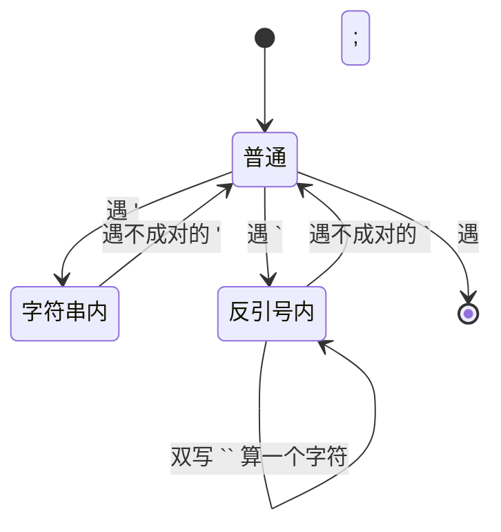
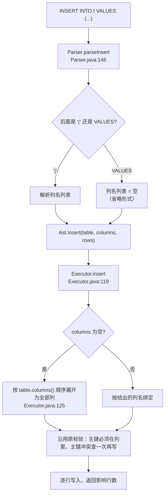

# P2.1 读代码地图(增量版)

> 这份只讲 **P2.1 相对 P2 新增的那一跳**(反引号标识符 / INSERT 省略列名 / SHOW DATABASES)。
> P2 的完整走读(SQL 一跳、key/value 编码、catalog 与系统表、Scan 多路归并、心跳闭环)见《读代码地图-P2》。
> 依据:`specs/P2.1-sql-compat.md` v0.1b(Approved)。

## 0. 先看结论:P2.1 一共只动了 7 个实现文件里的一小块

| 文件 | 动的地方 | 一句话 |
|---|---|---|
| `parser/TokenType.java` | :7 | 新增 `QUOTED_IDENT`,反引号标识符的独立词法单元 |
| `parser/Lexer.java` | :107 分派、:150 `readQuotedIdent` | 读反引号标识符:任意字符、双写转义、未闭合/空各有中文报错 |
| `parser/Parser.java` | :146 `parseInsert`、:427 `expectIdentifier`/:437 `expectIdentifierToken`、`parseShow`、:470 `describe` | 标识符统一走一个入口;SHOW 增 `DATABASES`;INSERT 可省列名列表 |
| `parser/Ast.java` | `ShowDatabases` 并入 `Statement` | 新增一种语句节点 |
| `client/SqlBuffer.java` | :15/:42/:62/:79 `inQuotedIdent` | 多行输入把反引号与单引号同级当定界符 |
| `execute/Executor.java` | :54 分派、:99 `showDatabases`、:119 `insert`/:125 展开、:155 报错 | 省略列名时按表定义顺序展开;SHOW DATABASES 直接造结果 |
| `client/Cli.java` | `USAGE` + 启动横幅 | 提示里加上 `SHOW DATABASES` |

**一句话:改动全在"字符串 → 语法树"和"一条语句怎么展开"这两层;存储、key/value 编码、proto、心跳一行没碰。**
所以它不需要数据迁移 —— P2 期间建的库、写的数据,升到 P2.1 后照旧。

---

## 1. `` `id` `` 从字符到列名的一次完整一跳

```mermaid
flowchart LR
    A["SQL 文本<br/>`` `id` ``"] --> B["Lexer: 遇到 '`'<br/>Lexer.java:107"]
    B --> C["readQuotedIdent<br/>Lexer.java:150<br/>读到不转义的 '`' 结束"]
    C --> D["Token(QUOTED_IDENT, \"id\")<br/>Lexer.java:166"]
    D --> E["Parser.expectIdentifier<br/>Parser.java:427/:437<br/>IDENT 与 QUOTED_IDENT 都收"]
    E --> F["AST 里就是一个普通字符串<br/>\"id\""]
    F --> G["Column / TableMeta / Catalog<br/>统一 toLowerCase"]
    G --> H["按列名匹配<br/>（与不带反引号时同一条路）"]
```

四个值得记住的点:

1. **反引号只在词法层有意义**。过了 `expectIdentifier` 就是一个普通字符串,下游(planner/executor/catalog)完全不知道它被反引号包过 —— 这也是为什么它不可能影响执行语义。
2. **关键字只匹配"裸"标识符**(`Parser.expectKeyword` 只认 `TokenType.IDENT`),所以 `` `from` `` 天然不会被当关键字 —— 这正是你要的反引号用途。反过来,`` `select` * from t `` 这种"用反引号包语句关键字"也被同一条规则挡住(语句头只认 `IDENT`)。
3. **反引号不改变大小写语义**:`expectIdentifier` 对 `QUOTED_IDENT` 统一转小写,而 `Column`/`TableMeta`/`Catalog` 本来也转小写,所以 `` `ID` ``、`` `id` ``、`id` 是同一个名字(K21 不变)。
4. **反引号内允许除反引号之外的任意字符**(空格、中划线、中文、数字开头),双写反引号表示一个反引号 —— 所以 `` `my table` ``、`` `a-b c` `` 都能当名字。

## 2. 为什么连多行输入缓冲 `SqlBuffer` 也得改

CLI 是"先攒够一条语句(见 `;`)再交给 Parser",所以它有自己一套**定界符状态机**:



- 反引号内的 `;` **不结束语句**、`--` **不是注释**(否则 `` `a;b` ``、`` `a--b` `` 这种名字会被切碎)。
- 跨行未闭合时用 `\n` 续接(与字符串字面量一致),所以**跨行写出来的名字里会带换行符** —— 符合"除反引号外任意字符",真实使用几乎不会遇到,属实现细节。
- `reset()` 需要一起复位这个状态。

> 一句话:`SqlBuffer` 只负责**别把语句切错**,不解释反引号的含义;语义解释全在 `Lexer`。

## 3. INSERT 省略列名:解析层给空列表,执行层才展开



- **为什么展开放在 Executor 而不是 Parser**:Parser 手上只有 token,不知道表有几列、列序是什么;`Ast.Insert` 的"空列名列表"是唯一的省略信号。
- `INSERT INTO t () VALUES (1)` 在 **Parser** 就被挡下(`列名列表不能为空`,Parser.java:154)—— 这样"空列表"的含义没有二义,只可能是省略形式。
- `insert into student values(9)` 的报错 `第 1 组取值个数(1)与列数(3)不一致` 来自 **Executor.java:155**,是执行期错误,不是语法错误;错误的组不写半行,此前已成功的组保留(与 P2 §2.3 逐行写入的口径一致)。

## 4. `SHOW DATABASES`:唯一一条不碰 BE 的语句

`Executor.showDatabases()`(:99)直接返回一张写死的表(列头 `Database`、一行 `default`),**不构造任何 `KvStore` 调用**。
注意区分两件事:

- `SHOW DATABASES` 本身**不依赖 BE**(单元测试用一个"被调用就抛异常"的假 KvStore 证明了这一点);
- 但**整个 CLI 会话仍然依赖 BE** —— 启动时 FE 必须先从 BE 的系统表加载 catalog(P2 FR-111),BE 不在,CLI 根本进不到交互提示。所以"BE 挂了还能敲 SHOW DATABASES"在真实 CLI 里演示不了,这条只有单元测试证据。

## 5. 与 P2 的差异(精确到文件)

| 能力 | P2 | P2.1 |
|---|---|---|
| 标识符 | 只能裸写 | 可 `反引号包裹`,反引号内任意字符、双写转义 |
| `INSERT` | 必须给列名列表 | 可省略(按表定义顺序取全部列);`()` 报错 |
| `SHOW` | 只有 `SHOW TABLES` | 增 `SHOW DATABASES`(一行 `default`) |
| 错误提示 | 反引号报"无法识别的字符" | 未闭合/空各有专门文案 |
| 其它 | —— | 一字未变(含 key/value 编码、proto、BE、系统表) |

## 6. 建议的阅读顺序(约 15 分钟)

1. `parser/TokenType.java`(第 7 行)看新增的 token 类型
2. `parser/Lexer.java` 的 `readQuotedIdent`(:150)—— 反引号的语法边界
3. `parser/Parser.java` 的 `expectIdentifier` / `expectIdentifierToken`(:427 / :437)—— 所有标识符位置的唯一入口
4. `client/SqlBuffer.java`(:15 ~ :79)—— 定界符状态机
5. `parser/Parser.java:146` + `execute/Executor.java:119` —— 省略列名怎么展开
6. `execute/Executor.java:99` —— SHOW DATABASES 为什么不需要 BE
7. 测试三件套:`ParserTest`(词法/语法)、`ClientParseTest`(缓冲)、`ExecutorTest`(端到端语义)

## 7. 上手改之前记住的四条

1. **谓词(NOT / IS [NOT] NULL / LIKE / BETWEEN)归 P5,本期一条都没有**(K37/FR-213)。看到它们报"需要一个比较运算符"是预期行为,不是 bug。
2. **任何新增的"标识符位置"都必须走 `expectIdentifier`**,别自己去 `expect(TokenType.IDENT, ...)`,否则反引号在那里就失效。
3. **别把反引号的语义写进 `SqlBuffer`**,它只负责切句;语义在 `Lexer`。
4. **`scripts/p2-test.sh` 与 `scripts/crash-test.sh` 都会 `taskkill` 掉所有 `be.exe` 并共用 `tmp/` 与端口** —— 两个会话别并发跑,否则互相踩(表现为"BE 未在预期时间内就绪")。
